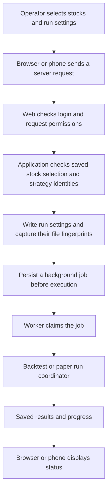
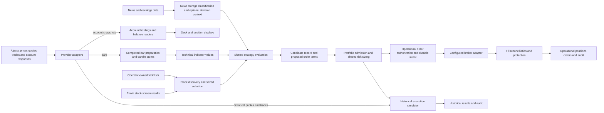
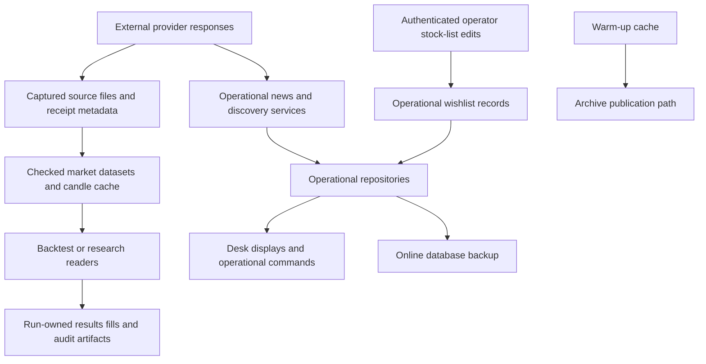
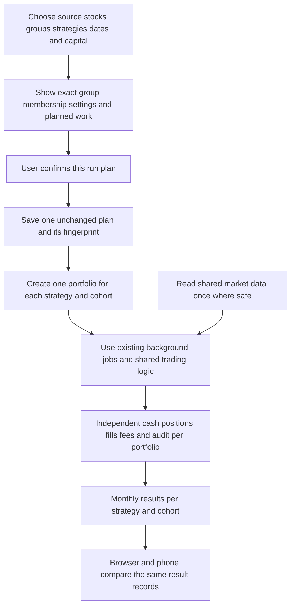

# System map, flows and plain names

Status: current source map plus clearly marked proposals. See the [review scope and limits](README.md). All implementation changes require user approval.

## Project responsibilities

The table covers the 18 TradingFlow project files found under `src`. A project being present does not mean it is enabled in the running app or included directly in every solution build. `TradingFlow.slnx` lists 15 projects; Mobile, WarmupService and Etoro need their own build/host scope or a verified transitive build.

| Project | Plain-language job | Main input → output; writes | Detailed review |
|---|---|---|---|
| Domain | Shared business records and definitions | Strategies, bars, orders and research identities → typed values/interfaces; some infrastructure exceptions need review | [02](02-trading-and-research.md) |
| Contracts | Messages the browser, phone and server exchange | Screen requests → versioned request/response records; no broker writes | [03](03-application-web-and-mobile.md) |
| Application | Coordinate user actions across clients | Selected stocks/settings → saved selection, run requests, jobs and status | [03](03-application-web-and-mobile.md) |
| Engine | Decide, size and enforce order behavior | Completed market evidence and approved strategy → decisions, sized requests and execution/protection rules; execution services call injected repositories/broker | [02](02-trading-and-research.md) |
| Backtesting | Coordinate historical simulations and the existing paper/live loop | Shared decisions + historical events or runtime snapshots → simulated books or operational intents; result/journal writes | [02](02-trading-and-research.md) |
| Data | Store operational state and captured evidence | Repository operations/data → SQLite, candle files, evidence catalog, immutable artifacts and backups | [04](04-data-platform-and-security.md) |
| Alpaca | Translate Alpaca market-data and broker interfaces | Typed provider requests → bars, quotes, trades, account/order information and broker responses | [04](04-data-platform-and-security.md) |
| Finviz | Read stock screens and provider material | Screener/filter requests → current discovered stocks and supported provider responses | [04](04-data-platform-and-security.md) |
| Earnings | Analyze earnings schedules and reactions for display | Earnings/calendar/news/bar data → advisory earnings information | [04](04-data-platform-and-security.md) |
| Etoro | Alternative provider/broker adapter | HTTP/WebSocket provider/session operations → adapter results; its presence is not proof it is wired into the primary host | [04](04-data-platform-and-security.md) |
| Research | Calculate research observations and statistics | Frozen datasets/definitions → analysis and statistical reports; no trading authorization | [02](02-trading-and-research.md) |
| Research.Workflows | Run a registered research study | Saved study/phase → analysis package and catalog registration | [02](02-trading-and-research.md) |
| Research.Orchestration | Coordinate collection and evidence publication | Collection/normalization requests → captured and checked dataset/catalog publications | [02](02-trading-and-research.md) |
| Web | Host browser screens, server endpoints and background composition | Browser/Mobile calls → views, status, jobs and application commands; currently also owns substantial application services | [03](03-application-web-and-mobile.md) |
| Mobile | Android/.NET MAUI client | Operator interaction → server calls and displayed server results; local connection/session settings | [03](03-application-web-and-mobile.md) |
| WarmupService | Prepare older candles before strategy evaluation | Warm-up requests → candle cache and preparation results; separate host/provider work | [04](04-data-platform-and-security.md) |
| CLI | Command-line entry to runs and research | Explicit arguments/settings → application/research calls and reports; provider/file I/O depends on command | [02](02-trading-and-research.md) |
| Tests | Verify component and integration behavior | Isolated fixtures/fake providers → test evidence; it must not alter operator data | [04](04-data-platform-and-security.md) |

Also reviewed: `tools/research/PortfolioEventRunner`, `tools/research/AlpacaMetadataCapture`, `DbChecker`, scratch/TestDb helpers, `sidecars/finbert-sentiment`, `tests/ui`, `.github`, `deploy` and configuration ownership. The Python sidecar scores text sentiment; it is not the separate Market Predictor application.

## Current user-action flow

This explains the existing “reviewed API request” phrase. It means a request to start a run using a saved stock selection and exact strategy/settings identities. It does not mean the API itself received a human code review.

Trace anchors: [server run endpoints](../../../src/TradingFlow.Web/RunWorkflowEndpoints.cs), [run workflow](../../../src/TradingFlow.Application/Jobs/RunWorkflowService.cs), [configuration mapping](../../../src/TradingFlow.Web/Services/WorkflowRunConfiguration.cs), [job execution](../../../src/TradingFlow.Web/Services/BacktestJobService.cs). Configuration copying and result projection have findings in 03; the diagram does not certify that every field survives the path correctly.

**Three distinct decisions:** approving a software design permits the agreed implementation; confirming run settings selects one research/job request; permission to send a paper/live order is enforced separately by strategy/account/mode/order controls. One does not substitute for another.

## Current market-data and trading flow

The “shared” evaluation intent does not imply that all orchestration is already consolidated: duplicated admission/composition responsibilities are identified in 02. Optional news affects an entry only when that strategy/run uses it and its decision-time evidence is available. Earnings/advisory displays do not authorize trades. Live execution remains subject to existing disabled-by-default and authorization boundaries.

## Current data ownership and write boundaries

Source anchors: [Data project](../../../src/TradingFlow.Data), [BacktestRunWorkspace](../../../src/TradingFlow.Backtesting/BacktestRunWorkspace.cs), [warm-up services](../../../src/TradingFlow.WarmupService/Services). Research inputs may be shared read-only; research results and disposable fixtures have separate ownership. Archive completion and operational stock-list writes need explicit semantics; DS-07 describes why a local cache pointer is not a durable archive. Current deployment templates do not establish a safe writer/storage boundary merely by containing a backup or lease component.

## Proposed flow for independent strategy/cohort tests — not implemented

No cohort shares capital with another cohort. A configurable example is 50 stocks, 10 per cohort and four strategies: five cohorts and 20 independent portfolios. Thirty stocks, five per cohort and two strategies produce six cohorts and 12 independent portfolios. Each portfolio can start with a configured amount such as $10,000. Runtime parallelism is a separate resource choice; it must not change portfolio membership, money or results.

## Names that explain purpose

These are proposed documentation/display labels first. Renaming public contracts, database fields or serialized evidence requires a separately approved change and migration impact assessment.

| Current term | Plain meaning / preferred label |
|---|---|
| Reviewed API request | Start-run request using the stock selection and settings the user confirmed |
| Universe | Selected stock list, with its source and capture time |
| Universe snapshot | Saved stock-list membership for this run |
| Cohort | A named group of study stocks with its own strategy-test portfolio |
| Run plan | Stocks/groups, strategy versions, dates, starting capital, execution assumptions and work budget saved together |
| Kernel / decision brain | Evaluate completed evidence against the selected strategy and return a decision with reasons |
| Pre-risk order plan | Proposed direction, reference price, stop, target policy and expiry before account sizing |
| Admission | Decide whether this portfolio may accept the proposed entry now |
| Reservation | Capital/position capacity earmarked for a pending entry |
| Intent | Saved instruction to request an order; it is not an executed trade |
| Execution sink | Simulator or broker adapter that receives order instructions |
| Point in time / known-at | Information recorded as available before that particular decision |
| Evidence | Saved source records, collection/availability times and checks that bind them to the run |
| Fingerprint / hash | A content identifier used to detect changes; it does not prove a dataset is complete or historically available |
| Warm-up | Load genuine earlier observations so indicators can be calculated before scoring new decisions |
| Marked-to-market return | Change in cash plus the value of open positions, including recorded fees, using the declared price basis |
| Realized result | Profit/loss of closed positions; it differs from the value of still-open holdings |
| Promotion | Explicit permission for an exact strategy version/content to enter a later operating mode; profit alone grants none |
| Durable job | A saved work request that can be recovered after a worker restart |
| Outbox | Saved pending work that a worker must deliver and acknowledge without silently losing it |

Function comments should state purpose, data/time assumptions, mutations and failures. If that explanation requires several unrelated workflows, split the function; comments do not repair mixed responsibilities. Proposed vocabulary is not evidence that source names have already changed.
