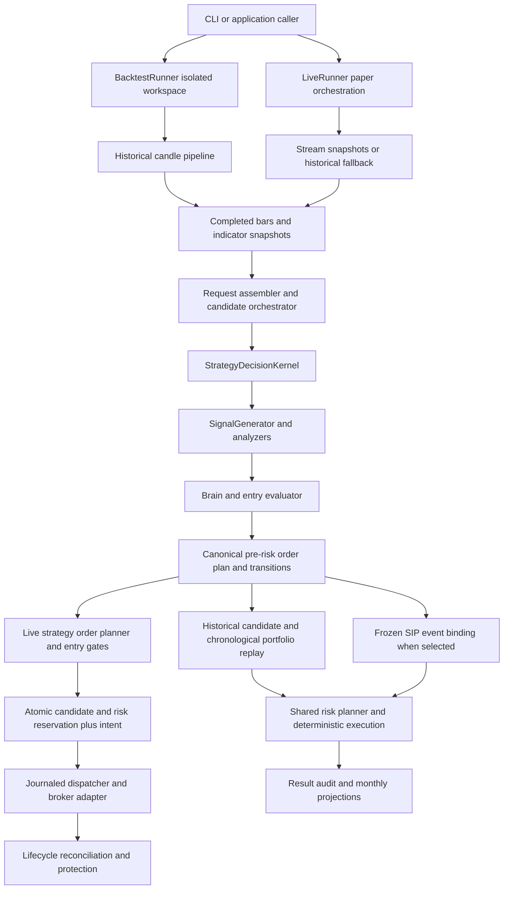
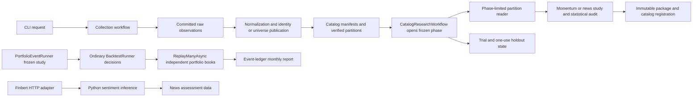
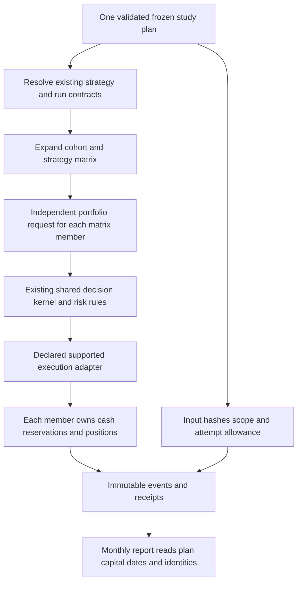

# Trading and research design review — 19 October 2026

Status: one-time, static design review. All proposals below are **unimplemented and pending explicit user design approval**. This document changes no trading behavior, configuration, evidence, or experiment. Priorities are conservative: P2 means a material design issue to address before extending the affected capability; P3 means a useful cleanup.

The review read `AGENTS.md`, `docs/operating-boundaries.md` and `docs/architecture.md`, inventoried the assigned source projects, and followed representative callers and callees. It includes older indicators, strategies, risk, execution, optimization and analytical modules, rather than only the recent event replay work. It does not claim every line was audited. No build, test, model download, provider request, broker operation, experiment or runtime change was performed. No credential file, database payload, or result/data archive was opened.

## Confirmed intent and design boundary

The user confirmed that **each cohort owns independent portfolio capital, and each tested strategy is independent**. Five stocks in a cohort and $10,000 starting capital are examples, not universal constants. Capital must be configurable. There must be no capital pool shared across cohorts/groups. The older architecture's combined-strategy portfolio is therefore an existing diagnostic capability that needs its future role clarified; it is not the user's requested default.

Keep three concepts distinct: cohort membership size; maximum **new symbols entered per exchange day**; and maximum **simultaneously open positions**. The user's practical intent is usually to invest in only two or three stocks per day using technical indicators. That is not approval for an exact hard cap of two or three, and neither membership size nor open-position capacity implements that daily intention. A proposed daily policy needs an explicit counting rule, including reentries, partial fills and New York session boundaries, before implementation.

“No hard coding” applies to business, study and environment settings. Mathematical conversions, protocol definitions, deterministic ordering and causality/protection invariants should remain named and explained in code. They must not become operator switches that disable safety. The proposal is one frozen, validated study plan and reuse of existing strategy/run contracts, not an expanding collection of flags.

## Component inventory and ownership

“Owner” below means the source module responsible for behavior, not an inferred human author. Inputs/outputs and side effects describe current code. Configuration is abbreviated to keep the inventory readable.

| Component and source | What it does; callers and input → output | Side effects; configuration; owner |
| --- | --- | --- |
| Domain: Market, Strategies, Orders, Execution, Portfolio; [StrategyDefinition](../../../src/TradingFlow.Domain/Strategies/StrategyDefinition.cs#L3), [TradeSignal](../../../src/TradingFlow.Domain/Strategies/TradeSignal.cs#L5) | Shared bar, evidence, strategy, signal, candidate and order contracts used by Engine, runners and adapters; typed values → shared records. | Mostly value construction; strategy rule records hold many optional settings. Domain owns contracts, not broker orchestration. Advisory portfolio types are separate from execution books. |
| Domain: Backtesting, Optimization, Research; [run configuration](../../../src/TradingFlow.Domain/Backtesting/BacktestRunConfig.cs#L3), [research evidence](../../../src/TradingFlow.Domain/Research/EvidenceResearchRuns.cs#L6) | Run/portfolio settings, results, promotion rules, evidence identity, partitions and trial contracts; research and runner inputs → reports/contracts. | Contract validation/canonical identity; configuration enters through loaders and requests. Domain owns shared meaning and identities. |
| Domain: Persistence, Audit, Discovery, Preparation, Jobs, Locking, Wishlists, News, Earnings | Repository interfaces and exchange records shared with applications/Data; repository calls → records and domain classifications. | Interfaces delegate persistence; news taxonomy/rule classifier also contain computation. HTTP bulkhead factory and logging profiler are infrastructure exceptions discussed below. |
| Engine: Abstractions, Market, Sessions, Pipeline; [historical pipeline](../../../src/TradingFlow.Engine/Pipeline/CandlePipelineEngine.cs#L100), [stream processor](../../../src/TradingFlow.Engine/Pipeline/StreamingMarketStateProcessor.cs#L420) | Backtest, evaluation and paper callers provide providers/events, timeframes and clocks → normalized completed bars and ticker states. Resampler and session clock define time boundaries. | Candle spill, bounded queues, per-symbol state, revision/fencing checks; pipeline/stream options and evidence profile. Engine owns preparation semantics; provider adapters and stores supply I/O. |
| Engine: Indicators; [IndicatorEngine](../../../src/TradingFlow.Engine/Indicators/IndicatorEngine.cs#L30) | Pipeline/analytical callers supply ordered OHLCV and evidence profile → indicator snapshots, including separate same-time/slot RVOL. | Calculation/allocation; immutable evidence profile, fixed indicator definitions. Engine owns formulas and market-evidence eligibility. |
| Engine: Strategies; [kernel](../../../src/TradingFlow.Engine/Strategies/StrategyDecisionKernel.cs#L19), [brain](../../../src/TradingFlow.Engine/Strategies/StrategyDecisionBrain.cs#L13), [evaluator](../../../src/TradingFlow.Engine/Strategies/BasicStrategyEvaluator.cs#L7) | Kernel → SignalGenerator plus technical/VCP/Connors/drawdown/AVWAP analyzers → entry evaluator/volume checks → state transition, semantic hash and canonical pre-risk plan. Candidate orchestrator calls kernel and repositories. | Pure kernel emits audit/transition data; orchestrator persists. StrategyDefinition, admission profile and point-in-time context own behavior. Engine owns shared decisions. |
| Engine: Universe, Regime, Catalysts | Ranker/share-class deduplicator, historical screener, promotion eligibility, benchmark regime and catalyst confirmation support runner decisions; candidate/history/evidence → ranked members or reasons. | Regime may load/cache benchmark history; catalyst attempt service tracks consumption. Rank/session/strategy rules configure behavior. Historical screener is not a replacement for proven historical membership. |
| Engine: Risk; [strategy planner](../../../src/TradingFlow.Engine/Risk/StrategyOrderPlanner.cs#L29), [shared sizing](../../../src/TradingFlow.Engine/Risk/SharedOrderRiskPlanner.cs#L9) | Immutable strategy stop plus equity/cost/limits → sized order or rejection. Deterministic simulator/book model fills, liquidity, partials and competing reductions. | Simulator returns next state/events; no broker I/O. Portfolio and simulation policies configure costs/limits. Engine owns sizing/fill rules, while each portfolio book owns its capital. |
| Engine: Execution; [submission](../../../src/TradingFlow.Engine/Execution/OrderSubmissionService.cs#L260) | Live/manual application callers → ordered gates, account binding, intent reservation, dispatcher, lifecycle and protection/reconciliation services → durable order state and broker requests. | Broker writes and repository mutations; production settings, account/run context and injected clocks. Entry blocks must not prevent exits or protection. Engine owns protocol; adapters/repositories implement effects. |
| Engine: Configuration, Signals, Storage, Research abstractions | YAML/run-artifact and production loaders → resolved immutable settings/authorized identity; external signal validator → admissible evidence; archive/atomic writers → artifacts; evidence interfaces decouple analytical readers. | File reads/writes and artifact/catalog publication where applicable; explicit roots, run settings and production registry. These are shared capabilities to reuse, not duplicate in drivers. |
| Backtesting: runners, workspace, discovery, decision assembly; [BacktestRunner](../../../src/TradingFlow.Backtesting/BacktestRunner.cs#L57), [LiveRunner](../../../src/TradingFlow.Backtesting/LiveRunner.cs#L105) | CLI/application → isolated historical workspace or polling/stream snapshot loop → shared kernel decisions and run results. Preview engine uses the same candidate decision orchestrator. | Historical files/audit journals; paper uses repositories and broker services. Run, identity, provider and retention settings configure behavior. Backtesting currently also owns paper orchestration, despite its name. |
| Backtesting: chronological/event replay, fine execution, artifacts, reporting, optimization, Research | Candidates plus bars/events → admission, fills, results, integrity/audit publications; optimizer varies strategy settings; Swing/Reversion analyzers calculate retrospective diagnostics. | Journals and report files; replay policy, portfolio, optimization and analyzer options. Candidate trade sketches, chronological execution and event replay are different stages; analytical forward returns are not broker fill evidence. |
| Research: EvidenceCatalogResearchRunner; Momentum, Universe, Catalysts, Statistics | Workflows → catalog manifests/rows → momentum ranking/formation observations, PIT identity/membership decisions, provider-update news study, inference and promotion evidence. | Core calculations return reports; readers load catalog-backed data. Frozen definitions/partitions/cost assumptions configure behavior. Research owns statistical analysis; it does not authorize broker routing. |
| Research.Workflows: CatalogResearchWorkflow and its momentum/static/news partials | CLI → frozen request/catalog → phase opening, phase-limited reader, research analysis, immutable package and registered result. | Catalog/trial state and artifact publication; explicit phase, study windows and dataset IDs. [RunMomentumAsync](../../../src/TradingFlow.Research.Workflows/CatalogResearchWorkflow.cs#L38) opens the phase before analysis; static diagnostic explicitly remains non-promotable. |
| Research.Orchestration: collection, identity/universe publication, verified loader, AsyncRequestGate | CLI → collection request → collector then normalization; committed identity observations → PIT builder → partition/dataset publication. | Network through injected collector, catalog/artifact I/O, keyed in-process serialization; explicit requests and normalizer versions. [Verified loader](../../../src/TradingFlow.Research.Orchestration/VerifiedEvidenceSourceLoader.cs#L12) checks committed identity and bytes; this is stronger than merely accepting a filename. |
| CLI: Program, SharedNewsImport, NewsAssessment, NewsCategoryPilot, ExecutionSourceAudit | Operator args → direct service/workflow construction and invocation → console status/reports. Generic run rejects paper/live; separate application workflow owns operational execution. | Depending on command, provider/catalog/artifact work; args/run files/environment and service URL. CLI should own parsing/formatting/composition, not duplicate application or provider policy. |
| tools/research: PortfolioEventRunner with FrozenRawProvider/MonthlyEventReport; AlpacaMetadataCapture | Explicit driver phases prepare/freeze/run/report use ordinary runner and shared event replay; metadata collector obtains calendar/condition receipts. | Frozen files, hashes, attempts, outcome/report files; metadata tool has network access when executed. Current driver contains study paths/dates/capital literals. Tools own study coordination, not a second strategy brain. |
| Python: sidecars/finbert-sentiment app/download script/Dockerfile/requirements | .NET Finbert HTTP adapter → POST text/headline/symbols → label, signed score, confidence, model name; downloader/container prepare Hugging Face files. | Model cache/download and inference; pinned Python package versions, unpinned model revision, fixed model name. This optional sentiment service is the only maintained Python sidecar found here. Market Predictor remains a separate project; scratch Python is not an ML engine. |

## Current call and data flows

These diagrams show observed paths, not a claim that every mode has identical orchestration.

Useful boundaries already exist. [StrategyDecisionKernel](../../../src/TradingFlow.Engine/Strategies/StrategyDecisionKernel.cs#L14) explicitly separates decisions from reservations/routing; [StrategyOrderPlanner](../../../src/TradingFlow.Engine/Risk/StrategyOrderPlanner.cs#L26) preserves the kernel stop. [Event binding](../../../src/TradingFlow.Backtesting/BacktestRunner.EventExecution.cs#L15) rejects missing sources instead of silently using candles. [Event controller](../../../src/TradingFlow.Backtesting/EventPortfolioExecution.cs#L100) currently requires exactly one long strategy and a declared zero-delay scenario. Consequently, its use of one event outcome is not evidence of currently mixing multiple strategies. Formation-weighted momentum returns are statistical observations, not a second deployable capital ledger.

## Findings and smallest reusable proposals

### TR-01 — P2: make the independent cohort/strategy capital boundary explicit

Observed: [BacktestRunner:564](../../../src/TradingFlow.Backtesting/BacktestRunner.cs#L564) always builds a unified portfolio as well as strategy results. [Diagnostics:147](../../../src/TradingFlow.Backtesting/BacktestRunner.Diagnostics.cs#L147) independently replays bar-mode strategies, while event outcomes are filtered from one already-computed outcome at line 170; the event controller's one-strategy check prevents treating that as an independent multi-strategy implementation. [PortfolioConfig:203](../../../src/TradingFlow.Domain/Backtesting/BacktestRunConfig.cs#L203) has configurable starting capital and concurrent positions, but no cohort identity or daily new-symbol limit. The current frozen driver already uses independent books; its fixed matrix is not a general cohort contract.

Impact: callers have to reconstruct independence through separate run files, and a unified diagnostic can be mistaken for the requested allocation. Membership count and concurrent slots cannot express the user's usual two-to-three-new-stocks-per-day intention.

Proposed: reuse PortfolioConfig, exact strategy identity, existing monthly valuation and ReplayManyAsync; introduce one reviewed study plan that expands each cohort/strategy into its own portfolio execution request and records its capital explicitly. Never pool across cohorts. Treat a daily new-symbol policy as a separate proposed rule with user-approved counting semantics, not a hardcoded 2/3 limit. Decide whether to remove the combined diagnostic from default presentation before changing a result contract. Validate capital isolation, cross-day open positions, same-day reentry/partials and monthly reconciliation using different configured balances.

### TR-02 — P2: replace executable study literals with a frozen study plan

Observed: [driver:22](../../../tools/research/PortfolioEventRunner/Program.cs#L22) derives sibling dated roots; lines 30–32 fix a parent hash, quote age and recipe keys; [ValidateRun:395](../../../tools/research/PortfolioEventRunner/Program.cs#L395) fixes dates/capital/risk/slots/costs. [MonthlyEventReport:32](../../../tools/research/PortfolioEventRunner/MonthlyEventReport.cs#L32), [line 86](../../../tools/research/PortfolioEventRunner/MonthlyEventReport.cs#L86) and [line 148](../../../tools/research/PortfolioEventRunner/MonthlyEventReport.cs#L148) independently encode row count, capital and dates. [Metadata collector:6](../../../tools/research/AlpacaMetadataCapture/Program.cs#L6) assumes a particular machine's local-settings path. These are source facts, not a claim about unseen credentials or authorship of earlier changes.

Impact: another cohort count, balance, study interval or machine requires source edits; the report can disagree with the run it describes. Name suffixes currently determine displayed costs. Hash checking and pass limits are useful, but the expected evidence and study dimensions belong to the plan.

Proposed: one immutable StudyPlan supplies explicit input references/hashes, identities, cohort membership, capital, scenario, dates and attempt allowance. Derive matrix count, months, partial-month labels and displayed costs from that same plan and receipts. Reuse existing canonical hashing, artifact validation, run configuration, evidence collectors and report valuation; pass environment/provider composition through the existing host instead of a hardcoded settings path. Preserve published studies unchanged. Future validation should vary balance, cohort count and dates, and reject any plan/report/receipt disagreement or consumed-attempt replay.

### TR-03 — P2: reuse completed state before replacing indicator algorithms

Observed: [GetTickerStateAsync:434](../../../src/TradingFlow.Engine/Pipeline/StreamingMarketStateProcessor.cs#L434) rebuilds completed state; [BuildCompletedState:610](../../../src/TradingFlow.Engine/Pipeline/StreamingMarketStateProcessor.cs#L610) selects and sorts retained bars and derives all configured timeframes. [Line 474](../../../src/TradingFlow.Engine/Pipeline/StreamingMarketStateProcessor.cs#L474) recomputes every requested indicator series. [IndicatorEngine:32](../../../src/TradingFlow.Engine/Indicators/IndicatorEngine.cs#L32) sorts again and materializes many whole-series indicator arrays at line 122. The existing completed-state fingerprint is available for reuse.

Impact: repeated reads of unchanged evidence repeat approximately O(T × B log B) preparation and O(I × B) indicator work, where B is retained bars, T timeframes and I indicators. Retention bounds B, but do not remove repeated allocation. This is a static cost estimate, not a measured latency claim.

Proposed: first memoize immutable completed state/snapshots using revision, calendar/evidence-profile, as-of completion boundary and ownership fence; reuse the existing calculator as the reference. Only consider incremental formulas after measurement. Validate unchanged-read reuse and exact parity after historical revision, no-trade repair, session rollover and fencing changes; invalidation must never reveal a correction before its known time.

### TR-04 — P2: validate and bound the optimizer's request before enumeration

Observed: [ExtractMetric:179](../../../src/TradingFlow.Backtesting/Optimization/StrategyOptimizer.cs#L179) ignores its strategyId argument, selects the first strategy and silently maps unknown metric names to total return. [GeneratePermutations:195](../../../src/TradingFlow.Backtesting/Optimization/StrategyOptimizer.cs#L195) materializes the Cartesian product; [ApplyParameter:244](../../../src/TradingFlow.Backtesting/Optimization/StrategyOptimizer.cs#L244) has its own path mapping. Shared prepared market data at line 54 is already a useful optimization.

Impact: a misspelled metric can rank a different objective without an error; memory and run count grow as the product of dimension sizes. A new strategy setting can parse in YAML yet remain unsupported by optimization. This is diagnostic parameter search, not promotion evidence.

Proposed: one validated optimization plan resolves supported metric, strategy identity and allowed parameter descriptors, computes checked permutation count before work, and lazily enumerates within the approved study resource/attempt allowance. Reuse existing run/artifact validation and prepared data. Remove silent objective fallback and the unused selection ambiguity. Validate unknown metric, wrong identity, unsupported path, overflow and cancellation; do not add a second set of strategy defaults or expand research authority.

### TR-05 — P2: bind sentiment output to the actual model revision

Observed: [app.py:8](../../../sidecars/finbert-sentiment/app.py#L8) and [download_model.py:3](../../../sidecars/finbert-sentiment/download_model.py#L3) select a model repository without a revision. [health:44](../../../sidecars/finbert-sentiment/app.py#L44) returns success without loading the model. The .NET [response contract:92](../../../src/TradingFlow.Alpaca/FinbertHttpSentimentAnalyzer.cs#L92) does not read the returned model field, and labels successful results `finbert-http`; fallback returns its own analyzer result. Packages are pinned, model weights are not.

Impact: a rebuilt sidecar can produce different scores under the same analyzer identity; health does not prove inference can start. The existing classifier/model-version and completion-time evidence contracts require more specific provenance for reproducible research. This observation does not establish that generic sentiment currently grants trading permission.

Proposed: reuse SentimentAssessmentEvidenceRow and the existing HTTP/fallback boundary; supply one deployment-owned immutable model/tokenizer revision, return actual revision and completion identity, and carry it into assessment evidence. Readiness should demonstrate loaded resources, with liveness kept simple. Preserve a visible VADER identity and diagnostic status. Validate model-load failure, pinned replay, version propagation, timeout/cancellation and fallback provenance; no new model training in this repository.

### TR-06 — P2: separate execution protocols behind the existing submission facade

Observed: [OrderSubmissionService:260](../../../src/TradingFlow.Engine/Execution/OrderSubmissionService.cs#L260) handles entries, protective stops (405), position exits (492), failed-exit restoration (933), cancellation (1351), replacement (1421) and recovery (1526 onward). Entry reservation at [line 358](../../../src/TradingFlow.Engine/Execution/OrderSubmissionService.cs#L358) already delegates the atomic candidate/risk transaction; dispatch and lifecycle are separate services. This is substantial existing reuse, not a proposal to rewrite order handling.

Impact: changes to one protocol require understanding several others, including the protection gap during exit handoff. Splitting only into partial files would not give each state transition a clear owner.

Proposed: keep IOrderSubmissionService as the caller-facing facade; extract the existing cancellation/replacement and exit-handoff protocols into narrowly owned collaborators, reusing dispatcher, mutation fence, journal and lifecycle. Keep account/symbol/generation ownership and atomic reservation semantics intact. Add concise intent/clock/failure comments at protocol boundaries instead of comments saying code was moved. Future checks must cover crash/retry, concurrent cancel/dispatch, successor replacement, partial fills and protection restoration before any operational rollout.

### TR-07 — P3: move HTTP resilience out of the shared domain assembly

Observed: [Domain/Http/RateLimiterFactory:11](../../../src/TradingFlow.Domain/Http/RateLimiterFactory.cs#L11) exposes Polly's HTTP-specific AsyncBulkheadPolicy; [Domain.csproj:8](../../../src/TradingFlow.Domain/TradingFlow.Domain.csproj#L8) references Polly. Alpaca, Finviz and Etoro clients consume the helper. Domain also contains an API profiler, alongside otherwise useful shared contracts.

Impact: pure contract consumers inherit a transport dependency, and the name “RateLimiter” describes a time-based request limit while the implementation limits concurrent/queued work. This is a layering/naming issue, not proof provider rate limits are currently exceeded.

Proposed: move the existing implementation to shared adapter infrastructure and call it HttpConcurrencyPolicyFactory; keep provider concurrency/queue settings host-owned. Do not introduce another resilience framework. Verify adapter composition and queue/cancellation behavior. Type/namespace movement is an internal source-compatibility change to plan explicitly; UI wording needs no transport type rename.

### TR-08 — P2: consolidate provider composition and make CLI commands thin

Observed: [CLI:1138](../../../src/TradingFlow.Cli/Program.cs#L1138) has its own news/sentiment/market-provider factories, while [BacktestRunner.Providers:26](../../../src/TradingFlow.Backtesting/BacktestRunner.Providers.cs#L26) owns similar composition. [CLI:817](../../../src/TradingFlow.Cli/Program.cs#L817) handles optimization directly, and multiple catalog branches separately construct artifact stores/readers/workflows. Existing standalone command classes and CatalogResearchWorkflow demonstrate smaller boundaries already available.

Impact: timeout, archive, fallback or provider policy changes can diverge by entry point; a large command dispatcher mixes argument handling, composition and reporting. The fix should reduce duplicate policy and local assumptions rather than add more command-specific flags.

Proposed: a shared provider/composition factory supplies configured adapters to runner/workflows; individual CLI handlers validate args, call existing application services and format bounded output. Keep research phase/holdout controls in the workflows, not the CLI. Preserve command syntax and artifact identity until separately approved changes. Validate command-to-service parity, cancellation, provider timeout/archive behavior and failure exit codes offline with fakes.

## Configuration and rule audit

This table audits actual source controls rather than assuming every constant is wrong. The current study drivers are reviewed as the session's explicit concern; attribution for older mixed modules is not established. KEEP does not mean expose a new UI knob. MOVE-TO-PLAN means one canonical owner and frozen effective values, with no retroactive mutation of existing evidence.

| Actual source value/control | Owner and purpose; current status | Duplicate/unnecessary? Proposed disposition and consequence |
| --- | --- | --- |
| [Driver:22–32](../../../tools/research/PortfolioEventRunner/Program.cs#L22): dated sibling roots, parent hash, four recipe keys | Study coordination; executable environment/study assumptions | **MOVE-TO-PLAN** explicit input references and identities/hashes. Hash is frozen metadata, not an operator preference. Removes location/name coupling. |
| [Driver:50](../../../tools/research/PortfolioEventRunner/Program.cs#L50), [395](../../../tools/research/PortfolioEventRunner/Program.cs#L395), [report:148](../../../tools/research/PortfolioEventRunner/MonthlyEventReport.cs#L148): fixed calendar/study dates | Study scope/coverage; repeated code checks | **CONSOLIDATE/MOVE-TO-PLAN** derive requested coverage from windows and actual warmup/hold horizons; keep coverage checks. |
| [Driver:65](../../../tools/research/PortfolioEventRunner/Program.cs#L65), [156](../../../tools/research/PortfolioEventRunner/Program.cs#L156), [report:32](../../../tools/research/PortfolioEventRunner/MonthlyEventReport.cs#L32): 5 cohorts, 20 passes/attempts, 140 report rows | Frozen matrix and attempt ceiling | **MOVE-TO-PLAN**, derive dimensions/report rows; **KEEP** consumed-attempt/no-overwrite enforcement. A new matrix needs new approved evidence. |
| [Driver:398](../../../tools/research/PortfolioEventRunner/Program.cs#L398), [report:86](../../../tools/research/PortfolioEventRunner/MonthlyEventReport.cs#L86): $10,000, 1% risk, 25% notional, 4 positions | Run has these settings already; driver/report repeat study values | **CONSOLIDATE** on frozen PortfolioConfig per cohort/strategy; capital configurable. Remove duplicated literals, not risk checks. |
| [Driver:401](../../../tools/research/PortfolioEventRunner/Program.cs#L401), [report:94](../../../tools/research/PortfolioEventRunner/MonthlyEventReport.cs#L94): `cost20` name → 20bps, otherwise 10bps | Execution scenario/display | **REMOVE** name-based business inference; read actual frozen scenario. Names remain labels. |
| [Driver:31](../../../tools/research/PortfolioEventRunner/Program.cs#L31), [event replay:69](../../../src/TradingFlow.Backtesting/EventPortfolioExecution.cs#L69): 30-second quote age and 5-minute entry window | Source eligibility and routing horizon | **MOVE-TO-PLAN** supported scenario values; reuse policy/expiry contract. These are assumptions, not mathematical facts. Any newly supported value needs replay/causality verification. |
| [Event replay:100–109](../../../src/TradingFlow.Backtesting/EventPortfolioExecution.cs#L100): one long strategy, native precommit, zero fill-report delay, actual spread | Explicit current capability guard | **KEEP** rejection of unsupported behavior; **MOVE-TO-PLAN** scenario declaration. Do not turn rejection off to claim latency/protection parity. |
| [Driver:325](../../../tools/research/PortfolioEventRunner/Program.cs#L325) condition contract; [504–510](../../../tools/research/PortfolioEventRunner/Program.cs#L504) zero spread/impact/report delay, raw-basis-verified `true`, price/share factors `1,1` | Condition metadata and explicit simulation assertions | **KEEP** exact condition evidence/hash binding; **MOVE-TO-PLAN** declared cost/latency/unit scenario. Assert evidence-supported compatibility, not unconditional truth; factor 1 is valid only for matching raw units, not a universal adjustment rule. Preserve rejection when an implementation cannot support the declared policy. |
| [Driver:429](../../../tools/research/PortfolioEventRunner/Program.cs#L429) five-bar hold; [296](../../../tools/research/PortfolioEventRunner/Program.cs#L296) economics/receipt/identity flags | Frozen horizon and statements of what evidence does not prove | **MOVE-TO-PLAN** horizon from the frozen strategy; **KEEP** honest evidence claims. Derive execution status from receipts; no flag should manufacture historical identity or original receipt proof. |
| [Metadata tool:6](../../../tools/research/AlpacaMetadataCapture/Program.cs#L6), [11](../../../tools/research/AlpacaMetadataCapture/Program.cs#L11): machine path and fixed calendar endpoint interval | Provider composition and collection scope | **REMOVE** environment path; reuse existing provider host/collector and plan dates. No credential value belongs in the plan or review document. |
| [Streaming options:12](../../../src/TradingFlow.Engine/Pipeline/StreamingMarketStateOptions.cs#L12): capacity 256, default derived frames, staleness 3 minutes | Existing bounded-stream operational defaults | **CONSOLIDATE** effective settings through existing options/production snapshot; derive needed frames from subscribed strategies. **KEEP** bounded queues and freshness checks. Profile-dependent defaults need one owner, not new flags. |
| [IndicatorEngine:14](../../../src/TradingFlow.Engine/Indicators/IndicatorEngine.cs#L14): RSI/ATR/Bollinger definitions; [RVOL profile](../../../src/TradingFlow.Engine/Indicators/MarketEvidenceProfile.cs#L9) | Shared formula/evidence contract | **CONSOLIDATE** strategy-selectable periods in declared indicator requirements, with one owner; **KEEP** named versioned formula/evidence definitions. Do not create independent per-caller defaults or weaken SIP/session provenance. |
| [Production registry:69](../../../src/TradingFlow.Engine/Configuration/ProductionParameterRegistry.cs#L69), [PortfolioConfig:203](../../../src/TradingFlow.Domain/Backtesting/BacktestRunConfig.cs#L203) | Existing operational specification and run-capital settings | **KEEP** current safety owners; **CONSOLIDATE** semantic mapping where scopes overlap. Do not copy every production parameter into StudyPlan or remove a rule without consumer/evidence analysis. |
| [Optimizer:179](../../../src/TradingFlow.Backtesting/Optimization/StrategyOptimizer.cs#L179) unknown metric fallback; [indicator math conversion](../../../src/TradingFlow.Engine/Risk/SharedOrderRiskPlanner.cs#L11) 10,000 basis-point divisor | Former changes ranking silently; latter is a unit fact | **REMOVE** unknown-metric fallback; **KEEP** named mathematical divisor. Neither needs a new operator setting. |
| [FinBERT model:8](../../../sidecars/finbert-sentiment/app.py#L8), [requirements](../../../sidecars/finbert-sentiment/requirements.txt#L1) | Deployment model choice and package versions | **CONSOLIDATE** immutable deployment model/tokenizer revision; **KEEP** pinned dependencies. Model identity is deployment evidence, not a daily strategy tuning control. |

## Proposed flow — pending approval

A source stream may be read once and fanned out; economic books remain independent. Reuse ReplayManyAsync rather than loading the same raw archive per strategy. C# continues to own trading; Python continues to own only its optional model service here. Statistical study outputs and execution-derived capital reports retain separate, clearly named evidence roles.

Other cost boundaries worth preserving: [momentum candidate construction](../../../src/TradingFlow.Research/Momentum/CrossSectionalMomentumResearchAnalyzer.cs#L202) already uses session-date indexes, while bootstrap inference costs roughly O(replicates × observations) plus sorting replicate means ([ResearchInference:40](../../../src/TradingFlow.Research/Statistics/ResearchInference.cs#L40)). [VerifiedEvidenceSourceLoader:41](../../../src/TradingFlow.Research.Orchestration/VerifiedEvidenceSourceLoader.cs#L41) reads an entire raw observation into memory after verification; its integer-sized limit is not a working-memory budget. [Missed-move diagnostics](../../../src/TradingFlow.Backtesting/BacktestRunner.Diagnostics.cs#L52) scan future windows and repeatedly filter trades; they belong after decisions and can use indexed trade/time lookups if profiling justifies it. Bound study size/concurrency through the existing job/plan, stream large source observations where practical, and preserve exact hashes and results; do not optimize these by skipping evidence or changing statistical definitions.

## Names, comments and future validation

| Current name → plain purpose | Proposed wording/name and compatibility consequence |
| --- | --- |
| `LiveRunner` → paper/future-live operational loop inside Backtesting | UI: “Paper trading run.” Consider `TradingRunCoordinator` only with a later source/API migration; live authorization stays disabled. |
| `StrategyDecisionBrain` → relative-volume readiness plus directional evaluator wrapper | Internal `EntryRuleEvaluator`; document that the kernel owns the whole state transition. Public type rename can affect consumers; no serialized field rename is implied. |
| `BasicStrategyEvaluator` → configured setup/entry rejection rules | `ConfiguredEntryRulesEvaluator` would describe its actual role; preserve wire settings and reason codes unless an explicit migration is approved. |
| `UnifiedPortfolio` → one combined-strategy diagnostic capital simulation | UI: “Combined strategy diagnostic” if retained; default user reports show independent cohort/strategy capital. Renaming a result field is a versioned public contract change, not a wording edit. |
| `RateLimiterFactory` → HTTP concurrency/queue policy | `HttpConcurrencyPolicyFactory` in adapter infrastructure; internal source/namespace migration only. |
| `key`, `batch`, `old`, `close` in study driver → scenario identity, cohort, prior registry, prior evidence root | Local names `scenarioId`, `cohortId`, `trialRegistryRoot`, `executionEvidenceRoot`; use plan metadata rather than encode meaning in names. |

Existing kernel comments explain purity and timing well; catalyst lifecycle and execution comments describe intent and failure conditions. Comments such as “split into a partial file; behavior is identical” explain editing history rather than the current responsibility. Replace those when affected code is changed, with input/clock/state/failure contracts. Do not add broad commentary to unchanged functions merely for cosmetic coverage.

After an approved design, use focused existing suites: StrategyDecisionKernel/Brain, mixed-timeframe timing, indicator/streaming parity, EventPortfolioExecution, PortfolioCloseValuation/monthly presentation, optimizer, order submission and catalog/holdout/publication tests. Add only tests for the approved behavior: independent capital and daily-count semantics; plan/receipt/report agreement; invalidation parity; explicit optimizer rejection; model provenance; and protocol recovery. No new experiment or provider access is needed to make those designs reviewable. Performance work needs a separately scoped representative measurement, not a speed claim from this static review.

Coverage limitations: this review sampled representative implementation bodies and traced their direct composition points. Provider adapters, database transactions and web/mobile presentation receive dedicated reviews elsewhere; only their interfaces/call sites needed for these paths were inspected here. Model inference, historical source availability, actual broker acceptance and quantitative performance remain unverified. Existing file/contract sizes and repeated scans identify maintenance or cost pressure; they do not prove incorrect trading outcomes by themselves.
