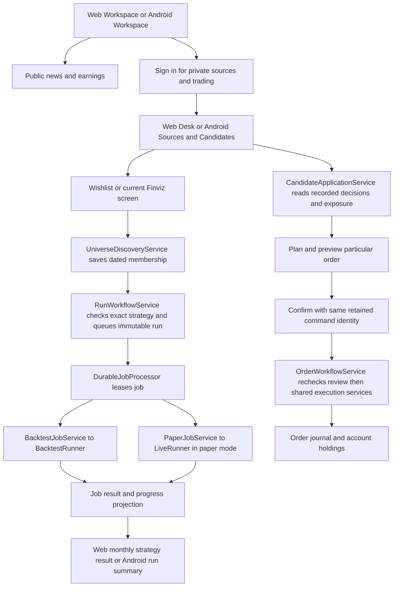
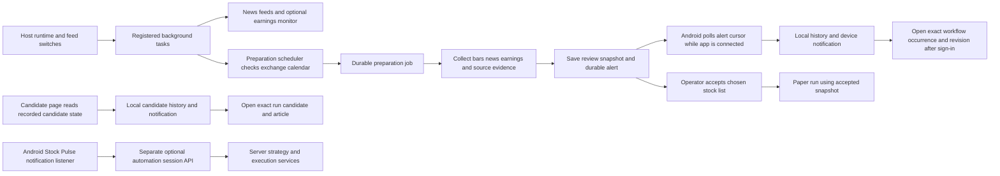
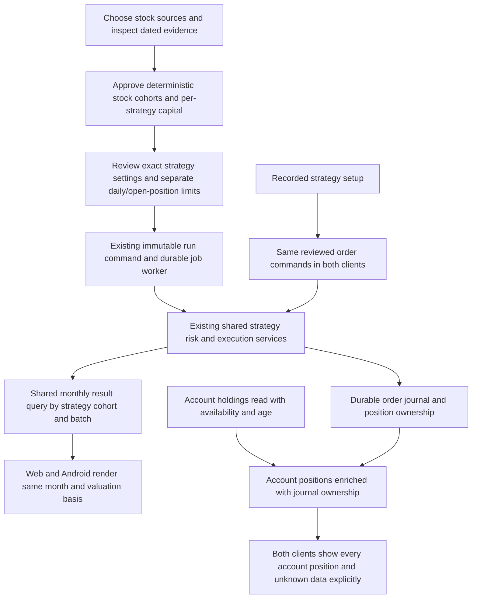

# Application, Web and Android design review

Date: 19 October 2026. Review role: independent application/client architect. Status: **design review only; implementation requires explicit user approval**.

This is a static review of `TradingFlow.Application`, `TradingFlow.Contracts`, `TradingFlow.Web` and `TradingFlow.Mobile`, including their calls into the shared engine, persistence and provider adapters. Read first: [agent rules](../../../AGENTS.md), [operating boundaries](../../operating-boundaries.md), [architecture](../../architecture.md) and [application workflows](../../application-workflows.md). No application, configuration, schema or generated contract was changed; no build, test, provider request, broker operation or runtime experiment was performed. Credentials, databases and captured data archives were not inspected.

The existing shared run commands, exact strategy references, candidate projections, durable workers and reviewed order commands provide useful foundations. The principal gaps are inconsistent account/result presentation, client values silently replaced with defaults, duplicate transport models, and application work still owned by the Web project. Findings below distinguish behavior proved from source from proposed improvements; they do not establish what positions or results exist in a running installation.

## Confirmed product intent and proposed controls

The user confirmed that **each stock cohort/group has a separate portfolio and configured starting capital, independently for each strategy test**. For example, five stocks in a cohort can share that cohort's $10,000; another cohort and another strategy test receive their own configured capital. This is a confirmed requirement, not an unresolved choice. It does not imply that an Alpaca account automatically creates separate broker cash balances.

The usual workflow of considering two or three stocks per day is context, not an approved fixed cap of three. Cohort size, daily admissions and simultaneously open positions are different limits. Proposed labels are **Stocks per cohort**, **Starting capital per strategy/cohort**, **Maximum new stocks per day**, and **Maximum open positions**. Their introduction, enforcement point, counting rules and exact values require approval. A failed/rejected submission must not silently consume a successful-entry allowance; retries must not count twice; the precise definition of an entry still needs a concrete approved design.

“Start a run” below means start using the stock list, exact strategy version and settings the operator selected. “Confirm an order” means submit the particular shares, prices and protections shown on the ticket after the server checks them again. Neither action substitutes for the user's approval of this design document.

## Component inventory and ownership

The source-file inventory covered every assigned project and its major component families. The table groups related files; it is not a claim that every function was read. Inputs/outputs describe existing code, and writes identify effects when these paths execute, not effects performed during this review.

| Component / purpose | Callers | Input → output | Writes / configuration owner |
| --- | --- | --- | --- |
| [Application/Candidates](../../../src/TradingFlow.Application/Candidates/UniverseCandidateWorkflow.cs): capture source membership; project candidate state, audit and change events | Candidate/run endpoints, run commands, client polling/streams | Source selections and exact strategy identity → immutable stock-list snapshot, candidate/run/audit records | Discovery/previews/events through domain repositories; source freshness supplied by adapters; does not route orders |
| [Application/Jobs](../../../src/TradingFlow.Application/Jobs/RunWorkflowService.cs): queue and recover durable work | Run endpoints; hosted worker; backtest/paper/optimization/preparation handlers | Start/cancel commands, immutable files and leases → queued job, progress, terminal result | Job repository and result publication; worker options, clock and handler recovery mode |
| [Application/Preparation](../../../src/TradingFlow.Application/Preparation/PreparationService.cs): schedule collection, collect evidence, curate and accept a stock list | Preparation endpoints, scheduler, durable worker | Versioned settings, exchange calendar, source/evidence adapters → dated review and accepted handoff | Definitions, occurrences, review wishlists, handoffs and alerts; schedule/filter/lifetime/attempt settings |
| [Contracts/V1](../../../src/TradingFlow.Contracts/V1/JobContracts.cs): runs, strategy identity, universe, candidate, audit, order and stream messages | Application, Web APIs, Android shared client | Versioned request/response records | No persistence; version and allowed protocol values are contracts |
| [Contracts/Preparation and Operator](../../../src/TradingFlow.Contracts/OperatorContracts.cs): preparation messages, catalog and automation records | Web and Android | Settings/catalog/session records, some display text | No storage; mixes transport fields and display formatting |
| [Contracts/Transport and Evidence](../../../src/TradingFlow.Contracts/Transport/TradingWorkflowClient.cs): HTTP commands, session security token, candidate update ordering, evidence labels/receipts | Android; shared projections | HTTP records/events → typed response, ordered candidate state, evidence text | HTTP mutations only at caller request; caller owns URL, cookies and cancellation |
| [Web host and endpoints](../../../src/TradingFlow.Web/Program.cs): dependency composition, HTTP boundary and runtime registration | Browser/Android, ASP.NET host | Settings and HTTP requests → services, responses and hosted tasks | Host selects repositories, providers, job limits and runtime switches; security reviewed separately |
| [Desk and wishlists](../../../src/TradingFlow.Web/Services/Desk/DeskReadService.cs): stock sources, Finviz previews/imports, monitoring and observations | Desk/TradeDesk/Wishlists, `/api/desk`, `/api/v1/wishlists` | Source/page/search → membership, quotes, daily technicals, news and holdings | Explicit imports/follows and monitoring write wishlists/signals; observational reads cache/provider evidence; saved screens own filters |
| [Order workflows](../../../src/TradingFlow.Web/Services/OrderWorkflowService.cs): plan/review/confirm, cancel and close | Web ticket/Orders/positions; Android candidate ticket and Trading | Exact candidate/account/quantity/prices → expiring review, durable outcome or pending reconciliation | Preview/command records, then shared engine/broker journal; account, quote/risk and strategy bindings are server owned |
| [Runs and research](../../../src/TradingFlow.Web/Services/WorkflowRunConfiguration.cs): resolve catalog settings, write run artifacts, execute jobs, display audit/results | Run endpoints, Paper/Backtests/Audit/OptimizationJob | Exact strategy + stock snapshot + settings → immutable generated files and progress/results | Config artifacts and durable results; Web currently owns config translation, handlers and monthly presentation |
| [News and earnings](../../../src/TradingFlow.Web/Services/NewsQueryService.cs): filter stored articles and calendar/reaction evidence | Public Web pages and Android APIs | Search/date/topic/source/holdings filters → bounded news/calendar rows with missing-data explanations | Collection/refresh services store provider evidence; query/view services shape display; no order execution from earnings |
| [Runtime services](../../../src/TradingFlow.Web/Services/RuntimeHostedServiceRegistration.cs): feeds, observations, recovery, jobs, backup and preparation scheduling | ASP.NET hosted-service lifetime | Runtime/feed switches → explicitly registered background tasks | Different tasks can collect data, write jobs or recover orders; shutdown ordering is documented in registration |
| [Android shell/pages](../../../src/TradingFlow.Mobile/AppShell.xaml): public Workspace, Trading, Research, System and secondary routes | Operator/device | Shared API messages + local form state → native screens, reviewed commands | Preferences for forms/settings; shared APIs for server mutations; page/session cancellation |
| [Android API and notifications](../../../src/TradingFlow.Mobile/Services/TradingFlowApiClient.cs): session/URL/HTTP/SSE, local alerts, Stock Pulse forwarding | All mobile pages, Android callback, notification navigation | Login/backend/settings/events → records, alerts and exact target navigation | Cookie session; Preferences/history/cursors; optional automation API call; Android notification permission |

Application source inventory: `CandidateApplicationServices`, `CandidateEventStreamService`, `UniverseCandidateWorkflow`; `DurableFileJobRequest`, `DurableJobProcessor`, `DurableJobResultPublication`, `RunWorkflowService`; `PreparationPlanning`, `PreparationService`. Contracts inventory: ten V1 files, three Transport files, two Preparation files, `OperatorContracts`, and two Evidence files. Project references confirm Application depends on Domain/Contracts; Mobile depends on Contracts; Web composes Application plus engine, runners, adapters and Data. Moving an application workflow out of Web must preserve these directions rather than make Application depend on Web.

Web inventory also included page families for Desk/TradeDesk/Workspace/Preparation, wishlists, Orders/OrderTicket/RunningTrades, News/Earnings, Paper/PaperJob, Backtests/Job/OptimizationJob/Audit, Operations/Warmup/Users/Login; their shared partials and JavaScript families; and service families for discovery, market/news feeds, order recovery/protection, config generation, jobs, health, predictor evidence and backup. Mobile inventory included all matching pages, controls/styles, AppServices/shell, Android lifecycle/listener, API/stream client and alert/navigation services. Representative call paths are documented below; generated `bin`/`obj` files were excluded.

## Current flows established from source

Evidence: [run boundary](../../../src/TradingFlow.Application/Jobs/RunWorkflowService.cs#L46), [configuration adapter](../../../src/TradingFlow.Web/Services/WorkflowRunConfiguration.cs#L9), [backtest execution](../../../src/TradingFlow.Web/Services/BacktestJobService.cs#L187), [paper execution](../../../src/TradingFlow.Web/Services/PaperJobService.cs#L509), [order review/confirmation](../../../src/TradingFlow.Web/Services/OrderWorkflowService.cs#L40). The desk's generic daily watch is advisory; it is not a strategy candidate admission. Paper run `LiveRunner` is a class name and does not mean real-money routing is enabled.

Evidence: [runtime composition](../../../src/TradingFlow.Web/Services/RuntimeHostedServiceRegistration.cs#L18), [preparation orchestration](../../../src/TradingFlow.Application/Preparation/PreparationService.cs#L11), [alert poll/cursor](../../../src/TradingFlow.Mobile/Services/PreparationNotifications.cs#L18), [candidate notification](../../../src/TradingFlow.Mobile/Pages/CandidatesPage.cs#L102), [Stock Pulse forwarding](../../../src/TradingFlow.Mobile/Services/NotificationAutomationHub.cs#L87). These are different notification sources. A local notification requires the relevant client path to run; this review did not establish OS background delivery or device reconnect behavior.

News Web queries call the shared `NewsQueryService`; Android calls `/api/v1/news/feed`. Both receive stored article evidence. Earnings Web/Android call `EarningsApiEndpoints` and `EarningsViewService`, which shape `EarningsMonitor` output; holdings filters use account reads there, while the Web page's initial HELD badges still use `RunningTradesBuilder` (AP-03). Explicit refresh calls collection services. Discovery imports do not start strategy runs. Optimization has an existing durable handler and detail screen; the shared start contract covers backtest/paper, not an equivalent Android optimization-start workflow.

Authentication/client path: browser mutations use `api-client.js`; Android shares cookies and `ApiAntiforgeryHandler`, obtains the session token from `/api/auth/csrf`, and invokes the same authenticated command endpoints. `AdvanceSession` cancels HTTP/stream requests and increments a generation on login/logout/backend change. Candidate/market pages suppress late responses; order screens retain issued commands for reconciliation. These are good existing patterns to reuse, not evidence that all clients have identical lifecycle handling.

## Findings and smallest reviewable changes

### AP-01 — P1 — Confirmed defect: Android displays whole-run returns instead of monthly strategy/cohort results

**Evidence.** [TradingFlowApiClient.cs:173](../../../src/TradingFlow.Mobile/Services/TradingFlowApiClient.cs#L173) reads job details and at line 180 formats `TotalReturnPct` as “Return …%”; [BacktestsPage.xaml.cs:359](../../../src/TradingFlow.Mobile/Pages/BacktestsPage.xaml.cs#L359) displays it. [JobContracts.cs:69](../../../src/TradingFlow.Contracts/V1/JobContracts.cs#L69) exposes a run summary without monthly strategy/cohort identity. The older fallback at [TradingFlowApiClient.cs:641](../../../src/TradingFlow.Mobile/Services/TradingFlowApiClient.cs#L641) also formats aggregate P/L, return and daily return.

**Impact.** A mobile user can see an accumulated-period percentage without a month, exact strategy version, cohort/batch or valuation basis. This conflicts with the repository's 8 October reporting convention even though Web's [monthly view](../../../src/TradingFlow.Web/Pages/Shared/_LabResults.cshtml#L57) explains realised equity, partial periods and strategy separation.

**Proposal/reuse.** Expose a shared monthly result read model using the existing `MonthlyBacktestPresentation`/`MonthlyStrategyPerformance` calculations and immutable strategy metadata. Bind month, strategy ID/version/hash, cohort/batch, opening equity and realised/marked-to-market basis. Until that exists, show “Monthly evidence unavailable” on Android instead of aggregate performance. Keep immutable original totals internally. Verify one run spanning two months, two strategies and two cohorts, partial month, missing timing metadata and open-position valuation; assert no pooled/whole-period return appears in either client. Do not recalculate economics in Android.

### AP-02 — P2 — Confirmed defect: Web offers an order-expiration value that the shared run API rejects

**Evidence.** [Paper.cshtml:263](../../../src/TradingFlow.Web/Pages/Paper.cshtml#L263) offers `active_cancel`, described as GTC plus a 30-minute auto-cancel. [run-workflow.js:156](../../../src/TradingFlow.Web/wwwroot/js/run-workflow.js#L156) forwards the selected expiration as `timeInForce`; [RunWorkflowService.cs:41](../../../src/TradingFlow.Application/Jobs/RunWorkflowService.cs#L41) accepts only `day` or `gtc`. Android already offers only those two values at [PaperPage.xaml.cs:40](../../../src/TradingFlow.Mobile/Pages/PaperPage.xaml.cs#L40).

**Impact.** A visible selectable option can never start a run through this command path; the failure arrives as a generic authorization/order-policy message. The UI promises a cancellation behavior that this API cannot express.

**Proposal/reuse.** Remove the unsupported choice from this workflow unless the user approves a separate auto-cancel policy and its durable recovery semantics. Obtain supported values/labels from one catalog definition shared by both clients, retaining the server check. Verify every displayed value constructs an accepted request and unsupported direct requests fail with a field-specific explanation. Do not silently translate `active_cancel` into `gtc`.

### AP-03 — P1 — Confirmed defect: the positions screen can present a partial run list as the whole account

**Evidence.** [RunningTradesBuilder.cs:21](../../../src/TradingFlow.Web/Services/RunningTradesBuilder.cs#L21) excludes inactive automation sessions; [line 55](../../../src/TradingFlow.Web/Services/RunningTradesBuilder.cs#L55) excludes inactive paper jobs before reading positions. [PaperJobService.cs:361](../../../src/TradingFlow.Web/Services/PaperJobService.cs#L361) returns an empty list for an unknown job/unavailable broker and at lines 387–395 converts failed position reads into empty lists. [RunningTrades.cshtml.cs:163](../../../src/TradingFlow.Web/Pages/RunningTrades.cshtml.cs#L163) uses this result for gross exposure and slots, with comments calling them whole-account facts. [Earnings.cshtml.cs:43](../../../src/TradingFlow.Web/Pages/Earnings.cshtml.cs#L43) also uses this builder to seed HELD badges.

**Impact.** A broker position without an active local job, or an unavailable broker read, can disappear from these displays. Exposure/slots and “held” badges can disagree with the account and with newer Orders/Trading views. The builder also infers wishlist/manual source from a run-name prefix at line 60; naming a run is not durable ownership evidence. No actual account discrepancy was queried.

**Proposal/reuse.** Start account position views with [DeskAccountReader](../../../src/TradingFlow.Web/Services/Desk/DeskAccountReader.cs#L14), already explicitly including positions without running jobs; enrich with journal ownership/protection rather than filter account truth by active-run status. Retain `Available`, read time and reason through every API/UI. Use durable run/candidate/position ownership for source labels. Verify stopped-job open positions, manual positions, broker timeout, successful empty account, duplicate symbols and unknown ownership. Server reconciliation/enforcement is a separate review; this finding concerns what users see.

### AP-04 — P2 — Confirmed defect: invalid Android backtest values silently become different approved-looking values

**Evidence.** [BacktestsPage.xaml.cs:176](../../../src/TradingFlow.Mobile/Pages/BacktestsPage.xaml.cs#L176) builds the start command using fallback parsers; [lines 393–401](../../../src/TradingFlow.Mobile/Pages/BacktestsPage.xaml.cs#L393) replace an invalid/nonpositive number with a default. For example a negative risk percentage becomes 1%, malformed capital becomes $10,000 and malformed lookback becomes 60 days. The server then receives valid substituted values. Web has explicit field errors in [run-workflow.js:60](../../../src/TradingFlow.Web/wwwroot/js/run-workflow.js#L60).

**Impact.** A run can start with capital/risk/date settings the user did not enter, and the retained retry request hides that substitution. This is distinct from a visible default used to initialise an untouched field.

**Proposal/reuse.** Validate entered values and display field errors before capturing membership or creating the immutable request; reuse server constraints and a shared catalog of defaults. Show the resulting dates/capital/risk summary before start, retain the exact request only for transport retries, and clear it on edits. Verify blank, malformed, negative, over-limit and locale-decimal input; rejection must leave no queued run and no silent fallback. Keep date-window validation server owned.

### AP-05 — P2 — Design gap: Web owns reusable application/report work and request-time archive discovery

**Evidence.** [Backtests.cshtml.cs:90](../../../src/TradingFlow.Web/Pages/Backtests.cshtml.cs#L90) reads generated config/strategy manifests, verifies hashes and constructs monthly accounting rows inside a Razor model. [Line 219](../../../src/TradingFlow.Web/Pages/Backtests.cshtml.cs#L219) calls a recursive [archive scan at line 235](../../../src/TradingFlow.Web/Pages/Backtests.cshtml.cs#L235) on page load. [Paper.cshtml.cs:202](../../../src/TradingFlow.Web/Pages/Paper.cshtml.cs#L202) orchestrates experiment registration. `RunConfigWriter` is 1,052 lines; `Program` 1,122; `TradingApiV1Endpoints` 972; `MobileAutomationService` has 700 lines plus 473/343-line entry/exit partials. Size is an ownership/review signal, not proof of a runtime failure.

**Additional producer/consumer defect.** [BacktestJobService:311](../../../src/TradingFlow.Web/Services/BacktestJobService.cs#L311) projects every strategy's `CompletedTrades` to an empty array. [BacktestsModel:118](../../../src/TradingFlow.Web/Pages/Backtests.cshtml.cs#L118) passes that strategy result to [MonthlyBacktestPresentation:19](../../../src/TradingFlow.Web/Models/MonthlyBacktestPresentation.cs#L19), which requires all accepted trades and capital reconciliation. A completed run with accepted trades therefore cannot produce its monthly rows through this projected job path. This is a source-level incompatibility; no browser session was exercised for this review.

**Impact.** Android cannot reuse monthly publication through the application API; Razor requests parse business evidence and an ever-growing archive tree. The trimmed-result mismatch also makes the Web monthly path unavailable for those nonempty runs. A monthly display failure and a filesystem problem meet in presentation code. Partial class files divide text but retain the same broad automation responsibility.

**Proposal/reuse.** First extract the existing monthly evidence/read-model operation behind an application query with file/catalog access supplied by an adapter, then have Web and Android consume it. Add a bounded research catalog query instead of recursive discovery per page request; preserve immutable artifacts. Separately move experiment command orchestration behind a small application operation, and split host registration by existing feature families. Reuse `IWorkflowRunConfiguration`, `IDurableJobHandler`, exact identity checks and existing runners; do not build another scheduler/strategy engine. Verify old/new projections on fixed in-memory/file fixtures, malformed metadata, cancellation and bounded paging. No broad rewrite is needed to fix AP-01.

### AP-06 — P2 — Design gap: shared contracts stop before important news/earnings/position models

**Evidence.** [Web MobileApiModels.cs:91](../../../src/TradingFlow.Web/Models/MobileApiModels.cs#L91) and [Android TradingFlowApiClient.cs:691](../../../src/TradingFlow.Mobile/Services/TradingFlowApiClient.cs#L691) separately declare news response records; earnings are declared in [Web EarningsApiModels](../../../src/TradingFlow.Web/Models/EarningsApiModels.cs) and again at [Android line 755](../../../src/TradingFlow.Mobile/Services/TradingFlowApiClient.cs#L755). Running-trade records similarly exist at [Web line 46](../../../src/TradingFlow.Web/Models/MobileApiModels.cs#L46) and [Android line 1154](../../../src/TradingFlow.Mobile/Services/TradingFlowApiClient.cs#L1154). The 1,315-line Android file combines HTTP/session/stream work with records and display calculations, despite its Contracts reference.

**Impact.** Adding availability, a clock, source evidence or a field can compile on one side while the other silently defaults it. API records named `Mobile…` are also used by Web; the name disguises ownership. Existing shared V1 run/order/candidate contracts show a better established boundary. This review found duplication, not a proved current serialization mismatch in every duplicate.

**Proposal/reuse.** Move one feature's transport-only records at a time into Contracts without changing JSON names; keep local presentation helpers in client view models. Split API transport by feature while sharing authentication/cancellation. Defer removal of obsolete request records until reference/caller inventory proves them unused. Verify serialized field/nullability/enum fixtures and affected Web/Android consumers; renaming public JSON/type identities needs an explicit migration decision.

### AP-07 — P1 — Confirmed design gap against clarified intent: run contracts do not identify independent cohorts or daily-entry limits

**Evidence.** [StartBacktestRequest](../../../src/TradingFlow.Contracts/V1/JobContracts.cs#L3) contains one universe, starting capital and maximum concurrent positions, with no cohort identities/partition settings or new-stocks-per-day limit. [WorkflowRunConfiguration.cs:15](../../../src/TradingFlow.Web/Services/WorkflowRunConfiguration.cs#L15) passes all snapshot members and selected strategies into a generated run. [PreparationSettings](../../../src/TradingFlow.Contracts/Preparation/PreparationContracts.cs#L6) limits collection capacity (`MaximumSymbols`), which is not a cohort size or trading-entry allowance.

**Impact.** The UI/API cannot express or report the confirmed strategy-by-cohort capital arrangement and separate daily-entry/open-position limits. A collection limit or max-open-position value must not be relabeled to imply these semantics. Engine portfolio behavior is addressed by the engine review; this finding is the missing application contract and display identity.

**Proposal/reuse.** Extend the existing immutable start/snapshot/result contracts only after approval of deterministic cohort formation, stable identity, entry counting and overlap policy. Reuse universe source evidence, exact strategy identity, existing per-strategy portfolio runner and durable idempotency. Show the four proposed labels above; show a preview such as “Strategy A/version/hash · cohort C1 · five stocks · $10,000 opening capital.” Persist actual cohort membership/settings and present monthly results per strategy/cohort/batch. Verify two cohorts with the same configured capital cannot spend each other's simulated balances and retries do not create new cohorts or consume a daily allowance twice. Actual broker account limits remain separately enforced.

### AP-08 — P2 — Design proposal: retire or explicitly govern the separate fixed daily-watch rule set

**Evidence.** [WishlistSwingWatchEvaluator.cs:29](../../../src/TradingFlow.Web/Services/Wishlists/WishlistSwingWatchEvaluator.cs#L29) defaults RVOL to 1.2, recent-high distance to 2% and EMA extension to 3.5 ATR; [line 56](../../../src/TradingFlow.Web/Services/Wishlists/WishlistSwingWatchEvaluator.cs#L56) fixes EMA10/20/MACD checks; [line 152](../../../src/TradingFlow.Web/Services/Wishlists/WishlistSwingWatchEvaluator.cs#L152) fixes alert severity at a 0.95 score. [Program.cs:264](../../../src/TradingFlow.Web/Program.cs#L264) registers the evaluator without explicit profile options. The [Desk view](../../../src/TradingFlow.Web/Pages/Desk.cshtml#L42) correctly labels it “Generic daily watch only. No strategy run selected.”

**Impact.** The desk has a second opinion about a stock being ready for a watch alert, independent of the configured strategy. It cannot authorize orders, so this is not evidence of an alternate broker admission path. Static source does not establish who introduced these rules or whether the user approved them. They should not be assumed to be unwanted agent inventions.

**Proposal/reuse.** Ask the user to choose reuse of an approved strategy profile for strategy-specific alerts, or retirement of the separate score while keeping raw daily observations. Prefer fewer rules/settings; do not expose every constant as a new slider. If the advisory profile is retained, bind its meaningful settings to a named, versioned shared profile and explain each alert's profile and failed checks. Reuse candidate decisions and `CandidateApplicationService` for strategy labels. Verify facts remain available without a selected strategy and observational alerts cannot create or promote strategy runs.

## Literal values, unnecessary controls and duplicated mapping audit

The user's “no hard coding” instruction means business choices must not be silently baked into client/server branches. Protocol identifiers, arithmetic and fail-closed safety requirements need documented ownership; making them loose user switches would weaken the operating boundaries. Approval history/authorship of the existing values below is not established. **This review's only new authored artifact is this document.**

| Existing value/control and evidence | Purpose / owner | Recommendation |
| --- | --- | --- |
| Android 60 days, $10,000, 1%, 25%, four positions, [BacktestsPage:176](../../../src/TradingFlow.Mobile/Pages/BacktestsPage.xaml.cs#L176) | Initial research settings, currently client owned | CONSOLIDATE with selected typed run profile; remove invalid-input fallback (AP-04); do not fix a daily cap at three |
| RVOL 1.2 / 2% proximity / 3.5 ATR / EMA/MACD / 0.95 severity, [watch evaluator:29](../../../src/TradingFlow.Web/Services/Wishlists/WishlistSwingWatchEvaluator.cs#L29) | Separate advisory selection rules | PLAN reuse approved strategy profile or REMOVE score, subject to user's choice (AP-08) |
| Three built-in Finviz query strings including $10/500K cutoffs, [DeskSources:28](../../../src/TradingFlow.Web/Services/Desk/DeskSources.cs#L28) | Discovery presets | CONSOLIDATE with saved named source definitions; retain source evidence and allow deliberate edits; no historical membership claim |
| Machine-specific tunnel/LAN URLs and default tunnel, [API client:11](../../../src/TradingFlow.Mobile/Services/TradingFlowApiClient.cs#L11), [line 129](../../../src/TradingFlow.Mobile/Services/TradingFlowApiClient.cs#L129) | Deployment connection choice | REMOVE machine-specific default from generic application source; reuse Settings and deployment-supplied profile; no credentials in profiles |
| `active_cancel` and the promised 30-minute timer, [Paper:263](../../../src/TradingFlow.Web/Pages/Paper.cshtml#L263) | Unsupported operational choice | REMOVE from displayed supported choices unless separately approved (AP-02) |
| Source freshness three minutes, [UniverseWorkflowAdapters:20](../../../src/TradingFlow.Web/Services/UniverseWorkflowAdapters.cs#L20); daily history 260 sessions, [DailyObservationService:44](../../../src/TradingFlow.Web/Services/Wishlists/DailyObservationService.cs#L44) | Evidence freshness/history profile | CONSOLIDATE under one documented evidence policy with server enforcement; avoid another per-screen knob |
| Five-second desk stream, 50 rows, 15-second account cache, [DeskEndpoints:46](../../../src/TradingFlow.Web/DeskEndpoints.cs#L46), [DeskSources:27](../../../src/TradingFlow.Web/Services/Desk/DeskSources.cs#L27), [DeskAccountReader:26](../../../src/TradingFlow.Web/Services/Desk/DeskAccountReader.cs#L26) | Resource and display limits | CONSOLIDATE in a typed host/read policy where tuning is justified; keep bounded reads, communicate age; no new trading knobs |
| Collection `MaximumSymbols`, retries, timeout, freshness, schedule controls, [PreparationContracts:16](../../../src/TradingFlow.Contracts/Preparation/PreparationContracts.cs#L16) | Collection capacity and review timing | KEEP only meaningful service settings; group advanced collection options; never repurpose as cohort/daily-entry/open-position limits |
| Repeated source/mode/policy/version mappings, [run-workflow.js:130](../../../src/TradingFlow.Web/wwwroot/js/run-workflow.js#L130), [WorkflowRunConfiguration:25](../../../src/TradingFlow.Web/Services/WorkflowRunConfiguration.cs#L25) | Translate form/catalog values into immutable commands | CONSOLIDATE allowed modes/policies/defaults in shared contract/catalog; preserve explicit server validation |
| `retentionPolicy: full`, SIP/all provenance, supported contract version, protected order restrictions | Audit retention, information source, wire compatibility, execution safety | KEEP as named documented contract/safety requirements unless an approved design changes them; do not turn them into bypass controls |

## Names and navigation: display language versus compatibility

| Current name | Plain meaning | Suggested display label / internal naming treatment |
| --- | --- | --- |
| Universe / UniverseSnapshotId | Exact dated stock list and its source evidence; a preview alone is not a user approval or authorization grant | Display “Dated stock-list snapshot”; keep wire identifier unless versioned migration approved |
| Candidate / readiness | Stock plus a recorded strategy evaluation and reasons | “Strategy setup” / “Entry conditions”; always show reasons and evidence time; keep candidate IDs/types |
| Preparation occurrence / revision / handoff | A particular scheduled collection, saved review, accepted selection | “Collection”, “Review snapshot”, “Accepted stock list”; retain separate identities and original expiry |
| Paper shadow / paper experiment | Different authorization grants for the exact strategy artifact; an experiment grant does not establish evidence-qualified shadow status | “Evidence-authorized paper shadow run” / “Authorized paper experiment”; keep existing mode wire values |
| RunLive / LiveRunner | Handler/class names also used for paper execution | Internal handler can become `StartPaperRun`; display “Start paper run”; runner rename is code/API work, not a label edit |
| Order Expiration Strategy / active_cancel | Broker time in force / separate cancellation automation | “Time in force”; remove unsupported option; do not rename wire values in a label-only change |
| Mobile… response used by both clients | Shared operator API data | Internal `…Response` under Contracts; preserve JSON names during incremental move |
| MaxConcurrentPositions | Simultaneously open positions | “Maximum open positions”; separate proposed daily-entry/cohort controls; public field migration requires approval |
| Daily RVOL / slot RVOL / Finviz RVOL | Different comparisons/sources | Explain “volume versus prior sessions at the same exchange time”, “this bar versus matching prior bars”, “Finviz reported value”; never substitute one for another |

Actual navigation is Web **Desk / Orders / Research / System** and Android **Workspace / Trading / Research / System**. The architecture's older Desk/Positions/Research/Operations and Android Watch/Earnings/Positions/Activity/More descriptions do not match the current shells: [Web layout:15](../../../src/TradingFlow.Web/Pages/Shared/_Layout.cshtml#L15), [Android shell:14](../../../src/TradingFlow.Mobile/AppShell.xaml#L14). Preserve discoverability of preparation, candidates, sources, activity, paper runs, news, earnings and account positions when choosing final labels. Android Paper is a registered secondary route and accepted preparation links to it; it is not a top-level tab. Propose a documented task-to-screen map and smoke navigation checks, not another parallel dashboard.

Function comments are useful where they explain facts: `CandidateApplicationService` explicitly reads recorded decisions, `DailyObservationService` explains bounded loads, and runtime registration explains shutdown order. Dense methods in `PreparationService`, monthly Razor computation, mobile run creation and repeated JS mappings need intent comments about clocks, mutations, retry identity and failure behavior when changed. Comments must accompany small named operations; merely adding comments or splitting a partial class does not separate responsibilities.

## Proposed flow, pending approval

The smallest sequence is: approve and fix misleading results/account availability and impossible/invalid inputs (AP-01–04); extract the shared monthly query and consolidate one contract family (AP-05–06); approve cohort and counting semantics before changing start/results contracts (AP-07); choose the fate of the independent advisory score and simplify associated settings (AP-08). Each step needs a concrete affected-file/data/API plan and the repository's independent implementation review before coding. Existing security, research and live-routing gates remain binding.

Static coverage limits: representative paths across every named feature were read, but not every branch or entire service implementation. No claim is made that the whole project, all broker protection, live routing, promotion logic, device notifications, browser accessibility or serialization parity has been verified. Existing focused test families (`RunWorkflowIntegrity`, `WorkflowConfiguration`, `OrderWorkflowIntegrity`, `CandidateWorkflowEndpoint`, `Preparation*`, `MonthlyBacktestPresentation`, `DeskReadModel`, `MobileMarketRead`) provide places to extend checks after approval; their existence is not a passing test result. Device/browser and external paper acceptance remain separate from deterministic tests. This prose-only review requires document/link/whitespace checks, not execution of trading software.
