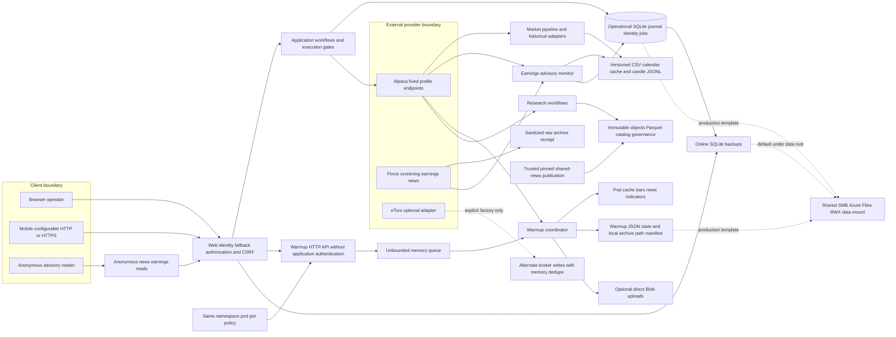
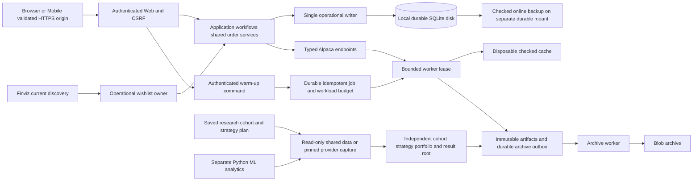

# Data, platform, and security design review

Date: 19 October 2026. Scope: project-wide static review; proposals require design approval before implementation.

## Evidence and limits

This review read `AGENTS.md`, `docs/operating-boundaries.md`, `docs/architecture.md`, the assigned project metadata, and targeted source paths across persistence, providers, advisory earnings, warm-up, authentication, mobile transport, deployment, CI, and helpers. It does not certify the application as secure.
No builds, tests, collectors, provider requests, broker calls, runtime changes, database reads, secret-file reads, or output-archive inspection were performed. Existing test names describe intended coverage, not results of this review.
Statements below marked **observed** describe source or templates. Cluster mounts, ingress/TLS configuration, filesystem permissions, published images, broker behavior, dependency vulnerabilities, and recovery under real load remain **unverified**.
The snapshot contains mixed historical and recent work. File presence or modification alone does not establish who introduced a rule; the parent review identifies the metadata capture helper as added in the current session.

## Component and write inventory

All six assigned libraries/services target .NET 10 with nullable references enabled. Data references Contracts/Domain/Engine; Alpaca and Finviz reference Domain/Engine; Earnings also references Finviz; WarmupService references Alpaca/Data/Domain/Engine; Etoro references Domain/Engine.
Data uses EF Core SQLite/Identity and Parquet.Net; Alpaca includes sentiment support; Etoro includes Polly. Metadata was inspected, without restoring packages or assessing current package advisories.

| Component / purpose | Caller | Inputs → outputs | Writes / isolation owner | Configuration |
|---|---|---|---|---|
| [Data context/migrations](../../../src/TradingFlow.Data/Context/TradingFlowDbContext.cs#L1): operational schema and Identity | Web/CLI/repositories | typed records → transactional rows | `tradingflow.db`, WAL/SHM; host owns location and sole writer | data root, EF model; WAL/FULL connection policy |
| [Data order repositories](../../../src/TradingFlow.Data/Orders/SqliteOrderIntentRepository.cs#L1): intents, lifecycle, reservations, protection | shared execution services/recovery | candidate/account/order contracts → journal evidence | account/run/symbol journals in operational DB | host DB factory; downstream broker policy |
| Data discovery/wishlists/preparation/jobs/application/audit repositories | application services/hosted workers | operational commands and versions → projections/events/leases | same operational DB; logical owners differ from file owner | host DB factory, owner/run keys |
| [Data candle store](../../../src/TradingFlow.Data/Candles/LocalFileCandleStore.cs#L16): bars, revisions, archive intent | pipeline, market stream, earnings, warm-up | scope/run/provider/source bars → JSONL/as-of reads | configured cache root; fenced writes supported | typed context and fencing token |
| [Data CSV cache](../../../src/TradingFlow.Data/Csv/CachedMarketDataProvider.cs#L16): reuse exact provider slices/calendar | CLI/runners/warmer | provider/range/feed/adjustment → checked manifest and bars | versioned CSV/JSON plus commit manifest, per-path locks | cache mode/source descriptor/freshness/clock |
| [Data catalyst cache](../../../src/TradingFlow.Data/Catalysts/CachedCatalystProvider.cs#L9): historical news reuse | runners | ticker/time window → cached catalyst list | separate JSON cache, atomic replacement | cache root/cache mode/provider identity |
| [Data evidence plane](../../../src/TradingFlow.Data/Evidence/EvidencePublicationCoordinator.cs#L11): raw receipt, normalization, Parquet, lineage, governance | research workflows/CLI/import | observed bytes/contracts → cataloged immutable objects | evidence catalog/object store/trial and authorization ledgers; distinct from mutable desk state | explicit roots, catalog open mode, pins and authorizers |
| [Data backup/restore](../../../src/TradingFlow.Data/Backups/SqliteDatabaseBackupService.cs#L27) and retention | Web backup host/CLI/evidence maintenance | source DB or eligible owner group → verified backup or tombstone | backup files/manifests; retention deletes only eligible evidence objects | backup root/date/schedule; policy/cutoff/object bound |
| [Alpaca](../../../src/TradingFlow.Alpaca/TradingFlow.Alpaca.csproj#L1): bars/calendar/assets/news/quotes/streams/broker | Web/CLI/pipeline/execution | symbols/ranges/profile/order contracts → typed evidence/receipts | raw archives/SIP execution archives when supplied; broker mutations through callers | credentials, typed profile, SIP policy, bounded provider budgets |
| [Finviz](../../../src/TradingFlow.Finviz/FinvizClient.cs#L16): current discovery, earnings, optional news | desk/discovery/Earnings/CLI | screen/date/symbol → rows plus receipt provenance | raw archive; caller owns discovery/earnings DB updates | fixed default host, auth source, saved screen query |
| [Earnings](../../../src/TradingFlow.Earnings/EarningsMonitor.cs#L12): advisory monitor | hosted service/refresh API | Finviz schedule/results + shared news + completed Alpaca bars → snapshots | operational calendar/analysis tables; `paper/earnings-monitor/alpaca` candle namespace | lookbacks, interval, heartbeat/concurrency/request budget |
| [Etoro](../../../src/TradingFlow.Etoro/Trading/EtoroOrderRouter.cs#L10): alternate adapter, outside current Alpaca-only product boundary | explicit factory consumers | instruments/rates/candles/portfolio/order → provider DTOs | possible broker writes; in-memory dedupe, no durable shared intent at this adapter boundary | demo/live profiles; live default disallows trading |
| [WarmupService](../../../src/TradingFlow.WarmupService/Program.cs#L8): independent HTTP worker | Web proxy/manual/nightly queue | ticker/timeframes/lookbacks → candle/news/indicator files and run records | own JSON state, cache artifacts, raw archive, optional Blob | `Warmup` options plus overlapping credential sources |
| Web/Mobile trust boundary | operator/browser/device | cookie + CSRF + request → application workflow | preview/job/order state belongs to services, keys in data root | Identity/session policy, backend URL, runtime/test mode |
| CI/deployment | GitHub Actions/container/Kubernetes operator | source/parameters → builds/tests/images/workloads | CI workspace; deployed data/cache/key mounts | .NET/Android workload, Kustomize/Bicep/manifests |
| [DbChecker](../../../DbChecker/Program.cs#L4), [DbQuery](../../../scratch/DbQuery/Program.cs#L4), [TestDb source](../../../src/TestDb/Program.cs#L11) | manually launched scratch tools | fixed machine paths → console rows/bars | SQLite defaults can create absent DB; TestDb reads files | embedded paths/query/symbol/date; TestDb has no project file here |
| [Metadata capture](../../../tools/research/AlpacaMetadataCapture/Program.cs#L3) | explicit research operator | output directory/mode → raw metadata + receipt | create-new output files; reads fixed local credential path | embedded credential path, calendar range, endpoints/tapes |

Operational DB tables, file caches, and immutable evidence are different authorities. A cache hit does not grant strategy authorization, a raw receipt does not establish complete historical coverage, and an earnings projection is not an order signal.
[FinvizMarketDataProvider](../../../src/TradingFlow.Finviz/FinvizMarketDataProvider.cs#L20) explicitly throws rather than supplying historical OHLCV; it should not appear as a viable historical provider in a selectable catalog.

## Actual current flow — observed source and deployment templates

The diagram deliberately distinguishes a library capability from an installed runtime: eToro has executable adapter code, but no Web registration or solution entry was found in the inspected composition roots. Production templates are not evidence that those workloads are currently deployed.

## Boundaries already worth reusing

- [AlpacaEndpointResolver](../../../src/TradingFlow.Alpaca/AlpacaEndpointResolver.cs#L12) owns paper/live endpoints; callers cannot redirect a typed profile. [AlpacaOptions](../../../src/TradingFlow.Alpaca/AlpacaOptions.cs#L30) rejects unapproved IEX fallback. Keep provider identity independent of credentials.
- [OperatorAuthentication](../../../src/TradingFlow.Web/OperatorAuthentication.cs#L66) supplies a signed-in fallback; [v1 routes](../../../src/TradingFlow.Web/TradingApiV1Endpoints.cs#L29) also require authentication. [API mutation middleware](../../../src/TradingFlow.Web/ApiMutationSecurity.cs#L16) checks CSRF, including login/logout through the shared transport handler. This establishes operator access, not an independently proven multi-tenant authorization model.
- [Order routes](../../../src/TradingFlow.Web/OrderWorkflowEndpoints.cs#L33) delegate preview/confirm/cancel/close to application services. Keep broker intent admission, lifecycle, account ownership, reconciliation and protective handling below UI. A second adapter must not bypass those services.
- [CSV cache publication](../../../src/TradingFlow.Data/Csv/CachedMarketDataProvider.cs#L628) writes versioned bytes before switching the manifest and validates cleanup containment. [Candle as-of reads](../../../src/TradingFlow.Data/Candles/LocalFileCandleStore.cs#L175) select known-at revisions. Reuse these contracts rather than adding a second undifferentiated cache.
- [Raw archive metadata sanitization](../../../src/TradingFlow.Engine/Storage/FileSystemRawArchiveWriter.cs#L257) removes sensitive query/header fields; [Finviz profiling](../../../src/TradingFlow.Finviz/FinvizClient.cs#L437) removes `auth` before recording the endpoint. Do not infer raw response bodies are automatically free of sensitive provider content.
- [Shared-news consumer](../../../src/TradingFlow.Data/Evidence/Collection/SharedNews/SharedNewsPublicationConsumer.cs#L14) requires trusted local writers, independently supplied plan pin, disjoint roots and bounded records; hashing is explicitly not sender authentication.
- [Evidence retention](../../../src/TradingFlow.Data/Evidence/EvidenceRetentionService.cs#L22) protects committed datasets/research and references/pins, requires a complete scan, and records retryable tombstones. [Restore](../../../src/TradingFlow.Data/Backups/SqliteDatabaseRestoreService.cs#L67) refuses existing DB/WAL/SHM destinations. Preserve these behaviors.

## Findings and smallest reusable designs

### DS-01 — P1: production templates place WAL SQLite on shared SMB storage

**Observed:** [production storage](../../../deploy/aks/production/storage.yaml#L24) defines RWX Azure Files/SMB; [Web](../../../deploy/aks/production/web.yaml#L54), [warm-up](../../../deploy/aks/production/warmup-service.yaml#L56), and [worker shards](../../../deploy/aks/production/paper-worker-shards.yaml#L64) mount the same data claim. [Web DB composition](../../../src/TradingFlow.Web/Program.cs#L350) places SQLite under that root; [durability initialization](../../../src/TradingFlow.Data/Context/SqliteDurability.cs#L38) requires WAL.
**Impact/precondition:** deploying these templates violates the stated local-disk/single-writer boundary; multiple processes on different nodes may contend for operational/evidence journals on a network share. This review did not observe actual corruption or deployment.
**Proposed:** retain SQLite behind one explicitly owned writer on Azure Disk; keep workers' mutable operational commands behind that owner. Give warm-up its own state volume. Store archives in Blob outside execution. Do not substitute a new distributed database without a separate design decision.
**Reuse/verification:** reuse existing repository contracts, leases and online backup/restore. Render manifests and assert disk class, one writer owner, distinct backup failure domain and worker access paths; later demonstrate crash/recovery using disposable deployment state. `replicas: 1` on several different Deployments is not one writer.
The same template has no separate backup mount/configuration; [backup-root fallback](../../../src/TradingFlow.Web/Program.cs#L109) therefore leaves backups under operational data, contrary to the [recovery policy](../../../docs/database-backup-restore.md#L23).

### DS-02 — P1: warm-up mutations trust network location instead of a caller identity

**Observed:** [Warmup Program](../../../src/TradingFlow.WarmupService/Program.cs#L83) exposes read/upsert/delete/run endpoints without authentication/authorization middleware. [Namespace ingress](../../../deploy/aks/production/networkpolicy.yaml#L49) admits every pod in the namespace, not only Web.
**Exploit/preconditions:** a compromised or untrusted allowed pod, or any client with direct local-service access, can replace/delete warm-up intents and start provider downloads using the service's credentials. The claimed `RequestedBy` is caller text, not a verified identity. No broker route exists in this service.
**Proposed:** authenticate the Web-to-worker service identity, authorize only warm-up operations, derive audit principal server-side, and narrow ingress to intended callers. Keep `/health` anonymous. Do not pass a browser cookie into a separate trust domain.
**Reuse/verification:** reuse Web's deliberate authenticated-default pattern and structured command/audit contracts, adapting it for service identity. Future in-process HTTP tests should reject anonymous/incorrect identities and prove authenticated requests cannot route broker orders; manifest checks should restrict caller labels.

### DS-03 — P1: container build context does not exclude local secrets or operational data

**Observed:** [.dockerignore](../../../.dockerignore#L1) excludes selected raw/normalized directories and build outputs, but does not exclude local settings, environment files, DBs, credentials, evidence/results or security keys. [Web Dockerfile](../../../deploy/docker/Dockerfile.web#L4) and [warm-up Dockerfile](../../../deploy/docker/Dockerfile.warmup-service#L4) copy the entire context into their build stages. Git ignore rules do not control Docker context.
**Exploit/preconditions:** a local image build from a workspace containing those files sends them to the builder and stores them in the build stage/cache. An actor with builder/cache access could recover them. Final-image publication of those files was not tested and is not asserted.
**Proposed:** use an explicit source-only build context or comprehensive context exclusions, plus explicit publish exclusions for local settings. Keep deployment secrets external. Make the boundary apply to every Dockerfile rather than patching one service.
**Reuse/verification:** reuse the existing external secret-provider deployment approach. Later build from a disposable context containing fake canary settings/DB/key files; inspect context, build-stage filesystem and published output for their absence. Never use real credentials for this check.

### DS-04 — P1: mobile credentials and session cookies can travel over cleartext HTTP

**Observed:** [Mobile defaults](../../../src/TradingFlow.Mobile/Services/TradingFlowApiClient.cs#L11) include HTTP LAN/emulator endpoints; [BaseUrl](../../../src/TradingFlow.Mobile/Services/TradingFlowApiClient.cs#L127) accepts arbitrary persisted text, and [login](../../../src/TradingFlow.Mobile/Services/TradingFlowApiClient.cs#L73) posts the password there. [Android manifest](../../../src/TradingFlow.Mobile/Platforms/Android/AndroidManifest.xml#L9) allows cleartext; [Web cookie policy](../../../src/TradingFlow.Web/OperatorAuthentication.cs#L40) follows request transport. Web's inspected pipeline has no forwarded-header/TLS enforcement configuration.
**Exploit/preconditions:** if an operator selects HTTP on a network with an observer or active intermediary, that actor can read credentials/session material or alter responses. This is conditional on transport selection; it does not imply a TLS tunnel is compromised.
**Proposed:** store a deployment-owned HTTPS origin, validate it before authentication, and keep any approved loopback development transport confined to a development profile. Configure trusted TLS termination/forwarded headers and secure production cookies as one transport design.
**Reuse/verification:** retain the existing CookieContainer, session generation cancellation and CSRF handler. Later prove HTTP rejection in release settings, valid TLS login/logout and secure-cookie flags behind the selected proxy. Device/proxy behavior remains unverified.

### DS-05 — P2: warm-up independently discovers local Web credentials in every environment

**Observed:** [Warmup Program](../../../src/TradingFlow.WarmupService/Program.cs#L9) loads two local JSON locations without a Development check. [WarmupCredentialResolver](../../../src/TradingFlow.WarmupService/Services/WarmupCredentialResolver.cs#L22) additionally searches parent directories for Web local settings. [Web](../../../src/TradingFlow.Web/Program.cs#L68) already limits its local-file load to Development.
**Impact/precondition:** a packaged/mounted/stale local file can supply the wrong account's credentials when deployment settings are missing; ancestor traversal makes the source depend on launch location. This is configuration confusion, not proof of leaked credential values.
**Proposed:** one explicit credential-source policy per host: external production settings; Development-only local support; no ancestor search. Fail startup/readiness with the missing key names rather than start with empty credentials. Never log their values.
**Reuse/verification:** use normal .NET configuration/environment and the existing secret-provider deployment, not another resolver. Verify Production ignores fake local files, Development precedence is documented and absent keys fail before provider I/O.

### DS-06 — P2: accepted warm-up jobs have neither durable acceptance nor bounded backlog

**Observed:** [queue](../../../src/TradingFlow.WarmupService/Services/WarmupJobQueue.cs#L8) is an unbounded in-memory channel; [run-now](../../../src/TradingFlow.WarmupService/Program.cs#L122) returns an accepted run ID after enqueuing. [Coordinator](../../../src/TradingFlow.WarmupService/Services/WarmupCoordinator.cs#L46) persists history only after completion; [request validation](../../../src/TradingFlow.WarmupService/Services/WarmupRequestStore.cs#L19) has no upper ticker/lookback bound.
**Impact/preconditions:** restart loses accepted runs; repeated allowed requests can accumulate memory and provider work faster than the single reader drains them. Per-ticker concurrency limits active operations, not queued jobs or requested history size.
**Proposed:** persist an idempotent job before acknowledgement, use a bounded worker wakeup queue, validate workload budgets and coalesce duplicate warm-up requests. Make saturation and cancellation explicit results.
**Reuse/verification:** adapt [durable job repository](../../../src/TradingFlow.Data/Jobs/SqliteJobRepository.cs#L21) enqueue/lease semantics through the approved single writer; avoid inventing another journal. Extend existing warm-up tests with restart, duplicate request, saturation and bounded history cases, using fake providers only.

### DS-07 — P2: local warm-up “archive” retains pointers to replaceable pod files

**Observed:** [artifact writer](../../../src/TradingFlow.WarmupService/Services/WarmupArtifactWriter.cs#L27) overwrites per-symbol cache filenames. [Local sink](../../../src/TradingFlow.WarmupService/Services/WarmupArchiveSinks.cs#L26) records absolute paths instead of copying bytes; [Blob sink](../../../src/TradingFlow.WarmupService/Services/WarmupArchiveSinks.cs#L49) treats an absent SAS configuration as a skipped upload. [Deployment](../../../deploy/aks/production/warmup-service.yaml#L75) makes that cache `emptyDir`.
**Impact/preconditions:** a successful run without Blob configuration can leave a durable manifest whose files disappear with the pod; a later run replaces bytes referenced by earlier manifests. This is not immutable archival evidence and must not support historical claims.
**Proposed:** distinguish cache completion from archive commitment; publish immutable hashed artifacts/manifest through a durable outbox and archive worker. A local archive option must own durable bytes, not absolute cache pointers.
**Reuse/verification:** reuse immutable artifact publication and candle archive intents. Verify a second run and disposable cache removal preserve the first committed archive's bytes/hash; inject failed upload/restart and prove pending status remains visible. Keep Blob off decision/broker paths.

### DS-08 — P2: research and diagnostic helpers encode machine state rather than explicit inputs

**Observed:** [metadata capture](../../../tools/research/AlpacaMetadataCapture/Program.cs#L6) reads one machine's Web credential file; [calendar request](../../../tools/research/AlpacaMetadataCapture/Program.cs#L11) embeds a date range and endpoint. [DbQuery](../../../scratch/DbQuery/Program.cs#L4) embeds the operational DB path without read-only mode; [TestDb](../../../src/TestDb/Program.cs#L11) embeds a symbol/date/cache path; [DbChecker](../../../DbChecker/Program.cs#L4) visibly contains doubled string delimiters.
**Impact/preconditions:** manual reuse can query or create the wrong DB, capture a different scope than the saved research plan, or fail before diagnosis. The malformed helper was not compiled. This is a tooling design problem, not evidence that a private DB was accessed here.
**Proposed:** consolidate retained helpers into existing CLI/source tools with explicit read-only DB/input/output roots and saved capture-plan parameters; remove redundant abandoned helpers only after approval. Resolve credentials through the approved source policy and endpoints through the existing typed resolver.
**Reuse/verification:** reuse evidence collection/receipt contracts, explicit UTC range conventions and existing CLI backup/query patterns. Verify missing inputs fail without creating files, read-only diagnostics cannot mutate a disposable DB, and receipts bind the exact saved plan. Do not add one setting for every literal.

## Literal and configuration disposition audit

| Current item / owner | Disposition | Design reason |
|---|---|---|
| Machine credential paths and ancestor searches; metadata/warm-up helpers | REMOVE / CONSOLIDATE | one credential policy per host; no dependence on another app's local file |
| Provider host/profile mapping; Alpaca adapter | KEEP | named protocol/security boundary; use resolver, never arbitrary credential-bearing URL overrides |
| Evidence adapter absolute endpoint override; [BuildUri](../../../src/TradingFlow.Data/Evidence/Collection/EvidenceHttpRequestAdapters.cs#L82) | CONSOLIDATE | typed provider endpoint plus saved plan; collector itself does not establish trusted origin from an arbitrary absolute URI |
| Calendar dates, tape set, sample symbols; capture helper/deployment | SAVED-PLAN | freeze request scope in auditable plan; trading universe comes from persisted ownership-aware selection |
| Mobile tunnel/LAN origins and fixed ports; transport host | OPERATOR-CONFIG | deployment origin is environment-owned, validated before login; avoid stale public tunnel defaults |
| Request timeouts, parallelism, lookback/backlog budgets; service owner | CONSOLIDATE / OPERATOR-CONFIG | named bounded resource policy shared by scheduler/manual path; do not expose accidental tuning in every screen |
| Warm-up defaults repeated in options and ConfigMap | CONSOLIDATE | one documented effective configuration with deployment overrides, no extra fallback chain |
| Four worker deployments and fixed stock lists; platform owner | SAVED-PLAN | resolve writer/shard ownership first; rendering is not authority to share SQLite |
| Storage classes/roots/replicas/backup mount; platform owner | OPERATOR-CONFIG | deployment-specific inputs must satisfy fixed single-writer and recovery requirements |
| WAL/FULL, hashes, completed-bar/known-at rules, order authorization, UTC | KEEP | explicit protocol/domain invariants; user configuration must not weaken them |
| Retention summary flag versus documented full audit default; host | CONSOLIDATE | [production ConfigMap](../../../deploy/aks/production/configmap.yaml#L17) says summary; confirm actual consumer/effective behavior before declaring retention policy changed |

## Proposed flow — approval pending

## Ownership, naming, and verification requirements for an approved implementation

C# continues to own the trading desk, provider adapters and execution services. The separate Python ML project may read agreed analytical datasets or collect its own data under explicit ownership; this review has not inspected that separate repository. The local Python FinBERT service performs bounded text sentiment inference, not trading control or provider collection. A shared-news inbox is an explicit raw import boundary and does not automatically update desk feeds or grant historical coverage.
For the confirmed research design, every cohort/group owns an independent configurable starting balance and portfolio, with result state separated by strategy/version and cohort. Five symbols with 10,000 starting capital is an example, not a fixed constant. Reading a shared immutable dataset does not authorize writes to the main wishlist/Finviz discovery state. Daily new-entry counts and concurrent-position limits are different quantities; “2–3 stocks per day” is design intent, not a new coded cap.
Name methods and records for the authority they represent: `EnqueueDurableWarmup`, `CommitArchiveManifest`, `ReadCalendarProjection`, `ResearchCohortId`, `StartingCapital`, `DailyNewEntryCount`, and `ConcurrentPositionCount` are illustrative design names. Avoid a generic `Succeeded` meaning both cached and durably archived. Comments should state purpose, input clock/provenance, state changes and retry/failure behavior; split workflow steps instead of adding comments around mixed I/O and policy.
Test isolation must include unique data/cache/evidence/backup/key roots, explicit read-only research inputs, fake HTTP/provider clients, no ambient credentials, and no writer shared with a running desk. Existing [warm-up tests](../../../src/TradingFlow.Tests/WarmupServiceTests.cs#L99), [backup tests](../../../src/TradingFlow.Tests/SqliteBackupRestoreTests.cs#L138), and [retention tests](../../../src/TradingFlow.Tests/EvidenceRetentionTests.cs#L12) already use temporary unique roots; reuse that pattern. Test-mode root selection must never silently choose operational storage.
CI currently builds/tests the solution and runs a secret scan; [workflow](../../../.github/workflows/ci.yml#L25) also installs Android tooling. The inspected `slnx` does not include Etoro/Warmup/Mobile/helper projects, while test project references include Warmup; do not equate a single solution command with every deployment/helper being verified. Future verification should name the affected target and remain offline until separately authorized operational acceptance.
Approval should select the deployment writer design, service identity, transport origin policy, durable warm-up job/archive contract and retained helper scope before code/config/tests change. No remediation has been implemented by this document.
