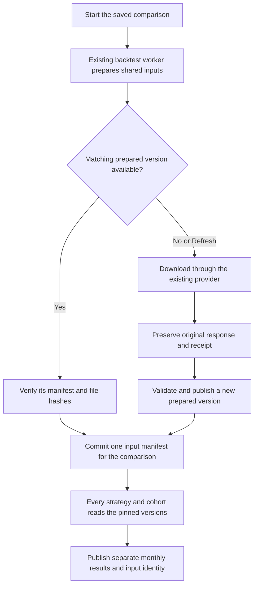

# Reuse prepared candles — approved design, 21 October 2026

Status: approved by the user on 21 October 2026; the approved implementation and offline component verification are complete. Approval: “Approve this design and implement”. The separate [original-data retention fix](../../verification/refactoring-cleanup-2026-10-21.md) is complete, with 138 focused offline tests passing. This document adds one bounded capability to the earlier plan: reuse validated historical candles across runs while keeping every comparison's inputs fixed.

## Behavior

Starting a comparison first selects or prepares its candles and exchange calendar. All strategy/cohort portfolios in that comparison read those exact prepared versions. A later comparison can reuse them or select newer versions according to the existing cache choice. Each portfolio still has independent money, positions and monthly results.

Keep three existing storage responsibilities:

| Data | Owner | Lifetime |
|---|---|---|
| Original provider response bytes and receipts | Existing configured `RawRoot` and raw archive writer | Protected core data; no automatic deletion |
| Validated source candles, calendar and immutable version manifests | Existing configured `NormalizedRoot`, shared historical subdirectory | Protected reusable data; retain committed versions |
| Derived candles, indicators, execution journals and temporary files | Existing private `.run-inputs-*` workspace | Generated run copies; clean after success, failure or cancellation |

“Original response” describes captured bytes. `raw` versus `all` price adjustment is a separate field and remains part of the exact input identity.

## Reuse the current implementation

`CachedMarketDataProvider` already reads/writes prepared CSVs, validates provider/feed/adjustment/revision, exact UTC request bounds, CSV/manifest schema and content hashes, and uses process/file locks for publication. Extend that implementation rather than creating another cache service or database.

Today its manifest is replaced on refresh and previous CSV/calendar files are deleted. Backtest workspaces also place this cache in temporary storage. Repointing that code to shared storage alone would therefore be unsafe.

`LocalFileCandleStore` stays the run's spill/recovery store. Its mutable, run-scoped upserts are not the authority for complete historical provider-request coverage. Indicators remain calculated by the current shared engine; no shared indicator cache is proposed.

## Prepared version identity and publication

Use `<NormalizedRoot>/_historical/<request-sha256>/` for each exact source request. The hash covers provider identity, feed, price adjustment, provider revision when available, symbol, timeframe, exact UTC start/end including warmup, and explicit parser/CSV contract versions. Calendar identity includes provider endpoint/profile and exact date bounds. Do not put credentials in any key or manifest.

- Reuse **exact ranges only** in this first change. A different start/end requests a separate version; no stitching, overlapping-range merging or new date-partition framework. Existing files without the required source-receipt/coverage evidence remain preserved but do not automatically qualify for verified reuse.
- Keep the current generated CSV/calendar files, but retain a version-specific immutable manifest beside every committed version. A replaceable latest-selection pointer may help a **new** comparison choose a version; execution never reads that pointer.
- Existing freshness rules govern selection for a new comparison. Expiry means a new download may be required; it never authorizes deletion. A pinned comparison ignores freshness expiry and continues reading its selected versions.
- Existing `use_cache` selects a matching valid version or downloads on a miss. Existing `refresh` creates a new version once for each unique request in the new comparison. Retain older versions and original responses.
- Finish validation before publishing. Use existing exclusive publication and locks. An interrupted uncommitted temporary write is disposable; a committed payload or manifest is retained.
- Record raw-response receipt references, actual collection times, completed pagination, query bounds, source omission semantics, row count and content hashes. Extend existing provider evidence plumbing where needed; do not infer complete coverage from first/last timestamps or a row count.

An empty response retains its exact query evidence. It does not create candles, prove that trades/quotes were absent, or relax the simulator's missing-interval checks.

## One fixed selection for the whole comparison

Use the existing backtest durable worker. Do not introduce another scheduler, a dependency graph or a new queue type.

1. **Preview/Save:** validate and show the plan as today. No provider collection or execution.
2. **Start:** freeze one data request for the plan and start retry key. Resolve rolling dates once, including warmup. The request contains the union of cohort symbols, admitted download timeframes, required benchmark queries and applicable calendars, deduplicated by exact source request. Different required price bases remain separate entries. Generate this server-owned request beside the existing immutable run configurations and include its path/hash in each child job's captured inputs. Perform existing budget/admission checks before accepting work; validate the full deduplicated query list, supported bounds and arithmetic before collection. The request and eventual manifests are comparison-owned, outside per-child discard cleanup. A losing/retried child must never remove inputs needed by siblings. Rejected attempts remove only their uniquely owned unaccepted staging files after checking durable ownership; admitted comparison requests remain retained parameters.
3. **Preparation phase:** the first claimed child job enters “Preparing candles” before any strategy evaluation. Under a comparison-specific process/file lock it selects/prepares **all** required versions with bounded per-slice memory, the existing configurable replay-bar budget enforced during collection, and existing provider timeouts/request limits. Do not hold the full universe in memory or repurpose a strategy-count limit as a data limit. Process one query at a time per preparer; existing job concurrency bounds active comparisons. Track source rows against each referencing book's existing `MaxRetainedReplayBars` allowance during collection, before accepting an oversized version; the ordinary engine retains its later derived-state checks. Do not invent an extra data-work setting or claim a separate pre-download row count is known. Other children wait asynchronously while the durable worker keeps their leases alive; cancellation releases waiting resources. The comparison gate ends after binding and never covers strategy evaluation. These process/file locks cover the current single-host filesystem owner, not distributed Azure coordination. The shared request is available to every child; preparation must not assume the first child contains all symbols.
4. **Commit:** publish one immutable comparison-input manifest only after every required query is complete and validated. Bind its request hash and selected manifest hash once through the existing application event store before any book consumes it. The comparison ID derives from saved plan plus Start retry identity; a fresh Start gets a fresh selection. No change to the immutable saved plan or accepted request is allowed.
5. **Execute:** each child verifies the same binding, manifest and referenced hashes, then reads only its required subset through the existing provider/pipeline interfaces. Each book records the common snapshot identity in its result. Exclude newly added transport paths, cache-hit flags and preparation/comparison metadata from semantic candidate identity; preserve the established logical run/strategy/decision identity and verify recovery stability. Per-book strategy/capital/risk rules remain unchanged.

Publication and recovery rules:

- As each exact query is selected, commit a comparison-owned immutable per-query version receipt under that same comparison gate. Recovery reuses those selections, including under `refresh`, and prepares only remaining queries. A comparison is a fixed collection of individually timestamped captures; it does not claim simultaneous provider-wide observation.
- Before the comparison manifest/binding is committed, no child may evaluate a strategy. A canceled/failed preparer leaves committed originals/versions intact; another still-requested child or host recovery can complete preparation. Existing per-job cancellation does not silently cancel other portfolios.
- A crash after manifest publication but before its binding may finish that same binding after validating the full request and referenced files under the comparison lock. It must not select a different set while keeping the same committed manifest.
- After binding, missing or changed evidence fails explicitly. A retry must never consult latest pointers, refresh, download a replacement or change the comparison's selected inputs.
- Every child acquires verified read leases for its referenced files. Reuse `DurableFileJobRequest`/`DurableFileEvidence`/`BacktestRunInputFiles` verification; store preparation's final selection receipt separately from the immutable admission request. The application layer owns the event-store binding; the data/engine layers do not gain database dependencies.
- Standalone CLI and optimizer use the same preparation component, with their existing immutable run-artifact publication for the selection receipt. Nested executions inherit the parent's selection. No per-study driver or strategy-specific preparation code.

## Timing and execution boundaries

Keep bar time, actual provider receipt time and any genuine revision/known-at time separate. Downloading or preparing old candles today does not prove those exact revisions were available before an old entry. Preserve existing values; never fill missing historical known-at evidence with the download time or label it historically observed.

Show the historical-data assumption explicitly: downloaded historical bars captured at the recorded time, with original historical revision availability unproved where applicable. Deterministic reuse improves reproducibility; it does not establish strategy profitability or remove look-ahead assumptions in revised history.

Frozen SIP quote/trade execution archives retain their existing separate binding, calendar checks and source hashes. The frozen SIP calendar stays authoritative for that execution. A conflicting prepared/REST calendar must fail explicitly; it cannot replace or repair the frozen source. Prepared candle reuse does not reconstruct SIP events or fill absent candles. News/earnings/sector histories remain under their existing evidence rules; this candle-only change does not claim to pin those inputs or make news-dependent runs fully reproducible.

## API, Web, Android and files

Keep the current stock/strategy/cohort/capital/date controls and existing cache choice. Add no new screen or operator setting.

Extend existing job/result contracts and both client views together to show “Preparing candles”, preparation failure reasons, snapshot ID/hash, provider/feed, price basis, requested coverage, collection time and reused/downloaded query counts. A queued job has no selected-data hash yet; the server fills it only after commitment. Clients display server facts. Do not expose private filesystem paths.

Likely implementation owners, to confirm during the first slice:

- `TradingFlow.Data/Csv/CachedMarketDataProvider.cs`, `MarketDataCacheManifest.cs`, `MarketDataCacheSourceDescriptor.cs`: immutable versions, identity, selection/read verification and evidence.
- Existing provider/raw-receipt plumbing: tie prepared versions to the responses that produced them.
- `TradingFlow.Backtesting/BacktestRunner.cs`, `.Providers.cs`, `BacktestRunInputFiles.cs`, existing optimizer: shared prepared inputs plus private calculations.
- `TradingFlow.Application/Jobs/BacktestPlanService.cs`, `RunWorkflowService.cs`, existing job workflow context; Web `BacktestJobService`: comparison request, preparation/binding and recovery using existing persistence.
- Existing run config model/reader/writer and job/result contracts: server-owned input-request/snapshot references, without editable new profile knobs.
- Existing Web backtest status/results and Android Backtests page/API client: the same preparation and evidence fields.

## Delivery and acceptance

- [x] Inspect existing cache, candle storage, durable jobs and retention behavior.
- [x] Obtain independent architecture and plan/data-timing source reviews. Their ownership, candidate-ID, bounded-collection, partial-recovery and frozen-calendar clarifications are incorporated above. Final independent implementation reviews rechecked the fixes and reported no remaining concrete finding; executable checks are recorded separately below.
- [x] Obtain approval of this concrete design before implementation (21 October 2026).
- [x] Retain immutable prepared versions; exact source/range/parser identities cannot collide.
- [x] Add shared comparison preparation and a single immutable selected-data binding; CLI/optimizer reuse that component.
- [x] Update API/Web/Android status and result evidence together.
- [x] Verify version preservation, concurrent refresh, interrupted publication, cancellation/restart, incomplete pagination/calendar, corrupted files and refusal to silently replace pinned data.
- [x] Prove every child/retry uses the same snapshot hash; a later comparison may use a newer version while earlier results remain reproducible.
- [x] With deterministic fixtures, first preparation downloads; a second compatible comparison using `use_cache` and eligible unexpired versions uses zero market-data provider HTTP calls. This claim excludes unrelated news/earnings calls. Refresh downloads once per unique query, rather than once per strategy. Compare candidate decisions, signal/entry/exit times, fills/costs and monthly results with identical input candles through direct versus prepared reads. Candidate IDs must remain stable across cache reads and recovery of the same accepted input selection; new comparison metadata must not introduce random per-attempt identities.
- [x] Compile affected backend and Android consumers; verify Web status/result contract behavior. Record actual phone checks separately.
- [x] Preserve original/core data and committed prepared versions; clean only isolated synthetic fixtures and private run intermediates.

Final component verification: **262 distinct .NET cases have passing latest outcomes**, **14 distinct browser scenarios have passing latest outcomes**, and **Android Debug/Release builds passed with zero warnings/errors**. The 20-, 12- and six-portfolio matrices and SIP interruption recovery passed. Earlier fixture failures and their passing corrections are retained in the receipt; overlapping counts are not added. See the [implementation and verification receipt](../../verification/prepared-candle-reuse-2026-10-21.md) for exact cases, commands, corrections and scope limits. Local CSV diagnostics retain their existing declared-file path without claiming verified provider history; mixed local/provider comparisons are rejected rather than partly claiming a shared snapshot.

This is a storage/preparation change. No strategy tuning, real provider collection, historical research execution, trading, external deployment or data deletion is included in this design approval.

Source-based effort allowance: approximately **2–4 focused engineering days** for versioned storage, shared binding/recovery, client evidence and checks. This is an uncertain implementation estimate, not measured agent elapsed time. Benchmark first preparation and reuse before predicting a real comparison's runtime. More reuse reduces download/normalization work; strategy calculations and simulated execution still run independently.
