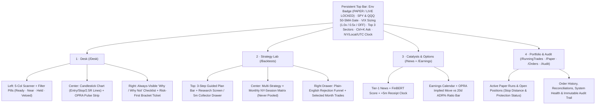

# TradingFlow UI 2.0 Redesign Plan — Simple, Accessible, Answers at Your Fingertips

> [!IMPORTANT]
> **Design Proposal Only (Awaiting Your Approval):** No UI source files have been modified yet. Under [AGENTS.md](file:///c:/project/trading_flow/AGENTS.md), all Razor/CSS/JS presentation changes remain strictly separated from C# engine, risk, and execution logic, preserve existing routes and safety locks, and keep monthly NY-session non-pooled reporting intact.

---

## 1. Visual Concept Mockups

````carousel

<!-- slide -->

<!-- slide -->

<!-- slide -->

````

---

## 2. Why Redesign Now? (Concrete Diagnosis of Today's UI)

Inspecting [_Layout.cshtml](file:///c:/project/trading_flow/src/TradingFlow.Web/Pages/Shared/_Layout.cshtml), [Desk.cshtml](file:///c:/project/trading_flow/src/TradingFlow.Web/Pages/Desk.cshtml), [Backtests.cshtml](file:///c:/project/trading_flow/src/TradingFlow.Web/Pages/Backtests.cshtml), [_LabResults.cshtml](file:///c:/project/trading_flow/src/TradingFlow.Web/Pages/Shared/_LabResults.cshtml), and [site.css](file:///c:/project/trading_flow/src/TradingFlow.Web/wwwroot/css/site.css) highlights four concrete friction points:

| Friction Point Today | Where It Happens | Impact on Daily Trading & Research |
|---|---|---|
| **1. Important answers require 3–5 clicks or page hops** | Market Regime (`SPY`, `QQQ`, `FRED VIXCLS` risk scale, Top-3 Sectors) has no global header; Desk hides `#watch-strategy-checks` inside a collapsed `<details id="watch-evidence">` below the chart. | You cannot tell at a glance *"Are longs allowed today, is VIX at half-risk, and which exact rule blocked AAPL?"* without scrolling and expanding accordions. |
| **2. Navigation sprawl across 7 sidebar menus + 18 pages** | `Desk`, `Preparation`, `Trading` (`/Orders`, `/RunningTrades`, `/OrderTicket`), `Strategies` (`/Paper`, `/Backtests`, `/Audit`, `/ResearchLedger`), `Earnings`, `News`, `Stock groups`, plus `Health` & `Warm-up`. | Related workflows (e.g., Earnings + Tier-1 News + OPRA Implied Move, or Saved Plan + Monthly Comparison) are split across separate destinations. |
| **3. Strategy Lab walls of fields & 1-job-at-a-time results** | `Backtests.cshtml` stacks 25+ inputs and 64-char SHA-256 hashes in one long left form; `_LabResults.cshtml` renders **1 strategy × 1 month** per page reload. | Running and comparing 10 swing strategies across 6 months (`May`–`Oct`) requires clicking 10 separate job links and 6 month dropdown reloads (`60` views instead of `1` matrix). |
| **4. 12 layered CSS files & harsh red-accent palette** | `_Layout.cshtml` loads 10 global CSS files plus page CSS; Light mode uses vermilion red (`#ec3013`) as `--color-accent` and plain black ink (`--color-text`) for gains with `0px` square corners. | Normal action buttons look like danger/error alerts, positive gains blend into neutral text, and component spacing drifts across screens. |
| **5. Stale, jargon-heavy banners & clipped step pills** | `_PreparationSummary.cshtml` renders a prominent *"Today's preparation"* banner on Desk even when the schedule has been paused for days (`Target session 2026-11-16 · evidence expired · saved schedule paused`) and clips `"Morning collection needed"` mid-word (`"Morning collection nee"`). | Pushes Desk stocks and charts down the screen, looks like a broken system error when nothing is wrong, and cuts off text on standard widths. |

---

## 3. Inspiration from Leading Trading & Quant Platforms

We borrow specific, proven interaction patterns—adapted to TradingFlow's swing-only, rule-governed workflow:

1. **Koyfin (Macro Pulse & Financial Matrices):**
   - A permanent, calm **1-line Market & Sector Pulse bar** across the top of the app.
   - Clean, right-aligned **Strategy × Month matrices** with subtle tinted cells (`▲ +3.42%` / `▼ −0.85%`) where every number aligns vertically and clicking a cell drills into underlying trades.
2. **TradingView (3-Pane Ergonomics & Chart Price Lines):**
   - Zero-scroll **3-pane Desk** (`Compact Scanner | Chart + Sub-Strip | Decision Inspector`) with keyboard `↑`/`↓` ticker stepping.
   - Plotting **Entry, Initial Stop (`1.0 ATR`), and Target (`2.5R`)** directly as horizontal levels on the stock chart so reward-to-risk is visual, not mental math.
   - Global **`Ctrl+K` / `/` Quick-Answer Command Bar** for instant ticker lookup and plain-English rule checks.
3. **Robinhood Legend & Public.com (Plain-English Readiness & Risk-First Tickets):**
   - Replacing cryptic rejection codes (`min_average_range_pct_not_met`) on screen with **human sentences** (*"20-day ADR is 1.82% — needs ≥ 2.50%"*, keeping the exact canonical code in a hover tooltip / audit copy).
   - **Risk-First Ticket:** Showing **Max Dollar Risk (`\$500 · 0.5% equity`)** and **Stop Distance** *before* share count so position sizing is immediately transparent.
4. **Composer.trade & QuantConnect (Guided Lab & Progressive Disclosure):**
   - Replacing a 25-field sidebar form with a **3-Step Guided Bar** (`① Screen & Window` → `② Strategy Set` → `③ Capital & Replay`) plus 1-click selection pills (`Select All Long Swing V1`, `Select All Short Swing V1`), tucking SHA-256 hashes inside a verified `ⓘ Provenance` popover.

---

## 4. Information Architecture: From 7+ Menus to 4 Clear Workspaces

All existing Razor URLs remain intact (zero broken links or bookmarks), organized under **4 clear primary workspaces** plus a persistent **Top Market Regime Bar**:



---

## 5. Accessibility, Typography & Visual System (WCAG 2.2 AA+)

> [!TIP]
> **Safety Through Calm Visual Hierarchy:** In trading software, bright red/orange must be reserved strictly for **losses, vetoes, cancellations, and live-money warnings**—never for ordinary primary buttons or active navigation tabs.

- **Three Contrast-Verified Themes (`Calm Light`, `Slate Dark`, `Colour-Blind High-Contrast`):**
  - **Calm Light:** Warm Alabaster background (`#F8FAFC`), crisp White cards (`#FFFFFF`), Slate-900 ink (`#0F172A`, `16.8:1` contrast), Cobalt primary action (`#2563EB`, `5.1:1`).
  - **Slate Dark:** Deep Slate-950 ground (`#0B111B`—never harsh `#000000` pitch black), Slate-900 cards (`#131C2B`), Ice-100 ink (`#F1F5F9`, `15.4:1`), Sky-Blue primary action (`#3B82F6`).
  - **Semantic Gain / Loss (Colour-Blind Safe by Default):**
    - **Positive / Pass:** Deep Teal (`#0F766E` light / `#2DD4BF` dark) + **`▲ +` / `✓`**.
    - **Negative / Veto / Stop:** Burnt Coral-Rose (`#BE123C` light / `#FB7185` dark) + **`▼ −` / `✕`**.
    - **Caution / Half-Risk (`VIX 18–22`):** Warm Amber (`#B45309` light / `#FBBF24` dark) + **`◐ 0.5×`**.
    - *Rule:* No status or P&L number is ever communicated by colour alone.
- **Financial Typography & Table Ergonomics:**
  - `Inter` (UI labels & plain-English explanations) + `JetBrains Mono` / `font-variant-numeric: tabular-nums` on every price, percentage, clock, and table cell so digits never jitter.
  - Right-aligned numeric columns, sticky header + sticky left Ticker/Strategy column, comfortable `40px` minimum click/touch targets (WCAG 2.5.8), and `2px` high-contrast keyboard focus rings.
- **Stylesheet Consolidation (Staged Reversible Rollout):**
  - During the phased UI-1 through UI-4 rollout, new tokens, components, and workspace overrides are staged additively in `wwwroot/css/ui2-foundation.css` (loaded last in `_Layout.cshtml`) so existing screens stay safely reversible until all workspaces are verified; full consolidation into 3 standalone files (`tokens.css`, `components.css`, `workspaces.css`) follows after all checkpoints are accepted.

---

## 6. Key "Answers at Your Fingertips" Improvements by Screen

### A. Global Top Regime Bar + `Ctrl+K` Instant-Answer Palette
- **Top Bar (1 read-only lightweight endpoint `GET /api/v1/workspace/regime-pulse`, cached 60s):**
  - Displays `SPY` 50-SMA status (`Rising ▲` / `Falling ▼` / `Mixed`), `QQQ` Nasdaq gate, previous-session `FRED VIXCLS` close + active sizing multiplier (`Longs 1.0×` / `0.5×` / `OFF`, `Shorts OFF` / `0.5×` / `1.0×`), Top-3 12-1 Sector ETFs (`XLI · XLV · XLF`), and Paper Readiness (`Ready ✓`).
- **`Ctrl+K` Palette:**
  - Type any symbol (`AAPL`, `NVDA`), strategy name, or navigation target to see an instant summary card (Price, 20d ADR%, OPRA Implied Move, and plain-English strategy gate status) or jump straight to Desk / Lab / Audit.

### B. Desk (`/Desk`) — 3-Pane Zero-Scroll Layout
- **Left Pane (Compact 5-Column Scanner):** Replaces the 10-column horizontal-scroll table with `Stock`, `Mid & Day %`, `ADR% · RVOL`, `News / OPRA`, and `Status Pill` (`✓ READY`, `◐ NEAR`, `✕ GATE OFF`), plus 1-click filter tabs (`All`, `Ready`, `Near`, `Held`, `Rejected`) and `↑`/`↓` keyboard row stepping.
- **Center Pane (Chart + OPRA Pulse):** Draws strategy `Entry`, `Stop`, and `2.5R Target` reference lines on the chart when a strategy is selected, with the compact OPRA Options Pulse (`ATM Implied ±%`, `25Δ Skew`, `Implied / ADR`) directly underneath.
- **Right Pane (Always-Visible Decision Card & Risk-First Ticket):** Pulls `#watch-strategy-checks` out of the buried `<details>` block into the primary right panel, translating machine codes into plain English (with exact audit details expandable underneath) above a clean Risk-First Order Ticket.

### C. Strategy Lab (`/Backtests`) — Guided Plan Bar & Multi-Strategy Monthly Matrix
- **3-Step Guided Bar:**
  - `① Universe & Dates`: Pick published Research Screen (or open the `Research Screens & 5m Bars` drawer right inline) + quick date presets (`May–Oct 2026 Diagnostic`, `Last 6M`, `Custom UTC`).
  - `② Strategies`: Quick filter/select pills (`All 5 Long Swing V1`, `All 5 Short Swing V1`, `Clear`) + readable strategy cards; 64-character SHA-256 hashes move into a clean `ⓘ Exact Artifact Identity` popover.
  - `③ Capital & Replay`: Profile selector (`swing-research-screen-profile.yaml` pre-fills `\$100,000`, `0.5%` risk, `20%` max notional, `10` positions, `5m RTH replay`, `GroupSize = Pool Size` automatically when a research screen is chosen!).
- **Saved-Plan Monthly Matrix (`GET /api/v1/backtests/plans/{id}/monthly-matrix`):**
  - Reads the immutable `MonthlyRunResult` records across all jobs of a saved plan so all 10 strategies display **side-by-side by NY session month (`2026-05` .. `2026-10`)** on one screen—strictly monthly `%` of month-opening equity with explicit valuation labels, **never** pooled or accumulated across months or strategies.
  - Clicking any row/month opens a slide-over **Plain-English Diagnostics & Trade Drawer** showing why candidates were rejected (`Market Regime Off`, `VIX Gate`, `ADR < 2.5%`) plus individual trades with gap-inflation and Top-3 sector badges.

---

## 7. Phased, Reversible Implementation Plan

Each checkpoint stays small, independently testable (Playwright UI specs + focused `.NET` endpoint tests), reviewed by two independent reviewers, and installed on `C:\project\tradingflow-site`:

| Checkpoint | Scope | Affected Files | Est. Effort |
|---|---|---|---|
| **UI-1: Design System, Shell & Global Regime Pulse** | Additive `ui2-foundation.css` staging (`Calm Light`, `Slate Dark`, `CVD`) ahead of final 3-file consolidation; 4-workspace nav rail; read-only `GET /api/v1/workspace/regime-pulse` header strip; `Ctrl+K` palette. | `_Layout.cshtml`, `wwwroot/css/ui2-foundation.css`, `wwwroot/js/theme.js`, `wwwroot/js/regime-pulse.js`, `WorkspacePulseEndpoints.cs` | 1 checkpoint |
| **UI-2: Desk 3-Pane "Answers at Fingertips"** | 5-column compact scanner + `↑`/`↓` keyboard nav; always-visible right-hand Plain-English Strategy Readiness Card & Risk-First Ticket; Chart `Entry`/`Stop`/`2.5R` lines + pinned OPRA strip. | `Desk.cshtml`, `_OptionsSentimentPanel.cshtml`, `_StockChart.cshtml`, `watch-desk.js` | 1 checkpoint |
| **UI-3: Strategy Lab Guided Stepper & Saved-Plan Monthly Matrix** | 3-Step Guided Bar, auto-`GroupSize` on research screens, 1-click Long/Short V1 pills, `GET /api/v1/backtests/plans/{id}/monthly-matrix`, side-by-side `Strategy × Month` matrix + Rejection Funnel drawer. | `Backtests.cshtml`, `_LabResults.cshtml`, `BacktestPlanEndpoints.cs`, `run-workflow.js` | 1 checkpoint |
| **UI-4: Unified Catalysts & Options Hub + Portfolio Polish** | Unified `Catalysts & Options` triage view (`News` + `Earnings` + `OPRA Implied vs ADR%` cards) and unified `Portfolio & Audit` tab bar across `/RunningTrades`, `/Paper`, `/Orders`, `/Audit`, plus mobile responsive cards. | `News.cshtml`, `Earnings.cshtml`, `RunningTrades.cshtml`, `Audit.cshtml` | 1 checkpoint |

---

## 8. Isolated Branch, Worktree & Side-by-Side Preview Setup (Created & Ready)

Because the running operator site on `http://127.0.0.1:10088` (`C:\project\tradingflow-site`) sets its working directory to `C:\project\trading_flow` and serves static `wwwroot/css` and `wwwroot/js` directly from there, switching branches inside `C:\project\trading_flow` would alter `:10088`'s live assets immediately. To keep `:10088` 100% untouched while building and testing UI 2.0 side-by-side:

- **Git Branch & Worktree:** `ui/redesign-v2` checked out in `C:\project\trading_flow-ui2` (branched from `main` at `d4b4688`; `C:\project\trading_flow` remains on `main` untouched).
- **Separate Preview Site Directory & Port:** `C:\project\tradingflow-site-ui2` configured to run on **`http://127.0.0.1:10089`** ([update-site.ps1](file:///c:/project/tradingflow-site-ui2/update-site.ps1), [start-site.ps1](file:///c:/project/tradingflow-site-ui2/start-site.ps1), [run-dotnet.cmd](file:///c:/project/tradingflow-site-ui2/run-dotnet.cmd))—not started until the UI checkpoints are built and reviewed.
- **Zero-Contention Data & Feed Isolation on `:10089`:**
  - `TRADINGFLOW_DISABLE_RUNTIME=true`, `TRADINGFLOW_ENABLE_MARKET_FEEDS=false`, `TRADINGFLOW_ENABLE_FINVIZ_SCREEN_CAPTURE=false` so `:10088` retains sole ownership of your Alpaca SIP websocket, Finviz captures, and background workers.
  - `TRADINGFLOW_DATA_ROOT=V:\trading_flow\data-ui-preview` seeded via an online SQLite backup of `tradingflow.db` + `data-protection-keys` + read-only junction to `research/`, so `:10089` never writes to `:10088`'s live `tradingflow.db`.

---

## 9. Decisions to Confirm Before Starting Checkpoint UI-1

1. **Default Theme Preference:** Prefer **Slate Dark** (Mockup 1) or **Calm Daylight Light** (Mockup 2) as the default appearance on first load (keeping the 1-click `Light / Dark / Colour-Blind / System` switcher in the top bar)?
2. **4-Workspace Navigation Grouping:** Happy collapsing the 7 current sidebar items into **`Desk` · `Strategy Lab` · `Catalysts & Options` · `Portfolio & Audit`** (keeping all existing URLs working)?

## Checkpoint UI-1 status (2026-11-21)
- **Committed (`5a24c1e`):** Additive `ui2-foundation.css` (Slate Dark default, Calm Light, colour-blind), 4-workspace nav with sub-tabs (`/AccountLossReview` mapped to System), fail-closed regime strip + `GET /api/v1/workspace/regime-pulse` (volatile cache record, UTC-midnight daily bar match, completed/fresh/70-bar fail-closed checks, schedule-provider fail-closed contract, exact previous-session VIX lookup without walkback, VIX deadline timeout guard), Ask/Jump button, theme toggle, clean UTF-8 `&hellip;`.
- **Independent Reviews & Verification:** Code review (`#189`) accepted with 3 minor fixes folded into `5a24c1e`; Plan & Governance review (`#191`) raised 4 blocking findings, all resolved in `5a24c1e` and accepted in `#196`. `WorkspacePulseTests` (10/10) + `node --check` green.

## Checkpoints UI-2, UI-3 & UI-4 status — Implemented vs. Deferred Scope (2026-11-21)

### Implemented Scope
- **UI-2 (Desk 2.0):**
  - Unclipped `.preparation-steps li` pills and calm 1-line `[data-preparation-summary][data-compact="true"]` mode for paused schedules or >12h expired evidence (never compacting unconfigured workflows, in-progress/failed/cancelled/unavailable steps, or unconfirmed workers on active schedules).
  - Always-visible `#watch-order-help`, `#watch-exit-help`, `#watch-holding-block`, and `#watch-strategy-block` moved outside `<details id="watch-evidence">` (renamed `More technicals & group tools`).
  - Side-by-side desktop `.watch-grid` (`>= 1200px`, sticky right `.watch-detail`, full-width `.watch-news` row 2) with `@section Styles` loaded strictly before `ui2-foundation.css`.
  - Presentation-only `humanizeCheck(check)` with `✓` / `✕` pills (guarded by `!passed` for failure-worded labels, preserving canonical `gateName`, `rejectionCode`, and `inputs` JSON inside each `<details>` disclosure), plus `ArrowDown` / `ArrowUp` row stepping on `.watch-table-scroll`.
- **UI-3 (Strategy Lab):**
  - Read-only `GET /api/v1/backtests/plans/{id:long}/monthly-matrix` backed by plan-scoped SQLite `{Id, RequestJson}` two-step lookup (`SqliteJobRepository.GetJobsForPlanAsync`, avoiding loading unrelated `SnapshotJson` blobs and isolating malformed `RequestJson`) and `SavedPlanMonthlyMatrixBuilder` (strictly monthly NY-session returns per strategy identity/version/hash/cohort/batch, preserving partial months, valuation basis, job-level unavailable reasons, and per-job top rejections; zero accumulated or pooled returns).
  - 1-click `Select Long`, `Select Short`, `Clear` buttons; `May–Oct 2026` / `Clear dates` UTC window presets; automatic `GroupSize = 1000` default when selecting a `research_screen` source with blank cohort inputs; accessible `#saved-plan-matrix-panel` rendered in `run-workflow.js` with race-safe request cancellation.
- **UI-4 (Catalysts & Options + Portfolio Polish):**
  - Consistent `CATALYSTS & OPTIONS` eyebrow and contextual `Open Desk ↗` links on `News.cshtml` (preserving `Model.Ticker`) and `Earnings.cshtml`.
  - Responsive table/card and badge styling polish for Catalysts and Portfolio views in `ui2-foundation.css`.

### Deferred Items Completed in Checkpoint UI-5 (2026-11-21)
All five previously deferred UI 2.0 items were implemented in Checkpoint UI-5 on `ui/redesign-v2` (including direct user Desk UX refinements from `#214`, `#215`, and `#219`):
1. **Desk 40% Scanner (6-col Compact Keeping News) + 60% Chart Window with Embedded Basic Indicators (`Desk.cshtml`, `_StockChart.cshtml`, `watch-desk.js`, `stock-chart.js`, `ui2-foundation.css`):**
   - Desktop `.watch-grid` (`>= 1200px`) uses a 40% / 60% split (`minmax(360px, 2fr) minmax(540px, 3fr)`).
   - Default compact 6-column scanner (`data-scanner-density="compact"`, toggled to `Full 10-col` via `#watch-density-toggle`, persisted under `scannerDensityV2`) keeps `Stock`, `Mid · Day %`, `Strategy`, **`News` positive/negative counts (col 6, never hidden)**, `RVOL · ATR`, and `Next action`, hiding only `Trade` (3), `Position` (5), `Daily technicals` (7 — moved into the 60% chart window), and `Volume` (9), with explicit `<col>` widths summing to 100%.
   - Basic indicators live inside `.watch-chart-window`: Desk mounts `TradingFlowStockChart` with `defaultStudies: ['sma20:1d', 'sma50:1d', 'sma200:1d', 'rsi14', 'atr14:readout']` when no saved `localStorage` indicator list exists, surfaces live study readout chips inline (`[data-chart-inline-studies]`), and renders a single compact completed-1d pill strip (`SMA 20 · SMA 50 · SMA 200 · RSI · ATR · RVOL` + `More ▾` disclosure) inside the chart frame.
   - Decluttered single-line chart header bar (`Interval`, `Session`, `Preset`, plus `Studies & settings` disclosure) and subtle single-row Desk toolbar (`Group`, `Strategy` + inline `↻ Refresh`/`Cancel`, `Find`, `Sort`, `+ Stock`, `+ Screen`, `Groups ↗`, plus compact single-line `#watch-strategy-status` with full 64-char SHA-256 in tooltip).
2. **Chart `Entry`/`Stop`/`Target` Reference Lines + Pinned OPRA Strip Under Chart (`_OptionsSentimentPanel.cshtml`, `Desk.cshtml`, `desk-options.js`, `stock-chart-plot.js`, `stock-chart.js`, `watch-desk.js`, `DeskTicketPlanService.cs`):**
   - Moved `#desk-options-selected` directly beneath `.watch-chart-window` inside `#watch-focus-content`.
   - Added `setTradePlanLevels(plan)` via Lightweight Charts `createPriceLine`/`removePriceLine` with theme-change repaint and `dispose()` cleanup.
   - Wired read-only `POST /api/v1/orders/plan` with `AbortController`, request sequence guard, `tradePlanKey` deduplication (no 1-second timer spam), explicit strategy-refresh clearing, long-only guard in `DeskTicketPlanService.Build`, and `plan?.stop != null || plan?.target != null` check so unavailable/non-long plans never draw inverted or stray ask-only lines.
3. **Risk-First Bracket Order Ticket (`_OrderWorkflow.cshtml`, `order-workflow.js`, `ui2-foundation.css`):**
   - Added entry-only `<section class="order-risk-strip" data-order-risk-strip data-entry-only>` (`1R Risk Budget`, `Stop Distance / sh`, `Order Risk ($)`, `Reward : Risk`), opened `<details class="order-options" data-entry-only open>` on entry tickets, and added pure display helper `refreshRiskStrip()` retaining `lastRiskBudget` across manual quantity/price edits (cleared on symbol/strategy change or `reset()`) while leaving server draft/preview/confirm authority untouched.
4. **Strategy Lab Slide-Over Diagnostics & Trade Drawer + `ⓘ Provenance` Popover (`BacktestPlanContracts.cs`, `SavedPlanMonthlyMatrixBuilder.cs`, `Backtests.cshtml`, `run-workflow.js`, `ui2-foundation.css`):**
   - Styled `.lab-provenance-popover` (`ⓘ Provenance`) preserving full SHA-256 and admission strings.
   - Added `SavedPlanMonthlyTradeSample` and `SampleTrades` (capped at 25 newest trades, NY exit month via `MonthlyBacktestPresentation.ExitSessionDate`, `RMultiple` via `BacktestDerivedMetrics.RMultiple`; zero pooled/accumulated returns) and wired `<dialog id="lab-matrix-drawer">` on month-cell / `Inspect` click with `<progress>` rejection funnel and explicit caveat that monthly `%` comes exclusively from `MonthlyRunResult`.
5. **Catalysts `OPRA Implied Move vs 20d ADR%` Ratio Cards (`CatalystOptionsAdrService.cs`, `DeskOptionsEndpoints.cs`, `News.cshtml`, `Earnings.cshtml`, `earnings.js`, `catalysts-opra.js`, `ui2-foundation.css`):**
   - Added authenticated read-only `GET /api/v1/catalysts/options-adr?symbols=...` (1–6 validated US equity symbols, default `SPY,QQQ`, 6s timeout, bounded 3-minute in-memory ADR cache skipping failed schedules).
   - Delegates 20-session ADR% math to canonical `SignalGenerator.ComputeAverageRangeAndDollarVolume` with exact 20-session schedule continuity (`TechnicalFactorCalculator.ExpectedCompletedSessions`), completed-bar causality, `HasFreshBenchmarkSession`, and fail-closed `Adr20Pct = null` on any missing session, stale bar, failed schedule, or `Close <= 0` / `High < Low` bar.
   - Rendered `textContent`-only ratio cards (`✓ <1.2x`, `◐ 1.2x–2.0x`, `▲ >2.0x`) on `News` and `Earnings` (driven cleanly by `tradingflow:earnings-symbols-changed` without competing timers).

### Independent Review Log (UI-5)
- **Round 1 Code & Architecture Review (`#216` — REJECT):** Flagged (1) Desk scanner `<colgroup>` width sum + fresh `scannerDensityV2` key, (2) `catalysts-opra.js` competing 50ms/350ms timers and company-name search leakage, (3) `order-workflow.js` blanking `1R Risk Budget` on manual edits, (4) uncached `HttpClient` / 65d bar fetches per ADR request + clearing chart lines on strategy refresh. All resolved in `781cf79`.
- **Round 1 Plan, Governance & Causality Review (`#217` — REJECT):** Flagged (1) `CatalystOptionsAdrService` ADR% formula divergence vs `SignalGenerator.ComputeAverageRangeAndDollarVolume` and silent corrupt-bar / missing-session bridging, (2) `DeskTicketPlanService.Build` short-strategy long inversion + lone ask-only line on unavailable plan, (3) `#215` user Desk layout & chart-window indicator placement, (4) updating this tracking plan. All resolved in `781cf79`.
- **Round 2 Plan, Governance & Causality Review (`#221` — ACCEPT on `781cf79`):** Verified canonical `SignalGenerator` 20d ADR% + exact 20-session fail-closed continuity, long-only `DeskTicketPlanService.Build` guard + chart plan lines, `#215`/`#219` 40/60 Desk layout keeping `News` col 6 + chart-window indicators, risk-first ticket `lastRiskBudget`, Strategy Lab Oct 8 monthly reporting & drawer, and tracking plan updates.
- **Round 2 Code & Architecture Review (`#222` CSS specificity fix -> `65a0c43`, `#224` — ACCEPT on `65a0c43`):** Raised `.workspace-app .watch-desk` specificity (`(0,4,0)`/`(0,4,1)`) on desktop chart-bar controls above `watch-desk.css:80-86`; verified `<colgroup>` 100% alignment, bounded 3m/256-entry ADR cache, event-driven `catalysts-opra.js`, `order-workflow.js`, native `<dialog>` focus/backdrop cleanup, and DOM/XSS safety.
- **Verification Evidence:** `node --check` passed on all 8 modified/added JS files (`watch-desk.js`, `desk-options.js`, `stock-chart-plot.js`, `stock-chart.js`, `order-workflow.js`, `run-workflow.js`, `earnings.js`, `catalysts-opra.js`); `dotnet test` passed **95/95** (0 warnings, 0 errors: **75/75** across `WorkspacePulseTests|Ui2RedesignTests|NewsCategoryUiTests|BacktestPlanTests|OrderTicketPlanApiTests|ManualOrderTicketServiceTests` + **20/20** across `DeskTicketPlanTests|ChartIndicatorResourceTests|ChartEndpointTests`).

### Independent Review Log (UI-2 / UI-3 / UI-4)
- **Round 1 Code Review (`#200` — REJECT):** Flagged (1) whole-table `SnapshotJson` scan + uncaught `InvalidDataException` in `GetSnapshotsForPlanAsync`, (2) `@RenderBody()` stylesheet `<link>` cascade order colliding with `ui2-foundation.css` at `>= 1200px`, plus 3 minor polish items (stale matrix fetch cancellation, newest-`CreatedAtUtc`-first row ordering, null-conditional consistency). All resolved in `39b7544`.
- **Round 1 Plan & Governance Review (`#201` — REJECT):** Flagged (1) `preparation-summary.js` compact mode hiding active/failed steps or unconfirmed workers and mislabeling unconfigured workflows, (2) Oct 8 reporting completeness (`valuationBasis` dropped when `unavailableReason` set, missing row-level `MonthlyUnavailableReason`, missing `ContentSha256` & `CreatedAtUtc` batch separation), (3) tracking plan scope accuracy, plus 2 polish items (`!passed` guard in `humanizeCheck`, moving `#watch-order-help`/`#watch-exit-help` outside `<details id="watch-evidence">`). All resolved in `39b7544`.
- **Round 2 Plan & Governance Review (`#204` — ACCEPT on `39b7544`):** Verified non-compaction guards in `preparation-summary.js`, full Oct 8 monthly reporting fidelity (`ContentSha256`, `CreatedAtUtc`, `MonthlyUnavailableReason`, `valuationBasis` + `unavailableReason`, zero accumulated/pooled returns), accurate implemented vs. deferred scope, and Desk polish.
- **Round 2 Code & Architecture Review (`#205` — ACCEPT on `39b7544`):** Verified two-step `{Id, RequestJson}` SQLite plan lookup + `JsonDocument` fault isolation + `[FromServices]`, `@section Styles` cascade order + `html body.workspace-app` specificity, race-safe `hideSavedPlanMatrix()`, deterministic batch ordering, and text-node DOM safety.
- **Verification Evidence:** `node --check` passed on all 4 modified JS files (`preparation-summary.js`, `watch-desk.js`, `run-workflow.js`, `regime-pulse.js`); `dotnet test` (`WorkspacePulseTests|Ui2RedesignTests|NewsCategoryUiTests|BacktestPlanTests`) passed **61/61** (0 warnings, 0 errors).

## Checkpoint UI-6 status (2026-11-21)
- **Desk 30/70 Split & Compact 5-Col Scanner (No `Inspect`, Keeps `News`):**
  - Desktop `.watch-grid` (`>= 1200px`) updated to `minmax(260px, 3fr) minmax(560px, 7fr)` (30% left stock table / 70% right chart window).
  - Compact default scanner (`Compact 5-col`) hides `col`/`th`/`td` `3, 5, 7, 9, 10` (removing `Next action`/`Inspect` col 10 while keeping `News` col 6 visible) with explicit `<col>` widths summing to 100% (`17% + 23% + 22% + 20% + 18%`).
- **Minimal-Words Chart & Single-Line `SMA20/50/200` + `Today support` + `ATR` + `1D·1W·1M Volatility` Strip:**
  - Moved `[data-chart-studies]`, `[data-chart-context-label]`, and `[data-chart-source]` inside `<details class="stock-chart-more">`; removed duplicate `[data-chart-inline-studies]` from `.stock-chart-readout` and removed the `More` disclosure button from `Desk.cshtml` (with null-safe DOM guards in `watch-desk.js`).
  - Bumped chart `preferenceKey` to `'tradingflow.stock-chart.v3'`; moved `item.reason` into `row.title` + `<details>`; added `defaultInterval: '1d'` and `onZones` on `TradingFlowStockChart.mount(...)` (Desk defaults to `1d` + `['sma20', 'sma50', 'sma200']`, standalone `/Chart` defaults unchanged).
  - Simplified `renderZoneKey` to 2-decimal `Support $XX.XX–$YY.YY` / `Resistance $XX.XX–$YY.YY` with pivot & timestamp evidence in `item.title` only (zero `<small>` sub-lines); hid `[data-chart-zone-key]` inside `.watch-chart-window`.
  - Added `DeskVolatilitySummary(DailyRangePct, WeekRangePct, MonthRangePct)` and `DailyObservationService.ComputeVolatility(...)` on `DailyObservationResult.Volatility` from strictly verified completed `1d` SIP/all bars (`1D`, `5D`, `21D` ranges with null guards on `<5`/`<21` bars or non-positive close; missing renders `—`, never `0%`).
  - Unified single-line `.watch-chart-indicators-strip` renders `#watch-sma20` (`SMA20 support/resistance $XX.XX`), `#watch-sma50`, `#watch-sma200`, `#watch-today-support` (clears immediately on symbol switch with stale-symbol guard), `#watch-atr` (`ATR $X.XX`), and `#watch-volatility` (`Vol 1D X.X% · 1W Y.Y% · 1M Z.Z%`) with zero visible dates or timestamps.
- **Independent Reviews & Verification:**
  - Plan, Governance & Causality Review (`#233` — **ACCEPT** on first pass).
  - Senior Code & Architecture Review (`#234` — **ACCEPT** on first pass).
  - `node --check` passed on `stock-chart.js`, `stock-chart-indicators.js`, `watch-desk.js`; single-process `dotnet test` (`Ui2RedesignTests|ChartIndicatorResourceTests|ChartEndpointTests|DeskTicketPlanTests|DailyObservation`) passed **46/46** (0 warnings, 0 errors).

## Checkpoint UI-7 status (2026-11-21)
- **Plain-English OPRA Labels & Explanatory Tooltips (`_OptionsSentimentPanel.cshtml`, `Desk.cshtml`, `desk-options.js`, `catalysts-opra.js`, `ui2-foundation.css`):** Replaced OPRA metric labels with `Expected move`, `Put vs Call fear`, `Near vs 30d IV`, and `Call/Put vol` plus plain-English regime badges (`Near-term event risk`, `Upside call chasing`, `Downside hedging`, `Balanced options`, `Thin options`), dynamic `.title` value explanations (accurate `<=35% bid-ask spread, 2–60 DTE, 80%–120% moneyness` filter rationale for `'—'`), and dotted-underline `cursor: help` styling while preserving all `data-options-field` hooks and C# `OptionsSentimentSnapshot.SummaryNote`.
- **Independent Reviews & Verification:** Code & DOM Safety Review (`#243` — **ACCEPT**) and Plan, UX & Financial Accuracy Review (`#244` — **ACCEPT**); `node --check` (`desk-options.js`, `catalysts-opra.js`) and single-process `dotnet test` (`Ui2RedesignTests|OptionsSentimentTests`) passed **21/21** (0 warnings, 0 errors).

## Checkpoint UI-8 status (2026-11-21)
- **Dense 3-Column Desk, Unified Top Status/Regime Strip, Chart Scale Fix & Retired Strategy Picker Filter (`D1–D8`, `G1–G9`, `G14–G15`):**
  - Filtered retired strategies absent from the catalog (including `swing.connors-rsi2`) and disabled catalog entries/families out of `DeskStrategyAssessmentService.ChoicesAsync` without deleting SQLite audit rows (`StockStrategyAssessmentTests`).
  - Unified `.workspace-status`, `[data-regime-pulse]`, `#desk-options-stress-chip`, and compact `#desk-preparation-chip` (`Preparation paused ›` / `Preparation expired ›`, preserving active/failed never-compact guard) into one sidebar-offset `.regime-pulse-strip`; split joined lines in `_Layout.cshtml`; formatted explicit SPY/QQQ close + 50-day + gate labels in `regime-pulse.js`; removed `.workspace-location` and visible `.watch-head` eyebrow/subtitle (`<h1 class="visually-hidden">Desk</h1>`).
  - Built 3-column Desk (`26fr 48fr 26fr` at `>=1440px`, `Chart | Why, News & Ticket` tabs at `720px–1439px`), `34px` single-line scanner rows (`Fewer columns` / `All columns`, blank 0/0 news vs `▲N ▼M` / `Unavailable`, hidden Strategy col until selected with `✓ Ready` / `◐ Near` / `✕ Gate`), always-visible `#watch-news` inside `.watch-inspector`, and wide-monitor height/width/dropdown guards.
  - Fixed `D6` chart scale bug in `stock-chart-plot.js` (per-bar grouped news/earnings markers + `autoscaleInfoProvider: () => null` on `paneIndex === 0` overlays), styled neutral/amber `↑`/`↓` resistance pills (`D7`), overlaid `.stock-chart-readout` on `.stock-chart-stage` (`D8`), tucked secondary chart controls into `Studies & settings`, condensed `#desk-options-selected` to one line (`G3`), and updated `Program.cs` (`ResolveWebRootPath`) + `start-site.ps1` (`ASPNETCORE_WEBROOT`) so `:10089` serves matched `bin\wwwroot` + `bin\TradingFlow.Web.dll`.
- **Independent Reviews & Verification:**
  - Round 1 Plan & UX Review (`#257` — REJECT) and Senior Code & Architecture Review (`#258` — REJECT) caught missing `.sr-only` CSS rule, `720px–1439px` pane specificity/padding, `Program.cs` `ASPNETCORE_WEBROOT` override, hidden `#watch-focus-controls` when unselected, `--stock-chart-*` tokens on `.watch-detail`, top-strip popover/stamp polish, and dead helpers `rowQuoteAge`/`signalLabel`; all resolved in `#260`.
  - Round 2 Plan & UX Review (`#262` — **ACCEPT**) and Senior Code & Architecture Review (`#263` — **ACCEPT**).
  - `node --check` passed on all 7 modified JS files; `git diff --check` clean; single-process `dotnet test` (`Ui2RedesignTests|WorkspacePulseTests|DeskTicketPlanTests|OptionsSentimentTests|DeskStrategyAssessment|StockStrategyAssessment|StockChart`) passed **55/55** (0 warnings, 0 errors).
