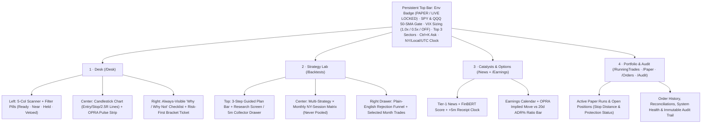

# TradingFlow UI 2.0 Redesign Plan — Simple, Accessible, Answers at Your Fingertips

> [!IMPORTANT]
> **Design Proposal Only (Awaiting Your Approval):** No UI source files have been modified yet. Under [AGENTS.md](file:///c:/project/trading_flow/AGENTS.md), all Razor/CSS/JS presentation changes remain strictly separated from C# engine, risk, and execution logic, preserve existing routes and safety locks, and keep monthly NY-session non-pooled reporting intact.

---

## 1. Visual Concept Mockups

````carousel

<!-- slide -->

<!-- slide -->

<!-- slide -->

````

---

## 2. Why Redesign Now? (Concrete Diagnosis of Today's UI)

Inspecting [_Layout.cshtml](file:///c:/project/trading_flow/src/TradingFlow.Web/Pages/Shared/_Layout.cshtml), [Desk.cshtml](file:///c:/project/trading_flow/src/TradingFlow.Web/Pages/Desk.cshtml), [Backtests.cshtml](file:///c:/project/trading_flow/src/TradingFlow.Web/Pages/Backtests.cshtml), [_LabResults.cshtml](file:///c:/project/trading_flow/src/TradingFlow.Web/Pages/Shared/_LabResults.cshtml), and [site.css](file:///c:/project/trading_flow/src/TradingFlow.Web/wwwroot/css/site.css) highlights four concrete friction points:

| Friction Point Today | Where It Happens | Impact on Daily Trading & Research |
|---|---|---|
| **1. Important answers require 3–5 clicks or page hops** | Market Regime (`SPY`, `QQQ`, `FRED VIXCLS` risk scale, Top-3 Sectors) has no global header; Desk hides `#watch-strategy-checks` inside a collapsed `<details id="watch-evidence">` below the chart. | You cannot tell at a glance *"Are longs allowed today, is VIX at half-risk, and which exact rule blocked AAPL?"* without scrolling and expanding accordions. |
| **2. Navigation sprawl across 7 sidebar menus + 18 pages** | `Desk`, `Preparation`, `Trading` (`/Orders`, `/RunningTrades`, `/OrderTicket`), `Strategies` (`/Paper`, `/Backtests`, `/Audit`, `/ResearchLedger`), `Earnings`, `News`, `Stock groups`, plus `Health` & `Warm-up`. | Related workflows (e.g., Earnings + Tier-1 News + OPRA Implied Move, or Saved Plan + Monthly Comparison) are split across separate destinations. |
| **3. Strategy Lab walls of fields & 1-job-at-a-time results** | `Backtests.cshtml` stacks 25+ inputs and 64-char SHA-256 hashes in one long left form; `_LabResults.cshtml` renders **1 strategy × 1 month** per page reload. | Running and comparing 10 swing strategies across 6 months (`May`–`Oct`) requires clicking 10 separate job links and 6 month dropdown reloads (`60` views instead of `1` matrix). |
| **4. 12 layered CSS files & harsh red-accent palette** | `_Layout.cshtml` loads 10 global CSS files plus page CSS; Light mode uses vermilion red (`#ec3013`) as `--color-accent` and plain black ink (`--color-text`) for gains with `0px` square corners. | Normal action buttons look like danger/error alerts, positive gains blend into neutral text, and component spacing drifts across screens. |
| **5. Stale, jargon-heavy banners & clipped step pills** | `_PreparationSummary.cshtml` renders a prominent *"Today's preparation"* banner on Desk even when the schedule has been paused for days (`Target session 2026-11-16 · evidence expired · saved schedule paused`) and clips `"Morning collection needed"` mid-word (`"Morning collection nee"`). | Pushes Desk stocks and charts down the screen, looks like a broken system error when nothing is wrong, and cuts off text on standard widths. |

---

## 3. Inspiration from Leading Trading & Quant Platforms

We borrow specific, proven interaction patterns—adapted to TradingFlow's swing-only, rule-governed workflow:

1. **Koyfin (Macro Pulse & Financial Matrices):**
   - A permanent, calm **1-line Market & Sector Pulse bar** across the top of the app.
   - Clean, right-aligned **Strategy × Month matrices** with subtle tinted cells (`▲ +3.42%` / `▼ −0.85%`) where every number aligns vertically and clicking a cell drills into underlying trades.
2. **TradingView (3-Pane Ergonomics & Chart Price Lines):**
   - Zero-scroll **3-pane Desk** (`Compact Scanner | Chart + Sub-Strip | Decision Inspector`) with keyboard `↑`/`↓` ticker stepping.
   - Plotting **Entry, Initial Stop (`1.0 ATR`), and Target (`2.5R`)** directly as horizontal levels on the stock chart so reward-to-risk is visual, not mental math.
   - Global **`Ctrl+K` / `/` Quick-Answer Command Bar** for instant ticker lookup and plain-English rule checks.
3. **Robinhood Legend & Public.com (Plain-English Readiness & Risk-First Tickets):**
   - Replacing cryptic rejection codes (`min_average_range_pct_not_met`) on screen with **human sentences** (*"20-day ADR is 1.82% — needs ≥ 2.50%"*, keeping the exact canonical code in a hover tooltip / audit copy).
   - **Risk-First Ticket:** Showing **Max Dollar Risk (`\$500 · 0.5% equity`)** and **Stop Distance** *before* share count so position sizing is immediately transparent.
4. **Composer.trade & QuantConnect (Guided Lab & Progressive Disclosure):**
   - Replacing a 25-field sidebar form with a **3-Step Guided Bar** (`① Screen & Window` → `② Strategy Set` → `③ Capital & Replay`) plus 1-click selection pills (`Select All Long Swing V1`, `Select All Short Swing V1`), tucking SHA-256 hashes inside a verified `ⓘ Provenance` popover.

---

## 4. Information Architecture: From 7+ Menus to 4 Clear Workspaces

All existing Razor URLs remain intact (zero broken links or bookmarks), organized under **4 clear primary workspaces** plus a persistent **Top Market Regime Bar**:



---

## 5. Accessibility, Typography & Visual System (WCAG 2.2 AA+)

> [!TIP]
> **Safety Through Calm Visual Hierarchy:** In trading software, bright red/orange must be reserved strictly for **losses, vetoes, cancellations, and live-money warnings**—never for ordinary primary buttons or active navigation tabs.

- **Three Contrast-Verified Themes (`Calm Light`, `Slate Dark`, `Colour-Blind High-Contrast`):**
  - **Calm Light:** Warm Alabaster background (`#F8FAFC`), crisp White cards (`#FFFFFF`), Slate-900 ink (`#0F172A`, `16.8:1` contrast), Cobalt primary action (`#2563EB`, `5.1:1`).
  - **Slate Dark:** Deep Slate-950 ground (`#0B111B`—never harsh `#000000` pitch black), Slate-900 cards (`#131C2B`), Ice-100 ink (`#F1F5F9`, `15.4:1`), Sky-Blue primary action (`#3B82F6`).
  - **Semantic Gain / Loss (Colour-Blind Safe by Default):**
    - **Positive / Pass:** Deep Teal (`#0F766E` light / `#2DD4BF` dark) + **`▲ +` / `✓`**.
    - **Negative / Veto / Stop:** Burnt Coral-Rose (`#BE123C` light / `#FB7185` dark) + **`▼ −` / `✕`**.
    - **Caution / Half-Risk (`VIX 18–22`):** Warm Amber (`#B45309` light / `#FBBF24` dark) + **`◐ 0.5×`**.
    - *Rule:* No status or P&L number is ever communicated by colour alone.
- **Financial Typography & Table Ergonomics:**
  - `Inter` (UI labels & plain-English explanations) + `JetBrains Mono` / `font-variant-numeric: tabular-nums` on every price, percentage, clock, and table cell so digits never jitter.
  - Right-aligned numeric columns, sticky header + sticky left Ticker/Strategy column, comfortable `40px` minimum click/touch targets (WCAG 2.5.8), and `2px` high-contrast keyboard focus rings.
- **Stylesheet Consolidation:**
  - Replace the 12 overlapping CSS files with **3 clean, maintainable files**:
    1. `wwwroot/css/tokens.css` (palette, spacing, type scale, radii, shadows, theme variables)
    2. `wwwroot/css/components.css` (buttons, badges, cards, tables, drawers, command palette, tooltips)
    3. `wwwroot/css/workspaces.css` (Desk 3-pane grid, Lab stepper & matrix, Catalysts hub, Portfolio tabs)

---

## 6. Key "Answers at Your Fingertips" Improvements by Screen

### A. Global Top Regime Bar + `Ctrl+K` Instant-Answer Palette
- **Top Bar (1 read-only lightweight endpoint `GET /api/v1/workspace/regime-pulse`, cached 60s):**
  - Displays `SPY` 50-SMA status (`Rising ▲` / `Falling ▼` / `Mixed`), `QQQ` Nasdaq gate, previous-session `FRED VIXCLS` close + active sizing multiplier (`Longs 1.0×` / `0.5×` / `OFF`, `Shorts OFF` / `0.5×` / `1.0×`), Top-3 12-1 Sector ETFs (`XLI · XLV · XLF`), and Paper Readiness (`Ready ✓`).
- **`Ctrl+K` Palette:**
  - Type any symbol (`AAPL`, `NVDA`), strategy name, or navigation target to see an instant summary card (Price, 20d ADR%, OPRA Implied Move, and plain-English strategy gate status) or jump straight to Desk / Lab / Audit.

### B. Desk (`/Desk`) — 3-Pane Zero-Scroll Layout
- **Left Pane (Compact 5-Column Scanner):** Replaces the 10-column horizontal-scroll table with `Stock`, `Mid & Day %`, `ADR% · RVOL`, `News / OPRA`, and `Status Pill` (`✓ READY`, `◐ NEAR`, `✕ GATE OFF`), plus 1-click filter tabs (`All`, `Ready`, `Near`, `Held`, `Rejected`) and `↑`/`↓` keyboard row stepping.
- **Center Pane (Chart + OPRA Pulse):** Draws strategy `Entry`, `Stop`, and `2.5R Target` reference lines on the chart when a strategy is selected, with the compact OPRA Options Pulse (`ATM Implied ±%`, `25Δ Skew`, `Implied / ADR`) directly underneath.
- **Right Pane (Always-Visible Decision Card & Risk-First Ticket):** Pulls `#watch-strategy-checks` out of the buried `<details>` block into the primary right panel, translating machine codes into plain English (with exact audit details expandable underneath) above a clean Risk-First Order Ticket.

### C. Strategy Lab (`/Backtests`) — Guided Plan Bar & Multi-Strategy Monthly Matrix
- **3-Step Guided Bar:**
  - `① Universe & Dates`: Pick published Research Screen (or open the `Research Screens & 5m Bars` drawer right inline) + quick date presets (`May–Oct 2026 Diagnostic`, `Last 6M`, `Custom UTC`).
  - `② Strategies`: Quick filter/select pills (`All 5 Long Swing V1`, `All 5 Short Swing V1`, `Clear`) + readable strategy cards; 64-character SHA-256 hashes move into a clean `ⓘ Exact Artifact Identity` popover.
  - `③ Capital & Replay`: Profile selector (`swing-research-screen-profile.yaml` pre-fills `\$100,000`, `0.5%` risk, `20%` max notional, `10` positions, `5m RTH replay`, `GroupSize = Pool Size` automatically when a research screen is chosen!).
- **Saved-Plan Monthly Matrix (`GET /api/v1/backtests/plans/{id}/monthly-matrix`):**
  - Reads the immutable `MonthlyRunResult` records across all jobs of a saved plan so all 10 strategies display **side-by-side by NY session month (`2026-05` .. `2026-10`)** on one screen—strictly monthly `%` of month-opening equity with explicit valuation labels, **never** pooled or accumulated across months or strategies.
  - Clicking any row/month opens a slide-over **Plain-English Diagnostics & Trade Drawer** showing why candidates were rejected (`Market Regime Off`, `VIX Gate`, `ADR < 2.5%`) plus individual trades with gap-inflation and Top-3 sector badges.

---

## 7. Phased, Reversible Implementation Plan

Each checkpoint stays small, independently testable (Playwright UI specs + focused `.NET` endpoint tests), reviewed by two independent reviewers, and installed on `C:\project\tradingflow-site`:

| Checkpoint | Scope | Affected Files | Est. Effort |
|---|---|---|---|
| **UI-1: Design System, Shell & Global Regime Pulse** | Consolidate 12 CSS files into `tokens.css`, `components.css`, `workspaces.css` (`Calm Light`, `Slate Dark`, `CVD`); 4-workspace nav rail; read-only `GET /api/v1/workspace/regime-pulse` header strip; `Ctrl+K` palette. | `_Layout.cshtml`, `wwwroot/css/*`, `wwwroot/js/theme.js`, `WorkspacePulseEndpoints.cs` | 1 checkpoint |
| **UI-2: Desk 3-Pane "Answers at Fingertips"** | 5-column compact scanner + `↑`/`↓` keyboard nav; always-visible right-hand Plain-English Strategy Readiness Card & Risk-First Ticket; Chart `Entry`/`Stop`/`2.5R` lines + pinned OPRA strip. | `Desk.cshtml`, `_OptionsSentimentPanel.cshtml`, `_StockChart.cshtml`, `watch-desk.js` | 1 checkpoint |
| **UI-3: Strategy Lab Guided Stepper & Saved-Plan Monthly Matrix** | 3-Step Guided Bar, auto-`GroupSize` on research screens, 1-click Long/Short V1 pills, `GET /api/v1/backtests/plans/{id}/monthly-matrix`, side-by-side `Strategy × Month` matrix + Rejection Funnel drawer. | `Backtests.cshtml`, `_LabResults.cshtml`, `BacktestPlanEndpoints.cs`, `run-workflow.js` | 1 checkpoint |
| **UI-4: Unified Catalysts & Options Hub + Portfolio Polish** | Unified `Catalysts & Options` triage view (`News` + `Earnings` + `OPRA Implied vs ADR%` cards) and unified `Portfolio & Audit` tab bar across `/RunningTrades`, `/Paper`, `/Orders`, `/Audit`, plus mobile responsive cards. | `News.cshtml`, `Earnings.cshtml`, `RunningTrades.cshtml`, `Audit.cshtml` | 1 checkpoint |

---

## 8. Isolated Branch, Worktree & Side-by-Side Preview Setup (Created & Ready)

Because the running operator site on `http://127.0.0.1:10088` (`C:\project\tradingflow-site`) sets its working directory to `C:\project\trading_flow` and serves static `wwwroot/css` and `wwwroot/js` directly from there, switching branches inside `C:\project\trading_flow` would alter `:10088`'s live assets immediately. To keep `:10088` 100% untouched while building and testing UI 2.0 side-by-side:

- **Git Branch & Worktree:** `ui/redesign-v2` checked out in `C:\project\trading_flow-ui2` (branched from `main` at `d4b4688`; `C:\project\trading_flow` remains on `main` untouched).
- **Separate Preview Site Directory & Port:** `C:\project\tradingflow-site-ui2` configured to run on **`http://127.0.0.1:10089`** ([update-site.ps1](file:///c:/project/tradingflow-site-ui2/update-site.ps1), [start-site.ps1](file:///c:/project/tradingflow-site-ui2/start-site.ps1), [run-dotnet.cmd](file:///c:/project/tradingflow-site-ui2/run-dotnet.cmd))—not started until the UI checkpoints are built and reviewed.
- **Zero-Contention Data & Feed Isolation on `:10089`:**
  - `TRADINGFLOW_DISABLE_RUNTIME=true`, `TRADINGFLOW_ENABLE_MARKET_FEEDS=false`, `TRADINGFLOW_ENABLE_FINVIZ_SCREEN_CAPTURE=false` so `:10088` retains sole ownership of your Alpaca SIP websocket, Finviz captures, and background workers.
  - `TRADINGFLOW_DATA_ROOT=V:\trading_flow\data-ui-preview` seeded via an online SQLite backup of `tradingflow.db` + `data-protection-keys` + read-only junction to `research/`, so `:10089` never writes to `:10088`'s live `tradingflow.db`.

---

## 9. Decisions to Confirm Before Starting Checkpoint UI-1

1. **Default Theme Preference:** Prefer **Slate Dark** (Mockup 1) or **Calm Daylight Light** (Mockup 2) as the default appearance on first load (keeping the 1-click `Light / Dark / Colour-Blind / System` switcher in the top bar)?
2. **4-Workspace Navigation Grouping:** Happy collapsing the 7 current sidebar items into **`Desk` · `Strategy Lab` · `Catalysts & Options` · `Portfolio & Audit`** (keeping all existing URLs working)?

## Checkpoint UI-1 status (2026-11-20)
Implemented: ui2-foundation.css (Slate Dark default, Calm Light, colour-blind), 4-workspace nav with sub-tabs, regime strip + GET /api/v1/workspace/regime-pulse, Ask/Jump button, theme toggle. Verification: 7 focused tests (WorkspacePulseTests) pass; Razor and C# compile clean. **Independent plan and code reviews NOT yet done** (model quota exhausted) - required before this checkpoint counts as complete or is published to :10089.
