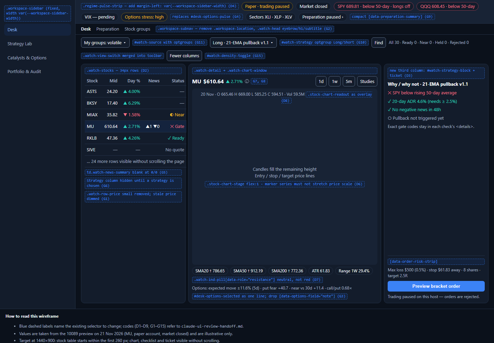

# UI 2.0 review handoff for Antigravity — 21 November 2026

Reviewer: Claude (Claude Code), at the user's request. Branch reviewed: `ui/redesign-v2` at
`31ddb98` (checkpoints UI-1 to UI-7). The review covered the running preview on
`http://127.0.0.1:10089` at a 1440×900 viewport, the mockups listed in
`docs/design-review/2026-11-20/ui-redesign-v2-plan.md`, and the branch code.

Scope limits from the user:

- **Strategies are out of scope.** Antigravity is adding strategies separately; this note
  does not ask for strategy, catalog, engine, risk or order changes.
- These are **suggestions, not approved designs.** Under `AGENTS.md` ("User Design Approval
  Required"), present the concrete design for any item below to the user and get explicit
  approval before implementing it.

Visual plan: open [`desk-layout-wireframe.html`](desk-layout-wireframe.html) in a browser. It
draws the proposed Desk and labels every region with the existing class name or id to
change, so each box maps to a selector in this note. A rendered copy at 1440×1000 is below.

---

## 1. Keep these (they work)

- Token palette in `wwwroot/css/ui2-foundation.css`: blue for actions, teal for gains, rose for
  losses, plus the `cvd` colour-blind theme. Ordinary buttons no longer look like errors.
- Equal-width digits (`font-variant-numeric: tabular-nums`) and the `:focus-visible` ring.
- Four workspaces with `.workspace-subnav` sub-tabs; every old route still resolves.
- Lab Strategy × Month table (`.lab-matrix-table`, `renderSavedPlanMatrix` in
  `run-workflow.js`). It shows separate monthly results only, with no pooled or running-total
  columns. The Lab mockup image showed pooled `Trades / Win % / Max DD` columns; do not add those.
- Plain-English check pills (`humanizeCheck`) and the risk-first ticket strip
  (`[data-order-risk-strip]`).

## 2. Defects observed in the preview

| # | What was seen | Where | Suggested fix |
|---|---|---|---|
| D1 | The stock table starts at y = 814 px on a 900 px-high window, so no stocks are visible without scrolling. | Desk. Space above it is taken by `.watch-head`, `[data-preparation-summary]`, `#desk-options-pulse`, `.watch-toolbar`, `.watch-view-switch`, `.watch-view-head`. | Apply the grouping in section 3 (items G1, G2, G4, G9). Target: table top within the first 260 px. |
| D2 | Table rows are 98.5 px tall, so about 5 of 30 stocks fit in the 340 px-wide column. | `td.watch-news-summary` renders `0 positive` / `0 negative` / `Last 1h · partial` on five wrapped lines. | See G5. Target row height 32–36 px. |
| D3 | The "why / why not" checklist from the mockup is not beside the chart. With `.watch-grid` at `minmax(260px,3fr) minmax(560px,7fr)`, `#watch-strategy-block` sits below the chart and options strip. | `Desk.cshtml`, `.watch-grid`, `.watch-detail` | Third column at ≥1440 px: `grid-template-columns: minmax(260px,26fr) minmax(480px,48fr) minmax(260px,26fr)`; move `#watch-strategy-block` and the order ticket entry into it. Below 1440 px it can become a tab next to the chart. |
| D4 | The SPY chip in the regime strip is hidden behind the fixed sidebar; the strip reads "QQ ▼ Shorts ON…". Measured: strip `left = 0`, sidebar is `position: fixed` over it. | `.regime-pulse-strip` (`_Layout.cshtml`), `.workspace-sidebar` (`desk-theme.css:58`) | Add `.workspace-authenticated .regime-pulse-strip { margin-left: var(--workspace-sidebar-width); }`, the same offset `.topbar` already uses (`desk-theme.css:73`). |
| D5 | Chips show "▼ Shorts ON 689.81" with no label for the number (price or moving average?). | `regime-pulse.js` | Say what it is: "SPY 689.81 · below 50-day · shorts on". |
| D6 | On the Desk daily chart for MU, a vertical column of blue dot markers near 20 Nov reaches about 1,400 while the price is about 610. The price scale stretches to fit them and the candles flatten. The cause was not traced. | `.stock-chart-plot` with Desk defaults (`defaultInterval: '1d'`, `onZones`) | Find which marker series draws them on 1d. Markers outside the candle range should not be allowed to change the price scale. Compare with `/Chart?symbol=MU` on main, which drew pivot markers on 5m without this. |
| D7 | Resistance pills are red/rose. The plan's own rule reserves red for losses, vetoes and live-money warnings. | `.watch-ind-pill[data-role="resistance"]` (`ui2-foundation.css` ~line 378) | Neutral or amber outline; keep a "↑"/"↓" or "support"/"resistance" word so meaning never depends on colour. |
| D8 | The chart gets about 45% of its panel height. The rest is the last-candle card and navigation buttons. | `.stock-chart-readout` (open/high/low/close card with ←/→), `.stock-chart-navigation` (`Load earlier`, `Go to latest`, `Chart details`) | Make the readout one line overlaid on the chart (crosshair legend); move the navigation buttons into an icon row or into `Studies & settings`. Let `.stock-chart-stage` fill the remaining height. |
| D9 | Earnings page shows an empty bordered box when there are no results. | `/Earnings` results area | Proper empty state: one line saying what will appear and when. |

## 3. Information to remove or group

| # | Repeated or unneeded now | Selectors | Suggestion |
|---|---|---|---|
| G1 | "Market closed" appears 5 times: status bar, Desk header line, every table row (`<small>` in `.watch-row-price`), chart header, and "Trading is paused…" under the options strip. | `.workspace-status`, `.watch-head`, `.watch-row-price small`, `.stock-chart-head`, `#watch-order-help` | State it once in the status line. In rows, dim stale prices (`.watch-stale`) and keep the detail in the `title` tooltip, which already holds it. |
| G2 | The page location is named 5 times: breadcrumb `Workspace / Desk`, sidebar, sub-tab, `MARKET WORKSPACE` eyebrow, and `<h1>Desk</h1>` plus subtitle. | `.workspace-location`, `.watch-head .eyebrow`, `.watch-head h1`, `.watch-head p` | Keep sidebar + sub-tab. Remove the eyebrow and subtitle; replace the `<h1>` with a visually hidden heading (`.sr-only`) for screen readers. |
| G3 | Each options card shows 4 numbers, then a sentence repeating the same 4 numbers. | `[data-options-field="note"]` in `.watch-options-card` | Remove the sentence. Move "2733 liquid contracts" into the card `title`. |
| G4 | SPY/QQQ options cards on the Desk while SPY/QQQ already appear in the regime strip. | `#desk-options-pulse` with `[data-options-slot="spy"]`, `[data-options-slot="qqq"]` | Replace with one `.regime-chip` "Options stress: high/normal" (tooltip has the numbers); full SPY/QQQ cards live in Catalysts. Keep `#desk-options-selected` for the chosen stock. |
| G5 | News cell: "0 positive / 0 negative / Last 1h · partial" in every row. | `td.watch-news-summary`, `.watch-news-window` | Blank when both counts are 0; otherwise a compact `▲2 ▼1`. Move "last hour, partial" to the `<th>` tooltip. |
| G6 | "Not selected" in the Strategy column × 30 when no strategy is chosen. | `signalLabel()` in `watch-desk.js`, `.watch-strategy-col` | Hide the Strategy column until a strategy is chosen; then show only `✓ Ready` / `◐ Near` / `✕ Gate`. |
| G7 | Price shown 4 times for the open stock: big price, "bid/ask midpoint…" line, Buy button, Sell button. | `.watch-focus` header | Big price plus Buy/Sell buttons; bid/ask and spread in a tooltip. |
| G8 | "History only · Daily candles are the provider's completed SIP daily series" and "Completed candles only". | `.stock-chart-head`, `[data-chart-completed-note]` | One info icon with a tooltip. |
| G9 | The preparation card still shows the paused 16 Nov schedule on 21 Nov. | `[data-preparation-summary]` | When compact (paused or expired), render as a chip at the end of the status line ("Preparation paused ›") rather than a card. Keep the existing rule that active or failed steps are never compacted. |
| G10 | Strategy dropdown entries are long sentences ("…V2-01 MTR-14 treatment, SPY/QQQ falling-average gate…"). | `#watch-strategy` | `<optgroup label="Long">` / `<optgroup label="Short">`; option text = short name + version ("21-EMA pullback · v1.1"); full text in `title`. (Labels only; no strategy change.) |
| G11 | Stock-group dropdown rendered as one flat list of about 50 items: your groups, earnings lists, about 40 Finviz signals. | `#watch-source`; `watch-desk.js` already builds `<optgroup>` when an item has a group (line ~138) | Make sure every item carries a group: "My groups", "Earnings", "Finviz signals". |
| G12 | Lab: "RESEARCH ONLY" tag and "ⓘ Provenance" on all 10 cards; cards sorted A–Z with long and short mixed. | `.lab-strategy-option .tag`, `.lab-provenance-popover`, `.lab-strategy-list` | One note above the list ("All listed strategies are research only"); show the tag only on cards whose status differs. Two columns via existing `[data-direction="long"]` / `[data-direction="short"]`. |
| G13 | News items are 5-line cards with "Provider symbols:" and "Inferred display labels" labels. | `_NewsEvidence.cshtml`, `news-evidence.js` (`.news-timeline-meta`, `.news-topic-labels`) | One row per story: sentiment chip · ticker · headline · time. Labels go into tooltips. |
| G14 | Footer help: "Buy shows the ask and Sell the bid…" and "Discovery and preparation are advisory…". | `.watch-fine` under the table, `.watch-footer` | Move into tooltips on the Buy/Sell buttons and the status line. |
| G15 | Button text "Compact 5-col". | `#watch-density-toggle` | "Fewer columns" / "All columns". |

## 4. Code and process notes

- **Style files layered on top of each other.** `ui2-foundation.css` loads last and beats older
  rules by raising specificity, for example `.workspace-app .watch-desk .watch-toolbar …` and
  `html body.workspace-app …`. Plan section 5 promised a later merge into `tokens.css`,
  `components.css` and `workspaces.css`. Doing that before more screens are restyled stops
  each change needing a stronger selector than the last.
- **Global button height.** `.btn, .btn-md, button, select.input, input.input { min-height: 40px; }`
  also enlarges chart toolbar, candle-step and pill buttons. Scope it to form controls and
  primary actions, or use `.btn` only.
- **Joined lines in `_Layout.cshtml`.** `};    var systemPages = …` and `}        @RenderBody()`
  each put two statements on one line. Split them.
- **Stale plan header.** `ui-redesign-v2-plan.md` still opens with "No UI source files have been
  modified yet". Its mockup links point to `C:/Users/manis/.gemini/antigravity/brain/…`, which
  is outside the repository, so other readers cannot open them. Copy the final mockups into
  `docs/design-review/2026-11-20/` or drop the links.
- **Question for the user, not a change:** the Desk strategy dropdown lists
  `swing.connors-rsi2 · 9.0.0 · recorded · paper_experiment`, while `AGENTS.md` records Connors
  RSI-2 as retired on 13 November 2026. Confirm whether it should appear.

## 5. Suggested order

1. D4, D5, D7 and the `_Layout.cshtml` line splits: small fixes, no layout decision needed.
2. G1–G9 and D1, D2, D8: free up the Desk's first screen.
3. D3: three-column Desk with the checklist beside the chart (the wireframe).
4. D6: chart marker investigation.
5. G10–G15 and the stylesheet merge.

Each step still needs the user's design approval and the two independent reviews required by
`AGENTS.md` before it is marked complete.
