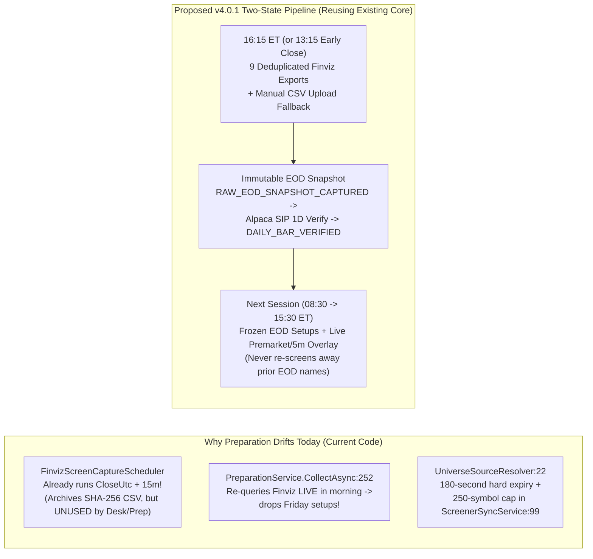

# Finviz EOD Candidate Freeze & Unified Trading v4.0.1 — Verification, Audit & Implementation Plan

> [!IMPORTANT]
> **Design Proposal Only (Awaiting Your Approval per [AGENTS.md](file:///c:/project/trading_flow/AGENTS.md)):** Read-only codebase and quant verification was executed by **Gemini 4 Neon High** (`finviz-neon-verifier`) and **Gemini 4 Carbon High** (`finviz-carbon-analyst`). Zero implementation files in `C:\project\trading_flow` have been modified yet.

---

## 1. Executive Verdict on Your Finviz EOD Freeze Proposal

Your core diagnosis—**freeze the Finviz candidate scan after market close, store raw exports immutably, verify OHLCV & indicators independently on completed consolidated `1D` bars, and overlay live premarket/intraday quotes & volume without overwriting yesterday's setup**—is **100% sound**.

During verification, the Neon + Carbon audit confirmed **why your current morning workflow drifts in code today** and uncovered **two subtle traps in the 22 Finviz URLs** plus an **80% API call optimization (`44 → 9` calls)**:

### A. Two Subtle Traps Found in `Finviz_Elite_v4_Manual_Screens.csv` (And How the Plan Fixes Them)

| Trap Found in the 22 Screen URLs | Concrete Failure Mode if Unaddressed | Clean Architectural Fix |
|---|---|---|
| **1. `ta_changeopen_u / d` on `S3` & all Intraday (`OD5`, `ORB30`, `VWAP`, `FLAG5` — 10 of 22 rows)** | At Friday `16:15 ET`, `ta_changeopen_u` only matches stocks where **Friday's** close beat **Friday's** open (`C > O`). A stock that closed `-0.2%` on Friday and then reports earnings Friday `16:30 ET` or releases FDA/guidance news Monday `07:30 ET` (a textbook `S3` or `OD5`/`ORB30` play!) is **100% omitted** by `focus_url` at Friday `16:15 ET`. | Use the `16:15 ET` **shared `broad_url`** (~1,400 liquid US stocks regardless of Friday candle color, pre-caching Friday `ATR14_1D` & 20d 5m slot medians) **unioned** in `current_session_live` with post-close/premarket Alpaca News catalysts + `09:00 ET` `BeforeOpen` / live SIP gap movers (`allow_additional_same_day_momentum_or_catalyst_candidates`). |
| **2. `focus_url` is stricter than v4 Hard Rules on `S4-S`, `S4-L`, and `S1P`** | • `S4-S` `focus_url` requires `ta_perf_1w10o` (`>= +10%`), silently dropping `+8.0%..+9.9%` exhaustion shorts that **pass** v4's `5d_gain >= +8%` hard rule. • `S4-L` requires `ta_perf_1wdown` (`5d < 0%`), dropping stocks that rallied Mon–Tue then fell Wed–Fri to `RSI2 < 10`. • `S1P-L` requires `ta_sma50_pa`, whereas v4 `S1P-L` only requires `EMA21` slope or 20d return. | Every `focus_url` is algebraically `broad_url + ta_*`. Evaluate all C# v4 strategy hard rules over the **1 shared `broad_url` (~1,400 stocks, `< 50 ms` on cached SIP `1D` bars)** so zero valid setups are dropped by Finviz proxies; record `focus_url` hits strictly as provenance/discovery tags. |

### B. Exact Finviz API Deduplication (`44` URLs → **`9` Unique HTTP Calls**)
Across all 22 rows in `Finviz_Elite_v4_Manual_Screens.csv`:
- All **22 `broad_url`s are 100% identical** (`cap_midover,geo_usa,sh_avgvol_o1000,sh_price_o10` = **1 query**).
- All **22 `focus_url`s collapse into 8 unique queries** (`S1P/S1C` share 1 per side; `S2/DON20/DON55` share 1 per side; `S3/OD5/ORB30/VWAP/FLAG5` share 1 per side; `S4` has 1 per side).
- **Result:** Capturing all 22 focused + fallback screens requires **only 9 HTTP calls total**, fitting comfortably inside Finviz Elite's `10 calls / rolling 5s` rate limit in a single ~5-second burst!

---

## 2. Codebase Verification: What TradingFlow Already Has vs. Why Morning Drift Happens Today

Inspecting `C:\project\trading_flow` on `main` revealed that **~70% of the heavy infrastructure already exists**, along with **4 specific code behaviors** that currently defeat EOD freezing:

### Reusable Capabilities Already in `C:\project\trading_flow`
1. **Calendar-Aware `16:15 ET` (`CloseUtc + 15m`) Capture & SHA-256 Archival:** [FinvizScreenCaptureScheduler.cs](file:///c:/project/trading_flow/src/TradingFlow.Web/Services/ScreenCaptures/FinvizScreenCaptureScheduler.cs#L217-L222) already uses the Alpaca exchange calendar (handling NY DST and `13:00 ET` early closes -> `13:15 ET`) with atomic byte-exact CSV + `.manifest.json` archival in [FileSystemRawArchiveWriter.cs](file:///c:/project/trading_flow/src/TradingFlow.Engine/Storage/FileSystemRawArchiveWriter.cs#L51-L106), `auth=` secret redaction, fenced SQLite leases, and HTTP `429 Retry-After` handling.
2. **Core v4 Indicators & FRED VIX Already Implemented:** [IndicatorEngine.cs](file:///c:/project/trading_flow/src/TradingFlow.Engine/Indicators/IndicatorEngine.cs#L131-L445) already computes `EMA21`, `SMA50`, `SMA200`, Wilder `ATR14`, `RSI14`, **`RSI2`**, population-stddev **`Bollinger(20, 2)`**, `PriorBollingerWidthPercentile` ([SignalGenerator.cs](file:///c:/project/trading_flow/src/TradingFlow.Engine/Signals/SignalGenerator.cs#L427-L439)), `VWAP`, 20-session median `RVOL` (both daily and same-clock-slot `SlotRelativeVolume`), and previous-session `FRED VIXCLS` ([VixRegime.cs](file:///c:/project/trading_flow/src/TradingFlow.Engine/Regime/VixRegime.cs)).

### Four Exact Code Gaps to Fix in Phase A
1. **Morning Re-Screening Bug ([PreparationService.cs](file:///c:/project/trading_flow/src/TradingFlow.Application/Preparation/PreparationService.cs#L252-L270)):** Morning collection currently re-queries Finviz live and either intersects or replaces Friday's list—dropping valid Friday setups when premarket quotes/RVOL change.
2. **3-Minute Expiry & Pre-Open Handoff Cutoff ([UniverseWorkflowAdapters.cs](file:///c:/project/trading_flow/src/TradingFlow.Web/Services/UniverseWorkflowAdapters.cs#L22), [PreparationService.cs](file:///c:/project/trading_flow/src/TradingFlow.Application/Preparation/PreparationService.cs#L303-L371)):** `DefaultSourceExpirySeconds = 180` expires Finviz snapshots after **3 minutes**, and `HandoffUntilUtc` blocks handoff at `09:30 ET` instead of keeping frozen swing setups active until **`15:30 ET`** order expiry.
3. **250-Row Cap, `/export.ashx` Normalization & Shared Rolling `10/5s` Limiter ([ScreenerSyncService.cs](file:///c:/project/trading_flow/src/TradingFlow.Web/Services/Wishlists/ScreenerSyncService.cs#L99), [FinvizClient.cs](file:///c:/project/trading_flow/src/TradingFlow.Finviz/FinvizClient.cs#L21-L61)):** `MembershipLimit = 250` truncates a ~1,400-row `broad_url` export; `FinvizClient` uses a concurrency bulkhead rather than a shared rolling `10 calls / 5s` limiter across services and strips `v=111`/`ft=4` on `/export.ashx`.
4. **Disconnected Catalog:** `SqliteFinvizCaptureCatalog` stores `AfterClose` captures observationally, with no query deduplication, no manual `S1_LONG_YYYY-MM-DD.csv` upload path, no `UNVERIFIED -> DAILY_BAR_VERIFIED` state machine, and no link into `PreparationService` / `Desk`.

---

## 3. Operating-Boundary & Governance Alignment ([operating-boundaries.md](file:///c:/project/trading_flow/docs/operating-boundaries.md))

> [!WARNING]
> **Four Non-Negotiable Boundary Alignments Built Into This Plan:**
> 1. **Forward Point-in-Time vs. Historical Backtests:** Frozen daily `16:15 ET` Finviz exports create a true point-in-time operational universe **from the first captured session forward** (manual CSV uploads imported *after* the next session opens are stamped `RETROACTIVE_IMPORT_DIAGNOSTIC` per `AGENTS.md`). Because Finviz has no historical as-of screener API, multi-month/year historical backtests cannot project today's Finviz list backward—they use a point-in-time Alpaca SIP daily `research_screen` (`unadjusted_close > $10`, `avg_vol > 1M`, PIT cap / dollar-volume proxy).
> 2. **US Equities via Alpaca Only (No CFDs):** References to short CFDs / eToro CFD financing in the v4 text remain inert/out of executable scope under `operating-boundaries.md` (`lines 23–31`); shorting checks use Alpaca equity `shortable` / borrow metadata.
> 3. **Intraday v2 (`OD5`, `ORB30`, `VWAP`, `FLAG5`) Backtest & Read-Only Telemetry First:** Per `operating-boundaries.md` (`line 106`), same-day strategies run with `paper_execution_enabled: false` (backtest + read-only Desk signal visibility) until an Intraday Paper Driver is separately designed and approved.
> 4. **Immutable `v1` Artifacts Preserved:** Existing `v1` swing strategies (`S1..S4`, `MTR-14`) remain untouched; `SWING-V4-RESEARCH` (`@4.0.0`), `STRATEGY-ADDONS-V2` (`@2.0.0`), and `INTRADAY-V2-RESEARCH` (`@2.0.0`) are registered as separate versioned artifacts, reported strictly monthly in NY session time per strategy version.

---

## 4. Proposed Phased Implementation Plan

| Phase | Scope & Reusable Changes | Key Files Affected | Est. Scope |
|---|---|---|---|
| **Phase A — Finviz EOD Freeze, 9-Query Capture, Clean v4 Dropdown, Manual CSV Import & Two-State Preparation/Desk** | • **Replace noisy Finviz dropdown clutter (`DeskSources.CatalogAsync`):** Remove the dozens of generic `FinvizSignalCatalog.All` chart-pattern presets (`Channel Up`, `Wedge`, `Head & Shoulders`, etc.) and legacy `BuiltIns` from the Desk & News `Group` dropdown, replacing them with two clean groups: **(1) `Frozen EOD (16:15 NY)`** (your immutable after-close snapshots) and **(2) `Finviz v4 screens`** (only the **9 deduplicated new v4 URLs**: `Broad US Liquid` + the 8 focused Long/Short v4 screens), while preserving your `My stock groups`, `Earnings`, and custom `saved:*` screens. • Shared singleton rolling `10 calls / 5s` rate limiter + `/export.ashx?v=111&ft=4` support + lift 250-row cap for EOD snapshots. • Embed the 22-screen manifest (`9` deduplicated queries by `(SessionDate, Kind, QuerySha256)`), archiving raw CSV + SHA-256 and fanning out immutable `EOD_CANDIDATES` rows. • Add manual dated CSV upload (`S1_LONG_YYYY-MM-DD.csv`) in Preparation UI/API preserving both `exchange_session_date` and `imported_at_utc`. • Two-step verification: `RAW_EOD_SNAPSHOT_CAPTURED` (`UNVERIFIED`) → verify completed Alpaca SIP `1D` bar & freeze `EMA21/SMA50/SMA200/ATR14/ATR20/RSI2/BB20_2/RVOL20` → `DAILY_BAR_VERIFIED`. • Fix `PreparationService` so premarket/intraday loads frozen EOD candidates **without re-screening them away**, removes the 180s expiry clamp (valid through next session `15:30 ET`), overlays live gap/news/shortability/5m `VWAP` & `time_slot_RVOL`, and unions same-day Alpaca News / `BeforeOpen` catalyst movers for `S3` & Intraday. | `DeskSources.cs`, `TradingFlow.Finviz/FinvizClient*.cs`, `SqliteFinvizCaptureCatalog.cs`, `PreparationService.cs`, `PreparationAdapters.cs`, `ScreenerSyncService.cs`, `Pages/Preparation.cshtml` | 1 checkpoint |
| **Phase B — Point-in-Time Historical `research_screen` Parity for v4 Backtests** | • Add `v4-broad-us-liquid` point-in-time daily screen preset (`unadjusted_close > $10`, `20d avg vol > 1M`, `260`-session warm-up floor, PIT cap / explicit dollar-volume proxy) + forward-date overlap diagnostic against captured Finviz `broad_url` snapshots. | `ResearchScreenBuilder`, `configs/backtest/` | 1 checkpoint |
| **Phase C — Shared Engine v4 Primitives, Soft Quality Score & Stop-Limit Execution** | • Add `ATR20` & `Donchian(20/55 -> 10/20)` to `IndicatorEngine`. • Add config-driven `quality_tags` (`PASS`/`FAIL`/`UNKNOWN`) + `quality_score = passed / measured` alongside hard rules. • Add v4 soft regime/VIX risk multiplier (`SPY` + Nasdaq/Tech `QQQ` 5d `SMA50` slope `UP`/`DOWN`/`MIXED` → `1.0 / 0.75 / 0.5`, `FRED VIXCLS > 26` `*0.5`, missing `*0.5`). • Add v4 swing next-session stop-limit (`trigger +/- 0.05*ATR14`, `0.5*ATR14` adverse cap, worst-case fill risk sizing, open-beyond-cap session cancel, `15:30 ET` expiry, Day-4/Day-10 `15:45 ET` time barrier, `max(2*spread, tick)` stop floor, `1.0%` daily drawdown halt, `max_per_symbol_across_modules: 1` with `DON55 > DON20`). | `TradingFlow.Engine/Indicators/*`, `Regime/*`, `Strategies/*`, `Execution/*`, `TradingFlow.Backtesting/*` | 1–2 checkpoints |
| **Phase D — Immutable v4 Swing, Donchian Add-Ons & Backtest-Gated Intraday v2 Artifacts** | • Author & hash-freeze `S1P`, `S1C`, `S2`, `S3` (`-> ORB30` non-catalyst route), `S4` (`@4.0.0`), `DON20`, `DON55` (`@2.0.0`), and backtest-only `OD5`, `ORB30`, `VWAP` (1–3 bar confirm), `FLAG5` (`p=4..12, k=2..8` tie-break) (`@2.0.0`) + acceptance tests **`T01..T21`**. | `configs/strategies/*`, `SignalGenerator.Setups.cs`, `TradingFlow.Tests/UnifiedV4AcceptanceTests.cs` | 1–2 checkpoints |

---

## 5. Decisions to Confirm Before Implementation

1. **Scope to Start First:** Start with **Phase A (Finviz EOD Freeze, 9-Query Capture, Manual CSV Import & Two-State Preparation/Desk)** first, or approve **Phases A–D** in sequence?
2. **Branch Target for Finviz Freeze / v4 Engine Work:** Build Phase A on `main` (so live `:10088` gets scheduled `16:15 ET` frozen Finviz captures immediately after review) or merge `ui/redesign-v2` into `main` first so UI 2.0 + Phase A share one unified branch?
