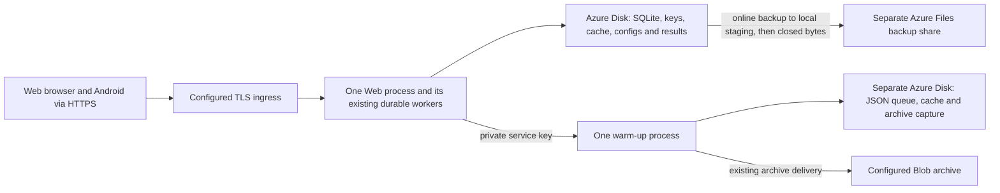

# Deployment ownership and service access — 21 October 2026

This records the P-01 implementation under the approved [implementation plan](../design-review/2026-10-19/07-implementation-plan-2026-10-21.md). These are source templates and verification instructions. No Azure infrastructure, Key Vault values, operator database or broker account was changed.

## The two persistent owners

Web owns the operational SQLite database and all existing in-process job workers. Its Deployment has one replica, `Recreate`, and a retained Azure Disk claim. There is no HPA or external worker Deployment in the active composition. `ReadWriteOnce` alone does not enforce one pod: the replica and replacement policy are also required. Do not scale this Deployment or mount its operational state into another writer without a separately reviewed migration.

Warm-up owns a separate retained disk. Its durable JSON queue, captured archive bytes and cache are not a second operational SQLite journal. Web accesses warm-up through its API, not through the warm-up volume. The provider candle caches are independent; no shared network filesystem is used for active operational SQLite.

Maintenance and disk reattachment can interrupt service. This deployment does not claim uninterrupted failover. Size the configured volumes and worker budgets for the measured workload; the template capacities are editable deployment inputs, not measured storage forecasts.

## Backups and recovery

`SqliteDatabaseBackupService` first creates, checks and closes a backup in `.backup-staging` beside the local operational database. The private copied database is converted to DELETE journal mode before closing, so the published file does not depend on WAL/SHM companions; the operational source stays in WAL mode. Publication rejects a copy with remaining journal companions. `IArtifactWriter` then publishes the closed bytes to `TRADINGFLOW_BACKUP_ROOT` and writes the existing hash/size manifest. Failed publication deletes only the owned staging file and its exact companions. Existing published backups are retained.

The production backup root is `/app/backups`, backed by a separate Azure Files share. Only completed backup artifacts use that share. Integrity checking of a published backup is read-only. An active operational database is never opened there.

Before a real deployment, rehearse recovery using a disposable database and the existing restore service: stop the Web owner, verify the backup manifest and file hash, restore onto local disk, run SQLite integrity checks, and only then restart Web. Copying an open `.db` without its transactional state is not a backup. Azure volume retention and a passing local fixture do not establish the operator's recovery time or acceptable data-loss window.

## Credentials, HTTPS and private calls

- Android retains the operator's saved HTTPS address, including an ngrok tunnel. There is no baked-in tunnel or LAN address. A new installation needs an explicit address in Settings. All requests pass the origin check before credentials or cookies reach transport; redirects are disabled. Release rejects cleartext HTTP. Debug permits only loopback and the Android emulator host bridge over HTTP.
- Web processes forwarded HTTPS only from its loopback defaults or configured `Transport:TrustedProxies`/`Transport:TrustedProxyNetworks`. Trust-all CIDRs are rejected. Production cookies are always secure; non-HTTPS application requests are rejected. `/health` remains available for private probes.
- The ingress controller must terminate TLS and send one trustworthy forwarding hop. Supply its actual network and namespace, class, public hostname and TLS secret when rendering; no proxy network or certificate is guessed.
- Warm-up protects all `/api/warmup` reads and mutations with `X-TradingFlow-Service-Key`. Configure the same private `WarmupService:ApiKey` on Web and warm-up; `TRADINGFLOW_WARMUP_SERVICE_KEY` is an explicit alternative host source. The browser and Android call the authenticated Web proxy and never receive that service key. Missing service configuration returns 503; missing or invalid authentication returns 401 before state changes.
- Warm-up production requires its own Alpaca key ID, secret key and service key. Missing names stop startup and are reported without values. Development may load only its own `appsettings.local.json`; neither environment searches ancestor directories or another application's secret file. Explicit blank environment credentials do not fall back to another source.
- Web and warm-up use their respective existing workload identities and matching SecretProviderClasses. The Bicep source binds their service accounts to the AKS OIDC issuer. These declarations have not been applied to Azure.

Rotate the shared service key in both host configurations and restart both owners. Singleton clients/providers do not promise live credential replacement. Internal warm-up HTTP is limited to loopback or private cluster service DNS; public service endpoints require HTTPS. The API key and network policy are complementary controls.

## Render, review, then authorize deployment

The authoritative composition is `deploy/aks/production`; the root AKS kustomization points there. Old external worker manifests were removed. Do not apply historical standalone deployment files or the earlier shared-SMB operational layout.

Run `deploy/azure/render-aks-production.ps1` with explicit `BicepOutputJson`, `ImageTag`, `PublicHostName`, `IngressClassName`, `IngressNamespace`, `IngressProxyCidr` and `TlsSecretName`. The Bicep output includes `tenantId`; rendering makes no Azure CLI request. Output must be a new child of `deploy/aks/rendered`. The renderer refuses links, existing output directories, trust-all proxy networks and unresolved placeholders. It never deletes previous output or deploys it.

Container contexts exclude local settings, environment files, databases/WAL, keys, caches, runtime data, evidence, results and scratch outputs. Deterministic source fixtures and configuration remain source inputs. A separate disposable image build with fake canaries must still confirm the resulting build context and image contain no excluded files.

## Verification status

- [x] Prepare the source ownership, access, origin and rendering changes described here.
- [x] Add focused transport/service-authentication, offline renderer, deployment-owner and backup publication tests.
- [x] Run transport/service authorization, renderer, deployment ownership and disposable SQLite backup/restore tests: the final 464-test integration report passed with zero failures. See [integration evidence](../verification/application-integration-2026-10-21.md).
- [x] Final Android Debug and Release builds passed with zero warnings/errors; merged Release manifest has `usesCleartextTraffic=false`. Actual phone interaction remains unverified.
- [ ] Build and inspect disposable Docker images with fake canaries. Docker was not found in this session's PATH.
- [ ] Validate rendered Kubernetes/Bicep resources and rehearse disposable recovery. Kubernetes/cloud deployment validation has not run.
- [ ] Obtain separate user authorization before creating resources, secrets, DNS, certificates or deploying an application.

Cloud costs require explicit region, VM count/size, disk and backup capacity, ingress, registry, monitoring and network assumptions. Editing or rendering these templates does not incur a cloud bill. The parent implementation record will carry the dated official-price evidence and its limits; no complete Azure bill is claimed here.

## Dated cost check and deployment sequence

A read-only Azure Retail Prices API query on **21 October 2026, 12:05:54 UTC** returned West Europe Linux consumption prices of **USD 0.23/hour for Standard_D4s_v5** and **USD 0.46/hour for Standard_D8s_v5**, excluding Windows, Spot and Low Priority entries. The response had twelve entries and no next page. These are observed public list prices, not a reserved price or account quote. The query used `serviceName = Virtual Machines`, `armRegionName = westeurope`, those two `armSkuName` values and `priceType = Consumption`. See Microsoft's [Retail Prices API](https://learn.microsoft.com/en-us/rest/api/cost-management/retail-prices/azure-retail-prices).

At the current template minimum of one D4s_v5 system node and two D8s_v5 trading nodes, 730 running hours would cost **$839.50 for the VMs alone**: `(0.23 + 2 × 0.46) × 730`. This does not choose a deployment region or establish how many nodes the measured application needs. Disks, the selected AKS tier, registry, ingress/load balancer, public IPs, logs, backups, transactions, egress, taxes and account discounts are additional. Check the selected [AKS tier](https://learn.microsoft.com/en-us/azure/aks/free-standard-pricing-tiers), [AKS prices](https://azure.microsoft.com/en-us/pricing/details/kubernetes-service/) and [managed disk prices](https://azure.microsoft.com/en-us/pricing/details/managed-disks/) before approving a full estimate. No Azure resource was created by this check.

Before requesting deployment approval:

1. Complete disposable backup/restore, service authorization and Web/Android checks. Build Docker images with fake exclusion canaries and inspect their files; do not use operator credentials or databases in that exercise.
2. Select region, measured compute/storage requirements, registry, private provider credentials, hostname/TLS and trusted ingress network. Reprice those explicit choices, including backup and monitoring costs.
3. Validate the Bicep parameters and offline-rendered Kubernetes definitions. Review the resource diff and one-writer storage ownership; confirm disk retention and the restore procedure.
4. Present that concrete resource diff, cost estimate and deployment steps for separate authorization. Only after authorization create infrastructure/secrets, deploy the single Web and warm-up owners, verify HTTPS/authentication and run a disposable application check with trading paused.

## Explicit diagnostic and standalone credential inputs

The CLI and research runner use their own `ALPACA_KEY_ID`, `ALPACA_SECRET_KEY`, `FINVIZ_API_KEY` and optional `FINBERT_SENTIMENT_URL`; they no longer search for Web's local settings. Web supplies its own configured provider credentials to the common provider factory. An explicitly blank environment value does not fall back to another application's file.

The old machine-specific `DbChecker`, `scratch/DbQuery` and unbuilt `src/TestDb` programs are replaced by the existing CLI's `inspect-data <news|users|integrity|candles> <existing-file> <positive-row-count>` command. It requires an explicit existing input, opens SQLite read-only, accepts fixed reports rather than arbitrary SQL, and never creates a missing database. Candle inspection reads the supplied JSONL file. This change removes source helpers only; no database, captured candles or published results are removed.
